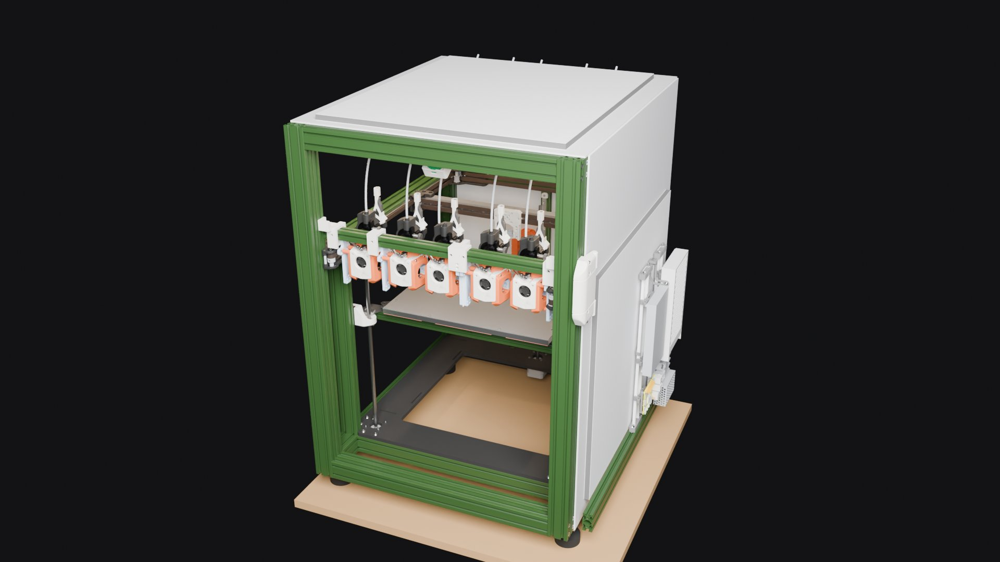

# vt350

Build repository for a [Voron Trident 350](https://vorondesign.com/voron_trident) 3D printer — CAD files, research notes, and machine configurations.

Created 2026-05-17 to centralize the build before construction begins.

## What this printer will be

The VT350 is a heavily modified Voron Trident 350 built around a [MadMax](https://github.com/zruncho3d/madmax) based **five-tool toolchanger**. Each tool is a complete toolhead with its own extruder, hotend and board, and the printer swaps between them during a print. That allows several materials or colours in one print without purging filament between them. It also has a **heated, enclosed chamber** for engineering plastics like ASA and ABS.

The model and renders always show all five tools. The first build will run **two** (T0 and T1, the outer docks). The other three are added later without changing the frame.

### At a glance

| | |
|---|---|
| **Base** | Voron Trident 350, rebuilt on a **4040** extrusion frame. 80 mm deeper at the front for the deeper toolheads, and 740 mm verticals for 100 mm more room above the gantry, for the bowden tubes and USB cables |
| **Print volume** | **342 × 340 × 335 mm** (X × Y × Z), measured from the model: every toolhead swept over the bed, keeping the area all of them can reach (`cad/data/print-area.svg`) |
| **Motion** | LDO Monolith milled gantry, 2WD, 9 mm belts, MGN9 Y rails, carbon-fibre X beam. X and Y run at 48 V on TMC5160T Plus drivers |
| **Z and bed** | Three integrated-leadscrew NEMA17s on 400 mm MGN9 rails. Kinematic bed: LDO 350 plate on tanaes's Trident mounts |
| **Toolchanger** | [MadMax](https://github.com/zruncho3d/madmax) (andrewmcgr's XOL-A4T-Cartographer mod) with **5 docks in a front row**, on a 2020 bar clamped to both faces |
| **Each toolhead** | [A4Tv2](https://github.com/DW-Tas/A4Tv2) with the aluminium Crossbow; Orbiter 2.5 extruder and Smart Filament Sensor; Orbitool O2S toolboard (one USB cable per head); Phaetus Dragon ACE Volcano hotend; two 4010 part-cooling blowers |
| **Probe** | Beacon RevH |
| **Chamber** | Fully enclosed, with an active heater. Target **60 °C sustained, 70 °C peak**. Insulated roof, filter, and a Clicky-Clack fridge-style door. The electronics sit outside the hot zone |
| **Electronics** | BTT Octopus Pro H723 and a Raspberry Pi 5 |
| **Software** | [Kalico](https://github.com/KalicoCrew/kalico) (a Klipper fork), Fluidd, and MadMax's tool-change macros on klipper-toolchanger |
| **Filament** | An [EMU](https://github.com/DW-Tas/EMU) unit behind the printer, with a bowden tube to each toolhead |

### How it is being designed

Nothing is cut or printed until the full printer model shows it fits. The design lives in one FreeCAD model, and every change is a script (a numbered `lite-N` pass) that edits the model and **refuses to save** if anything goes wrong:
- two parts overlap;
- a toolhead would hit something at any point of a tool change;
- a part lands somewhere other than where it was meant to go.

Other scripts measure what that means for the machine: reach, Z travel, print area and the extrusion cut list. Renders of each version come from the same model. The generic part of this tooling is in [`platform/`](platform/) and works for other printers too.

### Scope

- **In scope:** the complete design and its checks; every printed part, with source and licence (`parts/printed/`); the Klipper configuration; and the build itself, in nine stages ([#7](https://github.com/dvystrcil/vt350/issues/7)–[#15](https://github.com/dvystrcil/vt350/issues/15)).
- **Not in scope:**
  - **A kit or product.** Several parts are under non-commercial licences, so this repo is non-commercial.
  - **Six or more tools,** which would need a wider frame.
  - **Materials that need a chamber hotter than 70 °C,** such as some nylons. This limit is accepted.
- **Where it stands:** design. The current model is `vt350-lite-35`. Assembly hasn't started. See [`notes/status.md`](notes/status.md) for decisions and open questions.

## Layout

**Picking this back up? Start with [`notes/status.md`](notes/status.md).**

| Path | Purpose |
|---|---|
| `notes/status.md` | Where the build stands: decisions, open questions, where every file lives |
| `notes/scripts.md` | **Scripts at your command:** what to run, when, and how (refresh chain, backups, checks, renders, handoff lanes) |
| `notes/cut-list.md` | Extrusion cut list measured from the model (draft) |
| `notes/reference/` | Styled HTML reference pages (comparisons, part explainers), published at https://dvystrcil.github.io/vt350/ |
| `cad/README.md` | The FreeCAD model files (kept outside git), how each was made, and FreeCAD performance setup |
| `platform/` | The generic tools: FreeCAD clash and pass library, renders, Kalico simulation, parts and pages checks. They take a printer's data and work unchanged for another printer ([#122](https://github.com/dvystrcil/vt350/issues/122)); see [`platform/README.md`](platform/README.md) |
| `cad/passes/` | The VT350's model-writing passes (lite-N): how each working copy was made, with its checks |
| `cad/studies/` | The VT350's studies: toolhead and Z sweeps, print area, frame map, one-off investigations |
| `cad/scripts/` | The VT350's refresh chain (`refresh.py`) and STL derivation (`derive_stls.py`) |
| `cad/data/` | Script inputs/outputs: fastener records, frame map, kept fastener solids, run logs |
| `config/` | Klipper / Mainsail / Moonraker configuration (from build stage #15) |

## License

Our own work is **GPL-3.0-or-later** ([`LICENSE`](LICENSE)). That covers the code, configs, notes, CAD data and our own designs. Third-party parts keep their own licences, and so do our remixes of them; the exceptions are listed below.

Every file's licence is machine-readable: [`REUSE.toml`](REUSE.toml) labels each file, the licence texts are in [`LICENSES/`](LICENSES/), and CI runs `reuse lint` ([REUSE 3.3](https://reuse.software/spec-3.3/)), so an unlabelled file fails the build ([#122](https://github.com/dvystrcil/vt350/issues/122)).

The exception is `cad/derived/`: modified third-party parts, each under its original licence. `cad/derived/madmax-andrewmcgr-dock-arm/` and `cad/derived/madmax-andrewmcgr-carriage-beacon/` are **GPL-3.0** and `cad/derived/a4tv2-duct-4010-madmax-dock/` is **CC BY-NC-SA 4.0** (non-commercial); see the README in each folder.

`parts/printed/` is the other exception: third-party printed parts copied unchanged, each folder with its upstream `LICENSE` (GPL-3.0 or CC BY-NC-SA 4.0), plus copies of the `cad/derived/` remixes. The licence of each source is in [`parts/printed/README.md`](parts/printed/README.md).
