# CAD: model files, edit pipeline, and how to resume

The printer model is a FreeCAD document built from an imported STEP assembly.
The **model files are not in git** (140–510 MB each; GitHub refuses files over
100 MB). They live in `~/Documents/VT350/`. This folder holds everything needed
to understand them, check them, and redo any step.

## The model files

```mermaid
flowchart LR
    G["vt350-good.FCStd<br/>510 MB · 17,357 objects<br/><b>original, never saved over</b>"]
    L1["vt350-lite<br/>139 MB · 2,088 objects"]
    L2["vt350-lite-2<br/>Fasteners parts"]
    L3["vt350-lite-3<br/>+100 mm frame"]
    L4["vt350-lite-4<br/>3 door hinges"]
    L5["vt350-lite-5<br/>drilled verticals, bowden"]
    L5D["vt350-lite-5-dan<br/>user hand edit"]
    L6["vt350-lite-6<br/>+80 mm Y at the front,<br/>Monolith milled, Carbonara"]
    L7["vt350-lite-7<br/>belts on the 2WD milled path"]
    L8["vt350-lite-8<br/>Y rails 450, rear-flush"]
    L9["vt350-lite-9<br/>owned 400 steel + 74 mm<br/>front extension"]
    L10["vt350-lite-10<br/>gantry +50 mm, Z 400 rails + screws<br/>~348 mm print height"]
    L11["vt350-lite-11<br/>fixes: bowden placement,<br/>orphan screws, latch<br/><b>current</b>"]
    G -->|make_lite.py| L1
    G -.->|extract_fasteners.py<br/>read-only| J[(fasteners.json)]
    L1 -->|rebuild_fasteners.py| L2
    J --> L2
    L2 -.->|frame_map.py| M[(frame_map.json)]
    L2 -->|frame_plus100.py| L3
    M --> L3
    L3 -->|door_hinges.py| L4
    L4 -->|lite5.py| L5
    L2 -.->|drilled bars| L5
    L5 -->|FreeCAD by hand| L5D
    L5D -->|lite6.py| L6
    L6 -->|lite7_belts.py| L7
    L7 -->|lite8_rails.py| L8
    L8 -->|lite9_rails.py| L9
    L9 -->|lite10_ztravel.py| L10
    L10 -->|lite11_fixes.py| L11
```



| File | What changed | Verified by |
|---|---|---|
| `vt350-good.FCStd` | Original STEP-based model (2026-11-03). **Never saved over.** | — |
| `vt350-lite.FCStd` | 507 STEP fasteners removed; 3 PCB assemblies (Octopus Pro, 2× Nitehawk-36) → one box each; 3 leadscrews → plain rods; 90 empty containers removed | `data/logs/make_lite.log` |
| `vt350-lite-2.FCStd` | 442 parametric **Fasteners workbench** parts (`Thread = False`) put where the STEP fasteners were; 65 originals kept (T-nuts, square washers, self-tappers: no matching standard type) | `data/logs/rebuild.log`: 424/442 match the original's centre of mass; the other 18 are explained below |
| `vt350-lite-3.FCStd` | **+100 mm between the gantry and the top of the frame** (cut plane Z = 534). Verticals 640 → 740 mm, rebuilt as `Part::Extrusion` of their own end profile; back panel spliced; 71 parts above the cut moved +100 mm; leadscrew rods 8 mm | `data/logs/frame_plus100.log`: 0 problems; every untouched part unchanged within 1 µm |
| `vt350-lite-4.FCStd` | Door: **3 identical hinges** (copies of the complete bottom hinge) at −9.9…100.1, 265…375, 539.9…649.9; two loose top pins removed | `data/logs/door_hinges.log`: 0 problems |
| `vt350-lite-5.FCStd` | **6 verticals get their drilled side holes back**: lite-3's extrusions had lost them all, so the original drilled bars from lite-2 are spliced at Z = 534 (+100 mm of their own cross-section). **INDX parts removed.** **Rear 4040 corners follow the drilled holes**: each joint keeps its 2 staggered M5×50 through-bolts; 15 M5×16 BHCS + washers with no hole are removed. **Bowden tubes**: solid Ø4.12 mm (measured OD) from each Orbiter inlet to a top-rear exit (Y 460, Z 690, tilted 45° to the rear, for the EMU), 568 mm, tightest bend 119 mm at the docked pose; route parameters are stored on each tube | `data/logs/lite5.log`: 0 problems; hole faces 52/60/60/52/32/32 match lite-2; every untouched part unchanged |
| `vt350-lite-6.FCStd` | From `lite-5-dan`. **+80 mm of Y at the front** for the parked heads (#19 AC9: A4Tv2 + O2S head, deepest slice 68.6 mm with the plate → 6 + 4 + 68.6 ≈ 79). Everything in front of Y = 10 moves −80; the 4 side 4040s, 2 gantry 2040s and the cabinet 2040 are spliced (+80 of their own section). The old front 2040 verticals carry the front Z rails, so they **stay as Z posts** (Z −10…370); new front verticals and a new bottom front 2040 go 80 mm forward; the old bottom front 2040 stays for the Backbone. **Placeholder dock crossbar** (2040) between the new front verticals, 5 mm above the docked heads. **LDO Monolith milled 2WD VT 9 mm** (front 2WD_VT, rear VT **NP**, XY 2WD), aligned on the printed parts' pulley axes; **MGN9 × 470** Y rails; **Carbonara 20×20 CF X beam, 430 mm**; belts spliced with a copy of their own toothed stretch; both **Z cable anchors removed**; bowden tubes regenerated | `data/logs/lite6.log`: 0 problems; 999 original shapes unchanged or moved exactly −80; Monolith axes within 0.01 mm; collisions vs a lite-5-dan baseline: 5 new (below) |
| `vt350-lite-7.FCStd` | From lite-6. **Both XY belts re-drawn** on the Monolith 2WD path through the milled parts' pulleys and idlers: straight tangents plus wraps on the GT2 pitch line (pulley OD + 0.254 mm on the tooth side, 695 OD + 1.126 mm where the belt's back rides). Each end stops at its carriage belt clip's outer edge. **Printed Y endstop removed** with its hardware (8 solids): it sat in the lower belt's rear run and shared a slot with the milled rear mount | `data/logs/lite7_belts.log`: 0 problems. Belts are valid single solids touching nothing except their clips; every other part unchanged. **Belt length 1941.7 mm each** (pitch, clip edge to clip edge) + tuck-in |
| `vt350-lite-8.FCStd` | From lite-7. **Y rails 470 → 450**, the longest MGN9 West3D sells (Berserker). Placed **rear-flush** because the reach table (below) shows that keeps the same print reach as 470 | `data/logs/lite8_rails.log`: 0 problems; reach table for 470 and 450 front / centre / rear |
| `vt350-lite-9.FCStd` | From lite-8. **Y rails = the owned 2 × Berserker MGN9H 400 steel rails, rear-flush (Y 40.0…440.0), plus a 73.9 mm front extension** per side (Y −34.0…40.0, orange) that the Y blocks only ride while docking. Whether the extension is printed or cut from a shorter steel rail is still open | `data/logs/lite9_rails.log`: 0 problems. With the nozzle at the plate's front edge, the block front is at Y 40.24: **+0.28 mm on steel**, so all printing stays on steel |
| `vt350-lite-10.FCStd` | From lite-9. **Taller Z inside the same 740 mm frame.** lite-9's bed could rise only 14.8 mm, because its Z blocks hit the ends of the 300 mm rails, so the plate stayed 45 mm under the nozzle. **The gantry and everything on it move up 50 mm**: gantry bars and their joint bolts, the Monolith stations, beam, Y rails, X rail and carriage, MadMax carriage, belts, docks, docked heads and dock crossbar. **Z posts and the rear 2020 vertical are extended to Z 420.** **Z rails are MGN9 400; lead screws are 400** (the uncut 400 integrated-leadscrew motors). The rail stops now sit on the new rail tops; the right one had been floating 40 mm above its rail. **The printed X endstop is removed**: once raised, it swept into the left Z rail, its stop and the Z post. **Bowden tubes are regenerated** with handles chosen for the largest bend radius | `data/logs/lite10_ztravel.log`: 0 problems. **Max print height 347.8 mm.** The bed reaches the nozzle with 5 mm to spare before the rail stops, with no interference at either end of travel. The gantry clears the lead screws by 21.3 mm. **Bowden R 105.1 mm** (lite-9: 105.2), 646 mm, touching nothing |
| `vt350-lite-11.FCStd` | From lite-10, fixing three problems the user spotted. **Bowden tubes:** lite-10 placed the tube solids in the wrong group's coordinate frame, so they floated 35.5 mm above the couplers; they're rebuilt from their stored route and now start at the coupler tops. **4 orphan M3×8 screws deleted:** they held the printed front motorless mounts, which lite-6 replaced, but they were filed under the Door group and had floated since. **Clicky-Clack latch:** Hinge_Bottom sat 10.2 mm below the handle (already so in lite-5-dan) and is moved up flush, so its magnet pair has the same 0.4 mm gap as the top pair | `data/logs/lite11_fixes.log`: 0 problems. Tubes R 105.1, touching nothing but their couplers; Hinge_Bottom overlaps nothing; every other part unchanged |

Git only has the recipe, not the models. The models are backed up to the home
NAS with restic: run **`cad/backup-models.sh --verify`** after any model
change (back up, then restore the newest `.FCStd` and compare checksums).
Where it backs up to is local config (`~/.config/vt350/backup.env`), kept out
of this public repo. Without the restic password the backup cannot be opened,
so keep it in the password manager as well.

After each successful backup the script prunes old snapshots: it keeps the
last 10 runs, one per day for 30 days, and one per month for 12 months
(override with `VT350_KEEP` in the local config). On this laptop the alias
`vt350-backup` runs `cad/backup-models.sh --verify` from any directory.

## Why the original was unusable, and what fixed it

Measured from the original file's internal data (2026-11-04):

| Contents | Size | Shapes |
|---|---|---|
| Fasteners (vendor STEP with full detail; one M5×50 = ~20 MB) | 892 MB | 526 |
| PCB components (every resistor and capacitor a solid) | 400 MB | 1,845 |
| Extrusions | 301 MB | 235 |
| **Printed parts, rails, motors: the actual design** | **26 MB** | 279 |
| Empty origin scaffolding (8 per `App::Part`) | — | 12,864 |

FreeCAD held **9.8 GB of RAM** with it open. On top of that:

| Problem | Fix (applied 2026-11-04) |
|---|---|
| Rendered on the **Intel UHD iGPU**, not the RTX 2070 | `~/Desktop/freecad-26.3rc2.desktop`: `Exec=env __NV_PRIME_RENDER_OFFLOAD=1 __GLX_VENDOR_LIBRARY_NAME=nvidia /home/dan/FreeCAD/FreeCAD_26.3rc2-Linux-x86_64.AppImage`. Check with `glxinfo -B` under the same env |
| Autosave every 15 min wrote a full recovery copy (1.3 GB in `~/.cache/FreeCAD`) | Preferences → General → Document: autosave **30 min** |
| Save compression level 7 | Compression **3** |

Longer-term option (not done): split the model into per-assembly `.FCStd`
files brought together with `App::Link`, so you only open what you edit.

## Running the scripts

Data in / logs out go to `VT350_WORK` (default: `~/Code/vt350/cad/data`).
Input and output model paths are constants at the top of each script.

```bash
APP=/home/dan/FreeCAD/FreeCAD_26.3rc2-Linux-x86_64.AppImage
NV="env __NV_PRIME_RENDER_OFFLOAD=1 __GLX_VENDOR_LIBRARY_NAME=nvidia"

# Headless (read-only passes: no colours needed)
$APP freecadcmd $PWD/cad/scripts/extract_fasteners.py   # ~8 min (loads the 510 MB original)
$APP freecadcmd $PWD/cad/scripts/frame_map.py

# GUI mode (passes that SAVE a model: keeps colours/visibility)
$NV $APP $PWD/cad/scripts/make_lite.py
```

- **Pass absolute script paths.** In testing, a relative path produced no
  output and no error, while the same script by absolute path ran.
- **Model-writing passes must run in GUI mode.** A headless save drops
  `GuiDocument.xml`, so every part opens grey.
- During a GUI-mode run, GNOME shows **"FreeCAD is not responding"** (from
  about 84% of the load bar onward): the script holds the main thread.
  **Click Wait**; Force Quit kills the run before it saves.
- Every model-writing pass writes a **new** file, checks the result, and
  **refuses to save** if any check fails.

| Script | Kind | Purpose |
|---|---|---|
| `make_lite.py` | GUI, writes | original → lite |
| `extract_fasteners.py` | headless, read-only | records every STEP fastener: type, size, axis, tip, centre of mass, parent → `data/fasteners/` |
| `rebuild_fasteners.py` | GUI, writes | lite → lite-2 |
| `frame_map.py` | headless, read-only | Z extents of every shape → `data/frame_map/frame_map.json` |
| `frame_plus100.py` | GUI, writes | lite-2 → lite-3; also prints the cut list |
| `door_hinges.py` | GUI, writes | lite-3 → lite-4 |
| `lite5.py` | GUI writes; headless = dry run, never saves | lite-4 (+ drilled bars from lite-2) → lite-5 |
| `lite6.py` | GUI writes; headless = dry run, never saves | lite-5-dan → lite-6. Needs the Monolith/Carbonara STEPs (below) under `VT350_DL` |
| `lite7_belts.py` | GUI writes; headless = dry run, never saves | lite-6 → lite-7: belt path, belt length |
| `lite8_rails.py` | GUI writes; headless = dry run, never saves | lite-7 → lite-8: 450 Y rails (`RAIL_PLACE` front/centre/rear) + Y reach table |
| `lite9_rails.py` | GUI writes; headless = dry run, never saves | lite-8 → lite-9: owned 400 steel + front extension; checks that printing never needs the extension |
| `lite10_ztravel.py` | GUI writes; headless = dry run, never saves | lite-9 → lite-10: gantry +50, Z rails and screws 400; reports Z travel, print height, gantry-over-screw clearance, bowden bend |
| `lite11_fixes.py` | GUI writes; headless = dry run, never saves | lite-10 → lite-11: bowden placement, orphan screws, Clicky-Clack Hinge_Bottom |
| `ac9_head_envelope.py` | headless, read-only | #19 AC9: A4Tv2 + Orbiter/OSS/O2S head, width and exact depth at each height |
| `bowden_study.py` | headless (FreeCAD's Python for numpy) | bend radius vs exit position and tube length; results on #3 |
| `fs_probe.py` | headless | probes the Fasteners workbench API and screw orientation |
| `analyze.py`, `cats.py`, `tree.py`, `fastener_review.py` | plain Python | read an `.FCStd`'s `Document.xml` (unzip it first): sizes, categories, assembly tree, fastener classification |

## Gotchas hit while doing this (so they aren't hit twice)

- **Bounding boxes lie on B-spline parts.** `Shape.BoundBox` uses the spline
  control points: the leadscrew read 10.27 mm wide but is 8.00 mm (thread
  crest, from its cylinder faces). Use `shape.optimalBoundingBox()`.
- **The Fasteners workbench silently substitutes a stocked length** (M3×6
  FHCS came out 8 mm). Read `Length` back after setting it; use
  `Length = 'Custom'` + `LengthCustom`.
- Fasteners geometry: screws have their origin at the **underside of the
  head**, head toward +Z; countersunk screws at the **head top**;
  washers/nuts sit on z = 0 going +Z; inserts and set screws top at z = 0
  going −Z.
- Measuring a screw's diameter from its smallest coaxial cylinder reads the
  **hex socket**, not the shank. The label sizes were right.
- Checking placement against a point on the axis fails on anything with a
  hole or socket there. Compare **centres of mass** instead.
- 18 of the 36 McMaster `91290A198` (M5×50 SHCS) originals have their centre of
  mass 0.6 mm off their own shank axis (something extra on one side of those
  solids); the other 18 are within 0.001 mm. The new bolts sit on the shank
  axis.
- Removing an `App::Part` already removes its Origin; touching the Origin
  afterwards raises `ReferenceError`.
- `Base.Rotation` has `inverted()`; `Placement` has `inverse()`.

## lite-6: inputs, choices and what is left open

**Downloaded inputs** (not in git; `lite6.py` reads them from `$VT350_DL`):
- [LDO_Monolith_Gantry_Kits](https://github.com/Monolith3D/LDO_Monolith_Gantry_Kits) `CAD/`: `Front_{left,right}/LDO_2WD_VT_9mm.step`, `Rear_{left,right}/LDO_VT_9mm_0_NP.step`, `XY_{left,right}/LDO_2WD_9mm.step`. Their checksums don't match `CAD/manifest.json`, and neither do the byte sizes, so the manifest looks out of date.
- [Monolith3D/MISC](https://github.com/Monolith3D/MISC/tree/main/CF_tube_mounting) `CF_tube_mounting v6.step`: the 20×20×17 CF tube section, extruded to the Carbonara 350's 430 mm.

**How the kit was placed.** The kit's STEPs share one printer-centred frame, but this 4040 frame is ~100 mm wider and longer than the kit's reference printer. Each station is translated on its own, with no rotation:

| Station | Matched axis | Offset (X, Y, Z) | Residual |
|---|---|---|---|
| Front R / L | idler pulley pin | (−195 / −295, +115, +380): +195 minus the 80 mm move | 0.01 mm |
| Rear R / L | stepper shaft (NP) | (−195 / −295, +295, +380) | 0.00 mm |
| XY R / L | live-shaft pulley | (−195 / −295, +260, +380): the gantry stays at the printed pose | 2.8 / 2.2 mm from the printed **AWD** joints, as expected for 2WD |

**Choices made in the script (review these):**
- **Rear mounts NP, not FT.** FT sits 4 mm further back and puts the VC9-RTA tensioners 4 mm into this frame's rear gantry 2020 (911 mm³). NP is what the printed mounts were.
- **Z posts.** The front Z rails bolt to the old front verticals' rear face, so those verticals stay as posts between the bottom side bar and the gantry side bar. They need new joints (corner brackets or blind joints into the side bars mid-length); none are modelled yet.
- **Dock crossbar** is a placeholder 2040 above the parked heads (Z 467…507). Its real height and position come from the dock design.
- **Y rails** are 470 mm, the longest 10 mm step that fits the 474 mm between the front and rear mounts.
- The XY joints' slot T-nuts and M5×10 into the beam are dropped. A CF tube is through-bolted with printed inserts (M5 BHCS + nuts, per the Monolith README); that hardware isn't modelled.

**New collisions in lite-6** (vs the same check on lite-5-dan, where 131 overlaps already existed):

| Parts | mm³ | Why / action |
|---|---|---|
| Belts × XY joint idlers (both sides) | 37.6 | The belts were drawn for the printed AWD joints, which are 2.2–2.8 mm off. **Fixed in lite-7** (belts re-drawn) |
| Belts × rear mount M5×13 spacers | 8.9 | Same cause. **Fixed in lite-7** |
| Rear-right mount T-nut × Y-endstop T-nut | 17.8 | Both want the same spot in the slot. **lite-7 removes the printed Y endstop** (it was also in the belt path); a Y endstop that fits the milled rear mount still has to be chosen |

**Belt path (lite-7):** each belt runs clip → XY-joint idler → front pulley (223° wrap) → front idler → rear motor (180°) → rear idler → far toothed rear idler → far XY pulley → clip. That order is this script's reading of the Monolith 2WD path; no LDO belt drawing for this frame was available to compare it against. The collision check proves it's clear of every part, but not that it's LDO's routing, so look at the corners in lite-7. The carriage's clips are labelled "4mm Gap 6mm Belt", while these belts are 9 mm: check the clips before building.

## Y reach (lite-8 / lite-9)

**Travel is limited by the XY joints hitting the milled mounts, not by the rails.** At the front, an XY joint touches the front mount when its Y block's front end is at Y −30.0. At the rear, a joint touches the rear mount when its block's rear end is at Y 433.3. The gap between the mounts is 473.9 mm, so a 500 rail won't fit, and anything longer than 470 gains nothing. Measured by `lite8_rails.py` / `lite9_rails.py` from the model's own block, joint and mount geometry. "Carriage" means the toolhead carriage's front (mating) face; the nozzle is the stand-in E3D v6's, 21.1 mm in front of the head's mating face.

| Y rails | Pickup margin (carriage vs docked heads) | Nozzle vs plate rear edge | Printing on steel |
|---|---|---|---|
| 470 (lite-6/7) | −6.8 | −8.2 | yes |
| 450 front-flush | −6.8 | −25.4 | yes |
| 450 centred | −14.8 | −13.4 | yes |
| 450 rear-flush (lite-8) | −26.8 | −8.2 | yes |
| **400 rear-flush + 73.9 extension (lite-9)** | **−6.8** | **−8.2** | **yes, +0.28 mm** |

What this leaves open:
- **Docks 6.8 mm too far forward,** even with the longest rail: the carriage can't reach the docked heads. The dock position came from lite-5-dan moved −80, and was never checked against the carriage. Move the docks back ≥ 6.8 mm in the dock design.
- **Nozzle 8.2 mm short of the plate's rear edge** with every rail option, because of the joint/mount limit. Check this against the plate's actual printable area (its bounding box is 360.5 mm in Y), or move the bed forward.
- **lite-9's +0.28 mm on-steel margin is tight** and depends on the nozzle position. Re-check it once the Dragon Ace Volcano replaces the E3D v6 stand-in.
- **The extension, printed or steel:** the MGN9 raceway's accuracy, ball retention as the block crosses the joint, wear, and aligning it to the 400 steel rail.

## Z travel (lite-10)

| | lite-9 | lite-10 |
|---|---|---|
| Gantry bars | Z 370–390 | Z 420–440 |
| Nozzle tip (E3D v6 stand-in) | Z 330.8 | Z 380.8 |
| Z rails / lead screws | 300 / 300 | **400 / 400** |
| Bed's highest position | **45 mm under the nozzle** (Z blocks reach the rail ends) | reaches the nozzle; 5 mm left before the rail stops |
| Bed's lowest position | — | plate top Z 33.0, where the rear Z carriage's lock nuts reach the Backbone (bounding-box estimate; a boolean check at that pose finds no interference) |
| **Max print height** | — | **347.8 mm** (≈ 344.8 once the A4Tv2's 3 mm hotend spacer is in: the nozzle sits 3 mm lower) |
| Gantry over the lead screws | — | 21.3 mm clear (left and right); the rear screw is never under the gantry |
| Bowden, tightest bend | R 105.2 | R 105.1, using the best handles (290, 175); lite-5's handles would give R 95.9 |

300 mm lead screws with the gantry raised would leave the bed 74.8 mm under the nozzle. The other layout considered was keeping the gantry at Z 370 with 350 rails and screws, for about 300 mm of print height. Machining that lite-10 adds (#7): **re-drill the 4 gantry-joint holes in the verticals 50 mm higher**, since the M5×50 joint bolts now land 50 mm above their old holes; **Z posts and the rear 2020 vertical become 430 mm**.

## Model notes that affect the build

- **Drive layout is inconsistent:** `_11_9mm_2WD_belts` and
  `front_motorless_mounts` are 2WD parts, but the X axis is
  `_4_Printed_9mm_AWD_X_axis`. Resolve before ordering motors and belts
  (stage issue #11).
- The two **Nitehawk-36 boxes are placeholders**: the build uses the Orbitool
  O2S instead (#6), and they come out when the O2S CAD goes in.
- Door handle (latch side) is unchanged at ~435–495 mm, pending the
  side-pack/top-pack decision (#5).
