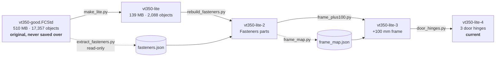

# CAD: model files, edit pipeline, and how to resume

The printer model is a FreeCAD document built from an imported STEP assembly.
The **model files are not in git** (140–510 MB each; GitHub refuses files over
100 MB). They live in `~/Documents/VT350/`. This folder holds everything needed
to understand them, check them, and redo any step.

## The model files



| File | What changed | Verified by |
|---|---|---|
| `vt350-good.FCStd` | Original STEP-based model (2026-11-03). **Never saved over.** | — |
| `vt350-lite.FCStd` | 507 STEP fasteners removed; 3 PCB assemblies (Octopus Pro, 2× Nitehawk-36) → one box each; 3 leadscrews → plain rods; 90 empty containers removed | `data/logs/make_lite.log` |
| `vt350-lite-2.FCStd` | 442 parametric **Fasteners workbench** parts (`Thread = False`) put where the STEP fasteners were; 65 originals kept (T-nuts, square washers, self-tappers: no matching standard type) | `data/logs/rebuild.log`: 424/442 match the original's centre of mass; the other 18 are explained below |
| `vt350-lite-3.FCStd` | **+100 mm between the gantry and the top of the frame** (cut plane Z = 534). Verticals 640 → 740 mm, rebuilt as `Part::Extrusion` of their own end profile; back panel spliced; 71 parts above the cut moved +100 mm; leadscrew rods 8 mm | `data/logs/frame_plus100.log`: 0 problems; every untouched part unchanged within 1 µm |
| `vt350-lite-4.FCStd` | Door: **3 identical hinges** (copies of the complete bottom hinge) at −9.9…100.1, 265…375, 539.9…649.9; two loose top pins removed | `data/logs/door_hinges.log`: 0 problems |

Git only has the recipe, not the models. The models are backed up to the home
NAS with restic: run **`cad/backup-models.sh --verify`** after any model
change (back up, then restore the newest `.FCStd` and compare checksums).
Where it backs up to is local config (`~/.config/vt350/backup.env`), kept out
of this public repo. Without the restic password the backup cannot be opened,
so keep it in the password manager as well.

## Why the original was unusable, and what fixed it

Measured from the original file's internal data (2026-11-04):

| Contents | Size | Shapes |
|---|---|---|
| Fasteners (vendor STEP with full detail; one M5×50 = ~20 MB) | 892 MB | 526 |
| PCB components (every resistor and capacitor a solid) | 400 MB | 1,845 |
| Extrusions | 301 MB | 235 |
| **Printed parts, rails, motors: the actual design** | **26 MB** | 279 |
| Empty origin scaffolding (8 per `App::Part`) | — | 12,864 |

FreeCAD held **9.8 GB of RAM** with it open. On top of that:

| Problem | Fix (applied 2026-11-04) |
|---|---|
| Rendered on the **Intel UHD iGPU**, not the RTX 2070 | `~/Desktop/freecad-26.3rc2.desktop`: `Exec=env __NV_PRIME_RENDER_OFFLOAD=1 __GLX_VENDOR_LIBRARY_NAME=nvidia /home/dan/FreeCAD/FreeCAD_26.3rc2-Linux-x86_64.AppImage`. Check with `glxinfo -B` under the same env |
| Autosave every 15 min wrote a full recovery copy (1.3 GB in `~/.cache/FreeCAD`) | Preferences → General → Document: autosave **30 min** |
| Save compression level 7 | Compression **3** |

Longer-term option (not done): split the model into per-assembly `.FCStd`
files brought together with `App::Link`, so you only open what you edit.

## Running the scripts

Data in / logs out go to `VT350_WORK` (default: `~/Code/vt350/cad/data`).
Input and output model paths are constants at the top of each script.

```bash
APP=/home/dan/FreeCAD/FreeCAD_26.3rc2-Linux-x86_64.AppImage
NV="env __NV_PRIME_RENDER_OFFLOAD=1 __GLX_VENDOR_LIBRARY_NAME=nvidia"

# Headless (read-only passes: no colours needed)
$APP freecadcmd $PWD/cad/scripts/extract_fasteners.py   # ~8 min (loads the 510 MB original)
$APP freecadcmd $PWD/cad/scripts/frame_map.py

# GUI mode (passes that SAVE a model: keeps colours/visibility)
$NV $APP $PWD/cad/scripts/make_lite.py
```

- **Pass absolute script paths.** In testing, a relative path produced no
  output and no error, while the same script by absolute path ran.
- **Model-writing passes must run in GUI mode.** A headless save drops
  `GuiDocument.xml`, so every part opens grey.
- During a GUI-mode run, GNOME shows **"FreeCAD is not responding"** (from
  about 84% of the load bar onward): the script holds the main thread.
  **Click Wait**; Force Quit kills the run before it saves.
- Every model-writing pass writes a **new** file, checks the result, and
  **refuses to save** if any check fails.

| Script | Kind | Purpose |
|---|---|---|
| `make_lite.py` | GUI, writes | original → lite |
| `extract_fasteners.py` | headless, read-only | records every STEP fastener: type, size, axis, tip, centre of mass, parent → `data/fasteners/` |
| `rebuild_fasteners.py` | GUI, writes | lite → lite-2 |
| `frame_map.py` | headless, read-only | Z extents of every shape → `data/frame_map/frame_map.json` |
| `frame_plus100.py` | GUI, writes | lite-2 → lite-3; also prints the cut list |
| `door_hinges.py` | GUI, writes | lite-3 → lite-4 |
| `fs_probe.py` | headless | probes the Fasteners workbench API and screw orientation |
| `analyze.py`, `cats.py`, `tree.py`, `fastener_review.py` | plain Python | read an `.FCStd`'s `Document.xml` (unzip it first): sizes, categories, assembly tree, fastener classification |

## Gotchas hit while doing this (so they aren't hit twice)

- **Bounding boxes lie on B-spline parts.** `Shape.BoundBox` uses the spline
  control points: the leadscrew read 10.27 mm wide but is 8.00 mm (thread
  crest, from its cylinder faces). Use `shape.optimalBoundingBox()`.
- **The Fasteners workbench silently substitutes a stocked length** (M3×6
  FHCS came out 8 mm). Read `Length` back after setting it; use
  `Length = 'Custom'` + `LengthCustom`.
- Fasteners geometry: screws have their origin at the **underside of the
  head**, head toward +Z; countersunk screws at the **head top**;
  washers/nuts sit on z = 0 going +Z; inserts and set screws top at z = 0
  going −Z.
- Measuring a screw's diameter from its smallest coaxial cylinder reads the
  **hex socket**, not the shank. The label sizes were right.
- Checking placement against a point on the axis fails on anything with a
  hole or socket there. Compare **centres of mass** instead.
- 18 of the 36 McMaster `91290A198` (M5×50 SHCS) originals have their centre of
  mass 0.6 mm off their own shank axis (something extra on one side of those
  solids); the other 18 are within 0.001 mm. The new bolts sit on the shank
  axis.
- Removing an `App::Part` already removes its Origin; touching the Origin
  afterwards raises `ReferenceError`.
- `Base.Rotation` has `inverted()`; `Placement` has `inverse()`.

## Model notes that affect the build

- **Drive layout is inconsistent:** `_11_9mm_2WD_belts` and
  `front_motorless_mounts` are 2WD parts, but the X axis is
  `_4_Printed_9mm_AWD_X_axis`. Resolve before ordering motors and belts
  (stage issue #11).
- The two **Nitehawk-36 boxes are placeholders**: the build uses the Orbitool
  O2S instead (#6), and they come out when the O2S CAD goes in.
- Door handle (latch side) is unchanged at ~435–495 mm, pending the
  side-pack/top-pack decision (#5).
