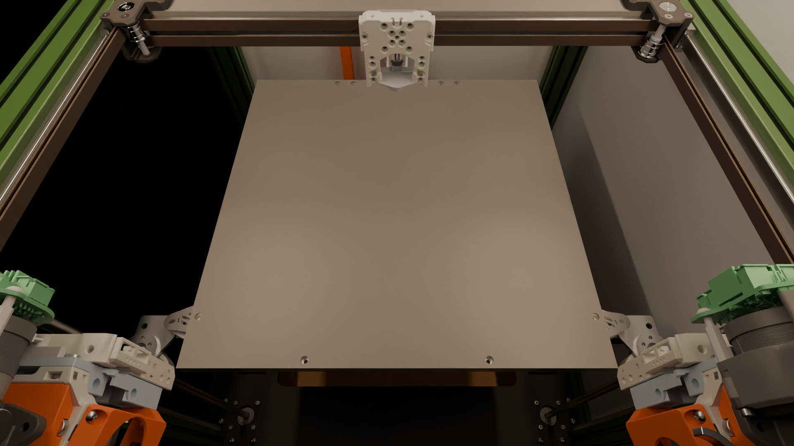
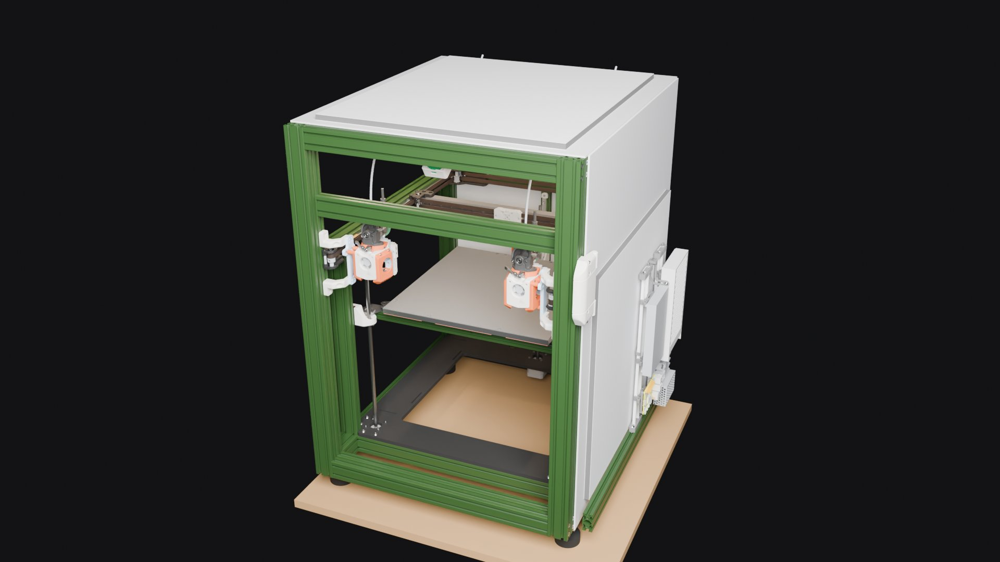

# CAD: model files, edit pipeline, and how to resume

The printer model is a FreeCAD document built from an imported STEP assembly.
The **model files are not in git** (140–510 MB each; GitHub refuses files over
100 MB). They live in `~/Documents/VT350/`. This folder holds everything needed
to understand them, check them, and redo any step.

## The model files

```mermaid
flowchart LR
    G["vt350-good.FCStd<br/>510 MB · 17,357 objects<br/><b>original, never saved over</b>"]
    L1["vt350-lite<br/>139 MB · 2,088 objects"]
    L2["vt350-lite-2<br/>Fasteners parts"]
    L3["vt350-lite-3<br/>+100 mm frame"]
    L4["vt350-lite-4<br/>3 door hinges"]
    L5["vt350-lite-5<br/>drilled verticals, bowden"]
    L5D["vt350-lite-5-dan<br/>user hand edit"]
    L6["vt350-lite-6<br/>+80 mm Y at the front,<br/>Monolith milled, Carbonara"]
    L7["vt350-lite-7<br/>belts on the 2WD milled path"]
    L8["vt350-lite-8<br/>Y rails 450, rear-flush"]
    L9["vt350-lite-9<br/>owned 400 steel + 74 mm<br/>front extension"]
    L10["vt350-lite-10<br/>gantry +50 mm, Z 400 rails + screws<br/>~348 mm print height"]
    L11["vt350-lite-11<br/>fixes: bowden placement,<br/>orphan screws, latch"]
    L12["vt350-lite-12<br/>materials (ShapeMaterial)"]
    L13["vt350-lite-13<br/>materials: backbone steel,<br/>kinematic supports Al"]
    L14["vt350-lite-14<br/>docks 5 mm back,<br/>arms lengthened"]
    L15["vt350-lite-15<br/>A4Tv2 + CNC Crossbow"]
    L16["vt350-lite-16<br/>insulation, camera,<br/>LED strips"]
    L17["vt350-lite-17<br/>tanaes Trident kinematic,<br/>10 mm plate<br/><b>current</b>"]
    G -->|make_lite.py| L1
    G -.->|extract_fasteners.py<br/>read-only| J[(fasteners.json)]
    L1 -->|rebuild_fasteners.py| L2
    J --> L2
    L2 -.->|frame_map.py| M[(frame_map.json)]
    L2 -->|frame_plus100.py| L3
    M --> L3
    L3 -->|door_hinges.py| L4
    L4 -->|lite5.py| L5
    L2 -.->|drilled bars| L5
    L5 -->|FreeCAD by hand| L5D
    L5D -->|lite6.py| L6
    L6 -->|lite7_belts.py| L7
    L7 -->|lite8_rails.py| L8
    L8 -->|lite9_rails.py| L9
    L9 -->|lite10_ztravel.py| L10
    L10 -->|lite11_fixes.py| L11
    L11 -->|lite12_materials.py| L12
    L12 -->|lite13_materials.py| L13
    L13 -->|lite14_docks.py| L14
    L14 -->|lite15_a4tv2.py| L15
    L15 -->|lite16_enclosure.py| L16
    L16 -->|lite17_kinematic.py| L17
```



| File | What changed | Verified by |
|---|---|---|
| `vt350-good.FCStd` | Original STEP-based model (2026-11-03). **Never saved over.** | — |
| `vt350-lite.FCStd` | 507 STEP fasteners removed; 3 PCB assemblies (Octopus Pro, 2× Nitehawk-36) → one box each; 3 leadscrews → plain rods; 90 empty containers removed | `data/logs/make_lite.log` |
| `vt350-lite-2.FCStd` | 442 parametric **Fasteners workbench** parts (`Thread = False`) put where the STEP fasteners were; 65 originals kept (T-nuts, square washers, self-tappers: no matching standard type) | `data/logs/rebuild.log`: 424/442 match the original's centre of mass; the other 18 are explained below |
| `vt350-lite-3.FCStd` | **+100 mm between the gantry and the top of the frame** (cut plane Z = 534). Verticals 640 → 740 mm, rebuilt as `Part::Extrusion` of their own end profile; back panel spliced; 71 parts above the cut moved +100 mm; leadscrew rods 8 mm | `data/logs/frame_plus100.log`: 0 problems; every untouched part unchanged within 1 µm |
| `vt350-lite-4.FCStd` | Door: **3 identical hinges** (copies of the complete bottom hinge) at −9.9…100.1, 265…375, 539.9…649.9; two loose top pins removed | `data/logs/door_hinges.log`: 0 problems |
| `vt350-lite-5.FCStd` | **6 verticals get their drilled side holes back**: lite-3's extrusions had lost them all, so the original drilled bars from lite-2 are spliced at Z = 534 (+100 mm of their own cross-section). **INDX parts removed.** **Rear 4040 corners follow the drilled holes**: each joint keeps its 2 staggered M5×50 through-bolts; 15 M5×16 BHCS + washers with no hole are removed. **Bowden tubes**: solid Ø4.12 mm (measured OD) from each Orbiter inlet to a top-rear exit (Y 460, Z 690, tilted 45° to the rear, for the EMU), 568 mm, tightest bend 119 mm at the docked pose; route parameters are stored on each tube | `data/logs/lite5.log`: 0 problems; hole faces 52/60/60/52/32/32 match lite-2; every untouched part unchanged |
| `vt350-lite-6.FCStd` | From `lite-5-dan`. **+80 mm of Y at the front** for the parked heads (#19 AC9: A4Tv2 + O2S head, deepest slice 68.6 mm with the plate → 6 + 4 + 68.6 ≈ 79). Everything in front of Y = 10 moves −80; the 4 side 4040s, 2 gantry 2040s and the cabinet 2040 are spliced (+80 of their own section). The old front 2040 verticals carry the front Z rails, so they **stay as Z posts** (Z −10…370); new front verticals and a new bottom front 2040 go 80 mm forward; the old bottom front 2040 stays for the Backbone. **Placeholder dock crossbar** (2040) between the new front verticals, 5 mm above the docked heads. **LDO Monolith milled 2WD VT 9 mm** (front 2WD_VT, rear VT **NP**, XY 2WD), aligned on the printed parts' pulley axes; **MGN9 × 470** Y rails; **Carbonara 20×20 CF X beam, 430 mm**; belts spliced with a copy of their own toothed stretch; both **Z cable anchors removed**; bowden tubes regenerated | `data/logs/lite6.log`: 0 problems; 999 original shapes unchanged or moved exactly −80; Monolith axes within 0.01 mm; collisions vs a lite-5-dan baseline: 5 new (below) |
| `vt350-lite-7.FCStd` | From lite-6. **Both XY belts re-drawn** on the Monolith 2WD path through the milled parts' pulleys and idlers: straight tangents plus wraps on the GT2 pitch line (pulley OD + 0.254 mm on the tooth side, 695 OD + 1.126 mm where the belt's back rides). Each end stops at its carriage belt clip's outer edge. **Printed Y endstop removed** with its hardware (8 solids): it sat in the lower belt's rear run and shared a slot with the milled rear mount | `data/logs/lite7_belts.log`: 0 problems. Belts are valid single solids touching nothing except their clips; every other part unchanged. **Belt length 1941.7 mm each** (pitch, clip edge to clip edge) + tuck-in |
| `vt350-lite-8.FCStd` | From lite-7. **Y rails 470 → 450**, the longest MGN9 West3D sells (Berserker). Placed **rear-flush** because the reach table (below) shows that keeps the same print reach as 470 | `data/logs/lite8_rails.log`: 0 problems; reach table for 470 and 450 front / centre / rear |
| `vt350-lite-9.FCStd` | From lite-8. **Y rails = the owned 2 × Berserker MGN9H 400 steel rails, rear-flush (Y 40.0…440.0), plus a 73.9 mm front extension** per side (Y −34.0…40.0, orange) that the Y blocks only ride while docking. Whether the extension is printed or cut from a shorter steel rail is still open | `data/logs/lite9_rails.log`: 0 problems. With the nozzle at the plate's front edge, the block front is at Y 40.24: **+0.28 mm on steel**, so all printing stays on steel |
| `vt350-lite-10.FCStd` | From lite-9. **Taller Z inside the same 740 mm frame.** lite-9's bed could rise only 14.8 mm, because its Z blocks hit the ends of the 300 mm rails, so the plate stayed 45 mm under the nozzle. **The gantry and everything on it move up 50 mm**: gantry bars and their joint bolts, the Monolith stations, beam, Y rails, X rail and carriage, MadMax carriage, belts, docks, docked heads and dock crossbar. **Z posts and the rear 2020 vertical are extended to Z 420.** **Z rails are MGN9 400; lead screws are 400** (the uncut 400 integrated-leadscrew motors). The rail stops now sit on the new rail tops; the right one had been floating 40 mm above its rail. **The printed X endstop is removed**: once raised, it swept into the left Z rail, its stop and the Z post. **Bowden tubes are regenerated** with handles chosen for the largest bend radius | `data/logs/lite10_ztravel.log`: 0 problems. **Max print height 347.8 mm.** The bed reaches the nozzle with 5 mm to spare before the rail stops, with no interference at either end of travel. The gantry clears the lead screws by 21.3 mm. **Bowden R 105.1 mm** (lite-9: 105.2), 646 mm, touching nothing |
| `vt350-lite-11.FCStd` | From lite-10, fixing three problems the user spotted. **Bowden tubes:** lite-10 placed the tube solids in the wrong group's coordinate frame, so they floated 35.5 mm above the couplers; they're rebuilt from their stored route and now start at the coupler tops. **4 orphan M3×8 screws deleted:** they held the printed front motorless mounts, which lite-6 replaced, but they were filed under the Door group and had floated since. **Clicky-Clack latch:** Hinge_Bottom sat 10.2 mm below the handle (already so in lite-5-dan) and is moved up flush, so its magnet pair has the same 0.4 mm gap as the top pair | `data/logs/lite11_fixes.log`: 0 problems. Tubes R 105.1, touching nothing but their couplers; Hinge_Bottom overlaps nothing; every other part unchanged |
| `vt350-lite-12.FCStd` | From lite-11; geometry and colours unchanged. Sets each solid's **ShapeMaterial** by rule: frame, Monolith and dock crossbar Aluminum-6061-T6; build plate Aluminum-Generic; fasteners, rails, carriages, bearings, pins and springs Steel-Generic; bowden PTFE-Generic; printed parts ABS-Generic (an explicit list of printed groups). FreeCAD has no ASA card. Anything whose material isn't known stays on **Default** and is listed in `data/materials-lite12.tsv` | `data/logs/lite12_materials.log`: 0 problems. 494 objects whose colour the material card changed were restored. Model mass of the assigned parts is 20.1 kg; it's not a real weight, because extrusions and electronics are simplified solids |
| `vt350-lite-13.FCStd` | From lite-12, with materials the user confirmed: the **backbone is steel** and the **kinematic bed-mount supports are aluminium**. The alloy wasn't given, so they use Aluminum-Generic. Also sets the back kinematic ball to steel, which lite-12's rule missed. `data/materials.tsv` lists the current material of every solid | `data/logs/lite13_materials.log`: 0 problems, 9 materials set, geometry and colours unchanged. 272 of 934 solids are still on Default |
| `vt350-lite-14.FCStd` | From lite-13. **Docks and docked heads 5 mm back (+Y)** so the carriage can reach them. The MadMax dock assembly includes a copy of the carriage at its pickup pose, with its front face at Y −24.00, but the gantry carriage can only reach Y −21.19. Pickup is now at −19.00, which leaves 2.19 mm before the XY-joint/mount hard stop. The printed **dock arms are 5 mm longer** through their straight section (193.2 mm², Y −57.6…−49.6), so their mounts on the front verticals don't move. Bowden tubes rebuilt from the moved couplers | `data/logs/lite14_docks.log`: 0 problems; arm volumes +966.2 mm³ exactly; no new collisions; tubes R 104.5 and touch nothing; everything else unchanged |
| `vt350-lite-15.FCStd` | From lite-14. **A4Tv2 replaces the A4T v1 on both heads**, from DW-Tas's `A4Tv2_assembly.step` (CC BY-NC-SA 4.0, not in git). Variant: Dragon Rapido UHF body, Orbiter, XOL mount; 4010 ducts; UHF hotend-fan duct and 2510 fan; low LED; Crossbow adapter; **DW-Tas's aluminium CNC Crossbow** (same parts as its CNC STEP, the one West3D sells); Dragon Ace with the **3 mm spacer**. It's placed by **all three XOL screw pairs on andrewmcgr's MadMax plate** (±15.5 at Z 441.1, ±16.2 at 449.5, ±16.25 at 397.8), so **the plate fits unmodified**. The v1 cowling, duct, LED, hotend mock-up and older Crossbow are removed. The Orbiters move (0, −0.89, −7.40) to sit on the new adapter, and the bowden tubes are rebuilt (R 107.4) | `data/logs/lite15_a4tv2.log`: 0 problems apart from one **known conflict, left visible: the left head's Crossbow lever (38 mm to −X) runs into the left dock's Dock Bracket and Alternate Bracket**. The A4Tv2's upper carriage screws reach 32 mm³ into the Alternate Bracket, so check the screw length. Nozzle Z 380.80 (unchanged, so ~348 mm print height); nozzle Y 0.88 mm further forward (on-steel margin +1.16, rear reach −9.08) |
| `vt350-lite-16.FCStd` | From lite-15. New group `Enclosure extras (lite-16)`. **Insulation:** the user's three 10 mm carbon-felt pads (508 mm square), each sheet sealed in 0.5 mm aluminium on both faces. Roof and back go **outside** their panels; the right wall sits between the side panel and the electronics. Cut plan: pad 1 = roof; pad 2 = back (top 508 mm); pad 3 = a 470 × 42 roof strip plus 508 × 466 for the right wall. Also a 3 mm roof panel and a 3 mm right side panel; the side panel starts behind the door latch. **Camera:** Nocturne USB (96° diagonal, rated −20 to +70 °C) in the public-domain Printables 305428 housing (front and back covers from its STEPs), top front centre at (−245, −52, 628). Its aim is searched so the whole plate stays in frame at every bed height. **Lights:** 24 V warm-white COB in 16 × 8 mm channel under the left and right top extrusions | `data/logs/lite16_enclosure.log`: 0 problems. Camera, out of 81 plate points: bed at Z 271, 81 in frame and 81 visible; bed at the top (first layer), 81 in frame and 63 visible (the X beam hides 18); bed at the bottom, 81 in frame and 72 visible (the bed frame and kinematic sandwiches hide 9). The bowden tubes pass through the rear roof strip, so the roof needs pass-throughs |
| `vt350-lite-17.FCStd` | From lite-16. tanaes's laser-cut **Trident** kinematic set (the user's West3D kit) replaces the printed `Z_Bed_Left/Right/Rear` holders and the V2.4 kinematic parts, built from his DXFs at the BOM thicknesses. A, B and G are anchored on the GE5C bores, with I on top. E's end holes sit on the front slot, and C/E slides along it until the pin groove runs through the bed's own front mount hole (C/E then lands 54.7 mm inboard of A's bore, the spacing his DXFs are drawn at). The rear ball sits on G's groove under the bed's rear hole. GE5Cs at the new bearing height (ring top = plate top). The front Z carriages move −2.85 and the rear one +1.55, with the Z cable chain. The build plate is the user's measured **10 mm** (was 6). The springs are shown flat. Fasteners are not modelled | `data/logs/lite17_kinematic.log`: 0 problems, 0 overlaps, 0 broken contacts. All three balls under the plate's mount holes (front 0.00 mm off, rear 0.10). Plate top is +17.6 mm relative to the front Z carriages (4 mm of it is the thicker plate) |

Git only has the recipe, not the models. The models are backed up to the home
NAS with restic: run **`cad/backup-models.sh --verify`** after any model
change (back up, then restore the newest `.FCStd` and compare checksums).
Where it backs up to is local config (`~/.config/vt350/backup.env`), kept out
of this public repo. Without the restic password the backup cannot be opened,
so keep it in the password manager as well.

After each successful backup the script prunes old snapshots: it keeps the
last 10 runs, one per day for 30 days, and one per month for 12 months
(override with `VT350_KEEP` in the local config). On this laptop the alias
`vt350-backup` runs `cad/backup-models.sh --verify` from any directory.

## Renders (lite-30, in colour)

Blender Cycles renders of `vt350-lite-30.FCStd` + `vt350-ebox.FCStd` (no filter: #115), made 2026-11-14 by the batch
lane's `vt350-render` chain (`vt350-lite-30-20261114t032557-82bc`; `render/render_full.sh` below makes the same on the laptop), in the
chosen colours (#38): RAL 6011 green powder-coated frame (chosen 2026-11-14, tentative until the #102 sample is matched: DLLPDF Dull Green, Prismatic photo #6E8C5B, rendered with albedo #27461F so it looks like the photo, #101), PET-GF white printed parts, PET-GF orange accents, matte black backbone and Monolith parts, brown belts, chrome bearings. Photo references for the rest: #75. They are
re-rendered when worth it, not on every pass. Earlier renders (lite-16 in model colours, lite-26 in seafoam) are in git history.
How the frame colour was chosen: [notes/reference/frame-colour.html](../notes/reference/frame-colour.html).

| What the Obico camera sees (LED strips only, 3800 K) | Outside, front 3/4 |
|---|---|
|  |  |

### Full colour renders on this laptop: `render/render_full.sh` (#38)

```bash
cad/render/render_full.sh                 # lite-26 + vt350-ebox.FCStd, 128 samples
cad/render/render_full.sh 27 256          # another lite-N, more samples
VT350_REUSE_EXPORT=<run>/export cad/render/render_full.sh   # changed only a role's colour/finish: skip the export (a new RULE needs a full run)
```

- **What it does:** runs the FreeCAD GUI export (the window opens and closes by itself; click **Wait** if GNOME asks), then Blender Cycles on the RTX 2070 (OPTIX).
- **Output:** `~/Documents/VT350/renders/<model>-<UTC>/`. Each view is written twice: `<model>-<view>.png` (lossless master) and `<model>-<view>.jpg` (quality 85), the file that goes in `cad/renders/` for this README. The batch lane's `vt350-render` chain (homelab#1961) writes the same pair.
- **Test:** `python3 platform/render/test_render.py` renders a one-box fixture at 1 sample and checks both files per view (needs Blender; `VT350_BLENDER="docker run … gpu-batch-blender:<tag>"` runs it in the lane's image).
- **Colours** come from `render/colours.json` (user, 2026-11-06), applied at render time, so the model is never edited:

  | Role | Colour |
  |---|---|
  | frame extrusions | RAL 6011 green powder coat (tentative, Prismatic Dull Green #6E8C5B; render albedo #27461F, #101) |
  | printed parts (ShapeMaterial ABS) | PET-GF white |
  | Voron `[a]_` accents | PET-GF orange |
  | bed backbone | matte black |
  | GT2 belts | brown, almost black |
  | LDO Monolith milled parts (`VC9-*`, `VT9-*`) | matte black |
  | ball bearings (695, F695, MR148ZZ) | chrome |

  Parts no rule matches keep the model's colour. The export writes them to `colour-audit.txt` beside `scene.json`, whatever their material: grouped by group path and material, with counts, the count on the first line (`colours.audit`, vt350#91). `export.log`'s `colour map:` line repeats that count. Add a rule for any that are printed.
- **Tests:** `render/colours.py` holds the shared rule matcher, tested by `render/test_colours.py` (CI `render-colours`). `render/test_render_full.py` (same CI, stub FreeCAD + Blender) checks how `render_full.sh` judges the export: a `FAILED` or a missing `done:` line fails it, the part-index hook's `index: FAILED` does not (#90). `VT350_DOCS` moves its output folder.
- **Voron logos** (the filter's front hinge and top cap) render orange with the recessed part white: `render/logos.py` picks the inset faces (tested by `render/test_logos.py`, FreeCAD: `$APP freecadcmd $PWD/platform/render/test_logos.py`). Every export that shows the printer's look (`export_meshes.py`, `export_exploded.py`) must use `colours.role_of` and `logos.split`; `test_colours.Aligned` fails CI if one doesn't, or if a new `export_*.py` isn't classified.

### Rendering on node-03 (fire and forget)

Renders don't have to tie up the laptop. The GTX 970 on `k8s-node-03` runs the same Blender 5.2.2 and the same unmodified `render.py`. On lite-16 its output matched the laptop's to within sampling noise (mean abs diff 0.06 and 0.01 of 255), and it took about 4 minutes. Lane design: [`homelab/architecture/gpu-batch-lane.md`](https://github.com/dvystrcil/homelab/blob/main/architecture/gpu-batch-lane.md).

1. **Export on the laptop**, as before: run `render/export_meshes.py` in the FreeCAD GUI. It writes the STLs and `scene.json` into one directory.
2. **Submit** from `~/Code/homelab`. Everything after `--` goes to `render.py` after its input and output directories, so `128` is the sample count. The command copies the export to the NFS share, creates the Job, prints the job id and **returns**:

   ```bash
   bin/gpu-batch-submit.py blender \
     --input <export dir> --script ~/Code/vt350/platform/render/render.py \
     --name vt350-lite-N --min-outputs 2 --notify dvystrcil/vt350#<issue> -- 128
   ```

3. **The result arrives.** A single comment on `--notify`'s issue or PR:
   - ✅ with each PNG's path, size and hash;
   - ❌ with the log tail;
   - ⛔ if it was refused.

   The images are at `/mnt/nfs/media/gpu-batch/<job id>/out/`. There's nothing to watch. `bin/gpu-batch-submit.py status <job id>` reads the result once if you'd rather not wait for the comment.

**It will not render while Neptune is printing.** The 970 also runs Obico's failure detector. A printer that is printing, or that answers but can't report its state, means a refusal. A powered-off printer is fine, because Obico then confirms no print is active. If Obico can't confirm it but you know the printer is off, resubmit with `--printer-off`; that flag is ignored whenever the printer answers.

Success means the images exist. If `render.py` crashes, Blender still exits 0, and the job reports ❌ "expected outputs missing" with the traceback.

## Why the original was unusable, and what fixed it

Measured from the original file's internal data (2026-11-04):

| Contents | Size | Shapes |
|---|---|---|
| Fasteners (vendor STEP with full detail; one M5×50 = ~20 MB) | 892 MB | 526 |
| PCB components (every resistor and capacitor a solid) | 400 MB | 1,845 |
| Extrusions | 301 MB | 235 |
| **Printed parts, rails, motors: the actual design** | **26 MB** | 279 |
| Empty origin scaffolding (8 per `App::Part`) | — | 12,864 |

FreeCAD held **9.8 GB of RAM** with it open. On top of that:

| Problem | Fix (applied 2026-11-04) |
|---|---|
| Rendered on the **Intel UHD iGPU**, not the RTX 2070 | `~/Desktop/freecad-26.3rc2.desktop`: `Exec=env __NV_PRIME_RENDER_OFFLOAD=1 __GLX_VENDOR_LIBRARY_NAME=nvidia /home/dan/FreeCAD/FreeCAD_26.3rc2-Linux-x86_64.AppImage`. Check with `glxinfo -B` under the same env |
| Autosave every 15 min wrote a full recovery copy (1.3 GB in `~/.cache/FreeCAD`) | Preferences → General → Document: autosave **30 min** |
| Save compression level 7 | Compression **3** |

Longer-term option (not done): split the model into per-assembly `.FCStd`
files brought together with `App::Link`, so you only open what you edit.

## Running the scripts

Data in / logs out go to `VT350_WORK` (default: `~/Code/vt350/cad/data`).
Input and output model paths are constants at the top of each script.

```bash
APP=/home/dan/FreeCAD/FreeCAD_26.3rc2-Linux-x86_64.AppImage
NV="env __NV_PRIME_RENDER_OFFLOAD=1 __GLX_VENDOR_LIBRARY_NAME=nvidia"

# Headless (read-only passes: no colours needed)
$APP freecadcmd $PWD/cad/studies/extract_fasteners.py   # ~8 min (loads the 510 MB original)
$APP freecadcmd $PWD/cad/studies/frame_map.py

# GUI mode (passes that SAVE a model: keeps colours/visibility)
$NV $APP $PWD/cad/passes/make_lite.py
```

### After a model change: `refresh.py` (#69)

One command for everything a new lite-N (or a `derive_stls` change) has to be followed by. Plain `python3`; it never
writes a model and never commits, so opencode or CI can run it and the caller commits the result:

```bash
python3 cad/scripts/refresh.py 26 --dry-run       # the steps, and which parts/printed copies would change
python3 cad/scripts/refresh.py 26                 # ~15-20 min: part_index -> derive_stls -> sync_printed -> check_printed -> sweep -> print_area -> test_print_area
python3 cad/scripts/refresh.py 26 --from sweep    # start part-way
```

It stops at the first failed step (exit code **or** a missing completion marker) and names the step and its log. The
summary goes to stdout and `data/logs/refresh.log`: STLs re-copied (only their `sha256` cell in `manifest.csv` changes,
by text edit), the reach compared with the committed sweep log, the print area, and the status of each model's box index
(`part_index`, #90: `vt350-lite-N` plus each companion `.FCStd` the pass saved within 10 min of it, never another lite-N).
A completion marker read from a separate log (derive_stls, sweep, part_index) only counts if this run rewrote that log. Then `git diff --stat` and commit.
A new lite-N that remixes a part also needs its `derive_stls.py` JOBS row; a new parts/printed copy needs its manifest
row first (refresh only updates existing rows).

- **Pass absolute script paths.** In testing, a relative path produced no
  output and no error, while the same script by absolute path ran.
- **Model-writing passes must run in GUI mode.** A headless save drops
  `GuiDocument.xml`, so every part opens grey.
- During a GUI-mode run, GNOME shows **"FreeCAD is not responding"** (from
  about 84% of the load bar onward): the script holds the main thread.
  **Click Wait**; Force Quit kills the run before it saves.
- Every model-writing pass writes a **new** file, checks the result, and
  **refuses to save** if any check fails.

| Script | Kind | Purpose |
|---|---|---|
| `cad/passes/make_lite.py` | GUI, writes | original → lite |
| `cad/studies/extract_fasteners.py` | headless, read-only | records every STEP fastener: type, size, axis, tip, centre of mass, parent → `data/fasteners/` |
| `cad/passes/rebuild_fasteners.py` | GUI, writes | lite → lite-2 |
| `cad/studies/frame_map.py` | headless, read-only | Z extents of every shape → `data/frame_map/frame_map.json` |
| `cad/passes/frame_plus100.py` | GUI, writes | lite-2 → lite-3; also prints the cut list |
| `cad/passes/door_hinges.py` | GUI, writes | lite-3 → lite-4 |
| `cad/passes/lite5.py` | GUI writes; headless = dry run, never saves | lite-4 (+ drilled bars from lite-2) → lite-5 |
| `cad/passes/lite6.py` | GUI writes; headless = dry run, never saves | lite-5-dan → lite-6. Needs the Monolith/Carbonara STEPs (below) under `VT350_DL` |
| `cad/passes/lite7_belts.py` | GUI writes; headless = dry run, never saves | lite-6 → lite-7: belt path, belt length |
| `cad/passes/lite8_rails.py` | GUI writes; headless = dry run, never saves | lite-7 → lite-8: 450 Y rails (`RAIL_PLACE` front/centre/rear) + Y reach table |
| `cad/passes/lite9_rails.py` | GUI writes; headless = dry run, never saves | lite-8 → lite-9: owned 400 steel + front extension; checks that printing never needs the extension |
| `cad/passes/lite10_ztravel.py` | GUI writes; headless = dry run, never saves | lite-9 → lite-10: gantry +50, Z rails and screws 400; reports Z travel, print height, gantry-over-screw clearance, bowden bend |
| `cad/passes/lite11_fixes.py` | GUI writes; headless = dry run, never saves | lite-10 → lite-11: bowden placement, orphan screws, Clicky-Clack Hinge_Bottom |
| `cad/passes/lite16_enclosure.py` | GUI writes; headless = dry run, never saves | lite-15 → lite-16: insulation, camera (with the view check), LED channels. Needs the housing STEPs under `$VT350_DL/dl_camhousing/` |
| `cad/passes/lite17_kinematic.py` | GUI writes; headless = dry run, never saves | lite-16 → lite-17: Trident kinematic bed, 10 mm plate. Needs `$VT350_DL/tanaes_trident_parts.json`, made by `tanaes_dxf2json.py` (needs `ezdxf`) from his `DXFs/Trident/` |
| `cad/passes/lite18_plate.py` | GUI writes; headless = dry run, never saves | lite-17 → lite-18: the measured LDO build plate (355 square, Ø6.5×4.9 counterbores), 1.5 mm heater pad with its cut-outs, 4 pad hold-downs, 1.4 mm magnet sheet; rear ball onto the real rear hole. Clashes with the pad are reported as findings, not save-blockers. No downloads needed |
| `cad/passes/lite19_ebox.py` | GUI writes; headless = dry run, never saves | lite-18 → lite-19 + `vt350-ebox.FCStd`: the `Electronics` and `Electronics Cabinet` assemblies move to their own document, in the printer's coordinate frame, with colours. The printer keeps a transparent `Ebox envelope` box, not an App::Link (a link would load the ebox anyway). Refuses to save unless all 102 copied solids match their originals |
| `cad/passes/lite20_rear_row.py` | GUI writes; headless = dry run, never saves | lite-19 → lite-20: the plate's rear hole row (348.5, was 349.5), fuse/lock-washer screws, and the rear pad strip (12.3 deep) from the re-measured photos; rear ball slides 1.0 along G's groove. Refuses to save if any other solid's bounding box changed |
| `cad/passes/lite21_no_pad7.py` | GUI writes; headless = dry run, never saves | lite-20 → lite-21: removes the BTT Pad 7 screen (`case display 7 hdmi BTT v1.2 v1`, one solid, nothing mounted to it); it will be mounted elsewhere, place not decided. Refuses to save unless exactly that solid is gone and nothing else moved |
| `cad/passes/lite24_beacon.py` | GUI writes; headless = dry run, never saves | lite-23 → lite-24 (#54 AC2): **Beacon RevH** (Beacon's own STEP, MIT; Molex connector under Molex's terms; read from `$VT350_DL`) under the MadMax carriage on its two M3 holes. The carriage's probe pocket ceiling is raised 2.145 mm on the gantry carriage **and** both dock copies (same cut, checked), so the coil face is **2.60 mm** above the carried nozzle tip (Beacon nominal 2.6; as drilled it was 0.46). Normal vs LowProfile and connector front/rear are tested against the carriage, each carried head + plate, everything at the model pose, and a 15 mm plug way-in (assumed). LowProfile-front plugs into the hotend; **Normal, connector rear** is chosen (rear preferred: cable away from the bowdens). Klipper offsets x 0, y +27.4. Nothing inside Beacon's 20 mm keep-out cylinder |
| `cad/passes/lite26_carriage_on_block.py` | GUI writes; headless = dry run, never saves | lite-25 → lite-26 (#61): the gantry's MadMax carriage sat on the **X rail's** front face, not on the MGN12H block, in every model since the original assembly (vt350-good → vt350-lite, same Y). Its ~3 mm block recess (floor 3.0 / 3.2 mm in from the back, as in upstream `MadMax_Core_MGN12H_DB_AH_v11.step`) was at Y 265.6 against the rail face at 265.5; the block's top is at 260.825. Everything under `Carriage (1)` (carriage, its 2 SpeedClips, the Beacon) moves **dY −4.775**, measured by ray probes (block mounting face = its highest plane; recess floor), not assumed. Rail on the beam (273.5) and block on the rail are unchanged. So are the docks' carriage copies (positioned by the docked tool) and the belts (drawn from the XY-joint idlers). Checks: floor on the block top (gap 0.0001), carriage × rail 25.68 → 0, clips × rail 82.25 → 0, carriage × block 3530 → 0 mm³, belts × carriage/clips not worse (0.42 → 0), Beacon offset from the carried nozzle unchanged (Klipper x 0, y +27.4 stands), 4 solids moved exactly, 899 unchanged. **Belt line:** at each carriage end the belts (Y 257.5–259.6) now run in the 3.1 mm channel between the clip's back (257.7) and the block top, as upstream. Pickup gantry dY −262.50 → −257.73, so the margin to the front stop at the large opening is **+8.69 → +13.46**. The carried nozzle's rear Y reach drops **375.47 → 370.69** (print square rear 380.5). The model block's top is 0.325 mm behind HIWIN's H = 13. No shape changed, so `cad/derived/` and `parts/printed/` are unchanged. ~7 min |
| `cad/passes/lite27_feet_filter.py` | GUI writes; headless = dry run, never saves | lite-26 → lite-27 (#83 options 2+5, #74 option A): **4 levelling feet** (placeholders: 40×40×8 T-slot bracket under each side 4040, M8 stud, Ø50×18 rubber pad) on an **18 mm base board**, frame bottom 50 mm above the board. Writes **`vt350-filter.FCStd`**: the Nevermore StealthMax 300 core (22 parts from upstream `CAD/StealthMax_300.step` @ a3451c5, GPL-3.0, BPM configuration, turned 180°) **recessed in the backbone cutout**, Z −80.0…−4.4 (placed 0.5 below the −4.0 limit: optimalBoundingBox differs GUI vs headless). The printer keeps a transparent "Filter envelope" box (like the ebox); render with `VT350_EXTRA=…/vt350-ebox.FCStd:…/vt350-filter.FCStd`. Checks: frame bottom is the lowest point (Z −50); feet touch nothing; filter ≤ Z −4, ≥ 5 mm inside the cutout, no overlap; bed 2020 T at the bottom of travel 2.4 above it; 20.0 above the board. Nothing holds the filter up yet (mount = #74 AC3). Log: `data/logs/lite27_feet_filter.log` |
| `cad/passes/lite28_filter_lips.py` | GUI writes; headless = dry run, never saves | lite-27 → lite-28, vt350-filter → **`vt350-filter-2.FCStd`** (#74 AC3, user 2026-11-08: the filter hangs by a lip 10 mm over the backbone and is lifted out from above). Lips on the **left and right edges only**: at the bottom of Z travel the bed frame's 2020 T rests on the backbone's front edge (front bar) and rear edge (spine), so a lip there would be hit. Each side has a concept hanger (orange PET-GF): a 4 mm lip on the backbone top (Z −2…2), a 4 mm drop down the cutout gap, and a tab into the main chamber wall just under the lid frame, split around the lid latch. The printer's Filter envelope grows to X −430…−60, Z −80.7…2. Checks: the lip bottoms sit on the backbone top over ≥ 90 % backbone material (the side slots are allowed); the lips stay off the 2020 T's landing; the bed at the bottom of travel is ≥ 5 mm above (28.0); the hangers keep ≥ 0.5 mm off every other filter part (3.0 off the latches) and don't overlap the printer. Log: `data/logs/lite28_filter_lips.log` |
| `cad/passes/lite29_filter_cradle.py` | GUI writes; headless = dry run, never saves | lite-28 → lite-29, vt350-filter-2 → **`vt350-filter-3.FCStd`** (#74 AC3, user 2026-11-08: the filter sits in a **cradle of two halves**, left and right, and lifts out). It replaces lite-28's four hanger pieces, which were split around the lid latches. Each half is one piece, Y 90…390: a 10 mm lip on the backbone top, a 4 mm wall down the cutout edge, and a 15 mm ledge under the filter's **bottom tray** (`M_1a.0_Body_BPM`, underside Z −79.9; its plain BoundBox is polluted, the optimal box is right), plus a 3×5 ridge beside the tray wall. The centre of the underside (fan, exhaust slider, access hatches) stays open. The filter doesn't move. Checks: the tray rests on both ledges (0.00 mm, no overlap); ≥ 0.5 mm off every other filter part; lift-out path clear; bed ≥ 5 mm above at the bottom of travel (28.0); ledge 16.1 mm above the board; no overlap with the printer. Log: `data/logs/lite29_filter_cradle.log` |
| `cad/passes/lite30_filter_ring.py` | GUI writes; headless = dry run, never saves | lite-29 → lite-30, vt350-filter-3 → **`vt350-filter-4.FCStd`** (#74 AC3, user 2026-11-09): the filter holder goes **all the way round**, and the cutout is **sealed**. The first pass written on `litelib.py` (#93). One ring replaces lite-29's two cradle halves: a 4 mm collar 1.5 mm inside the cutout edge, concentric with its measured R10 corners (top Z −3, under the 2020 T's landing), lite-29's left/right lips, walls, ledges and ridges, and a 1 mm channel round the collar's outer face at the backbone's mid-height. **Seal:** a 3 × 3 TPU cord in the channel, squeezed 0.5 mm against the cutout's inner edge face, as **two U halves, left and right**, with a 10 mm half-height lap at X −245, each printable on the VT350 (`fits_print_area`; a front/rear split leaves each half 351 mm wide, over the 342 printable width). Front/rear ledges and the filter's duct wait on the airflow decision (the outlet is on the flow chamber's rear edge, Z −77…−66, under the backbone; see #74). Log: `data/logs/lite30_filter_ring.log` **Never run**: no lite-30 existed until `lite30_orbitool_o2s.py` wrote it (#6), and the filter comes off the printer in #115 (lite-31), so this pass is superseded |
| `cad/passes/lite31_dock_row.py` | GUI writes; headless = dry run, never saves | lite-30 → **lite-31** (#19, user 2026-11-13): **five docks in a front row, `LLRLR`**, from `dock_layout.py`'s committed result (`data/logs/dock_layout.json`, 2 mm: L\|L 85.16, L\|R 76.12, R\|L 92.00), **centred** in the sweep's nozzle-X reach (6.30 mm margin each side). Docked nozzles at X −409.70, −324.54, −248.42, −156.42, −80.30. Slot 1 = the Left head + Left Dock, slot 5 = the Right head + Right Dock, moved in X; slots 2–4 are copies (`Toolhead slot N (L/R)`, `Dock slot N (L/R)`, `Bowden slot N`) **without** a dock carriage copy (the pickup reference stays only in Left/Right Dock, where `sweep_toolhead.py` reads it). Both bowden tubes live in the Left head's group, so the Right tube is re-placed after the move. **Mount (user: "by a 2020"):** the 2040 placeholder above the heads is removed, and so are both corner dock arms; a 2020 (the model's own `2020 (1)` profile, X −480…−10) rests on the five keyslot plate tops, Y −75.53…−55.53, Z 469.30…489.30, its rear face 2.00 mm in front of the carried head at attach_y (the Orbiter hub sets it in that band). The bracket joining each keyslot plate to the bar is **not modelled** (AC7). Checks: row fits the reach (≥ 5 mm each side), every docked nozzle on target (0.01 mm), each slot overlaps nothing outside itself, the tubes cross only the roof parts lite-30's tubes already cross (top exit, pass-through not cut, #3 AC4), the bar overlaps nothing, ends on the 2040 front verticals, sits on all five keyslot tops (gap 0.00), carried head and carriage at attach_y ≥ 1.5 mm off it (2.00 / 49.66), solids 919 − 2 + 348 = 1265. ~40 min GUI. Log `data/logs/lite31_dock_row.log` |
| `cad/passes/lite30_orbitool_o2s.py` | GUI writes; headless = dry run, never saves | lite-29 → **lite-30** (#6 AC2 + AC3): the **Orbitool O2S** toolboard and the **Orbiter Smart Sensor** on both heads, from LorinczElectronics/Orbiter-Toolboards @ `52a5a33` (`Orbiter v2.5_SmartSensor and O2S Toolboard.step`, CC0-1.0, the Orbiter designer's own assembly; not in git, checked by size and sha256). **Registration** (`register.py`): the STEP's Orbiter and each head's `Orbiter V2.0 Mockup` pair on 15 labels; 14 fit to 0.0003 mm with no rotation, but the head's **HubHousing sat 2.000 mm low against its own motor/gear stack** (every horizontal face), inside the gear housing (40.7 mm³) and spider shaft (46.0). The hub is the part bolted to the Crossbow adapter and sits on it (0.000), so **the stack is corrected −2.000 mm onto the hub** (49 solids per head) instead of replacing the mockup (same solids, labels, materials, colours); then all 15 pairs fit (COM max 0.0003 mm) and the hub coincides with the STEP's. Added per head, in the head's App::Part (so `sweep_toolhead` carries them): the O2S board, its standoffs + screws, its **USB cable stub** (for #3), and the Smart Sensor; not the 4 Orbiter screws (lite-1 removed fasteners) or the wire restraint (a printed part). **Removed:** both `Nitehawk-36 … (simplified box)` placeholders, and each head's old inlet (`4mm Bowden Coupler`, `BrassCouplerRing`), which the sensor's coupler and collet replace. **Bowden tubes** rebuilt from the collet top (+18.25 mm, same filament axis) with handles from `bezier.py`'s search (largest bend radius ≥ R 100 with no new hits). Named checks, by boolean volume: new parts vs the A4Tv2 cowl, the Crossbow adapter, the MadMax carriage (gantry + both dock copies), both docks, and everything else |
| `cad/passes/lite25_carriage_9mm.py` | GUI writes; headless = dry run, never saves | lite-24 → lite-25 (#58): the belts are **9 mm**, but andrewmcgr's MadMax carriage is the stock **6 mm** one. Its two belt-clip pockets are swapped for those of upstream `Carriage_MGN12H_9mm.stl` (zruncho3d/madmax @ 6bf670d, GPL-3.0; 20 → 26 mm tall, same centre line and depth), on the gantry carriage **and** both dock copies; andrewmcgr's probe pocket and lite-24's Beacon cut are kept. The six `4mm Gap 6mm Belt` SpeedClips become upstream `SpeedClip_4mm_Gap_9mm` (registered on the old clips, centred in the pocket). Checks: STL→model frame on the carriage (0.006 mm), the swap boxes hold every 6/9 mm difference (re-triangulation only outside) and none of andrewmcgr's changes, copies = carriage + offset (point sampling: OCC booleans of coincident copies returned 0/negative volumes), volumes add up, clips seat flush (3.81 mm³ mesh-contact overlap, sharp minimum), belts don't touch the carriage, everything else unchanged. Writes `cad/derived/madmax-andrewmcgr-carriage-beacon/MadMaxCarriage Beacon RevH pocket 9mm belts.stl`. Needs the upstream STLs in `$VT350_MADMAX`; ~30 min |
| `cad/passes/lite23_cowl_docks.py` | GUI writes; headless = dry run, never saves | lite-22 → lite-23 (#53): the MadMax dock screws move from the Dock/Alternate Brackets (deleted) onto **bosses fused to each head's A4Tv2 4010 duct** (head Y −8.8/−28.8, Z 7.5/61.5; Voron M3 insert pocket Ø4.8×4.4 + Ø2.9 tail, from andrewmcgr's bracket). Each boss ends 0.2 mm inside the duct wall's solid run (no air-channel intrusion), keeps ≥ 0.4 mm off the fan screws and the tilted body-screw counterbores. Heads parked 12.5 mm further back; the keyslot plates move (0, −14.06, −5.78) and both arms of each dock are 14.06 mm shorter through their constant section. Checks pocket axes vs moved keyslots (0.0004 mm), pickup margin at the keyslots' large opening (**+8.69 mm**, lite-22 −3.81), tubes rebuilt, no new collisions. STLs to `data/stl/` |
| `cad/scripts/derive_stls.py` | headless, read-only on the models | (Registration lives in `reglib.py`, shared with lite-25.) Printable copies of remixed parts into `cad/derived/` (`VT350_ONLY=<name>` writes just one; `VT350_REPO` picks the checkout): matches each part as it sat in the old model to the upstream STL (principal axes + closest-point refinement, every sampled vertex ≤ 0.05 mm), then applies that transform to the remixed part. Log `data/logs/derive_stls.log` |
| `cad/passes/lite22_pad_cutouts.py` | GUI writes; headless = dry run, never saves | lite-21 → lite-22: the heater pad's side strips and front notches and the fuse/lock-washer screws, as measured with calipers; K341 holes confirmed. Checks the pad volume against the measured outline and that no other solid moved |
| `platform/freecad/clashlib.py` | library; read-only workers (headless) | Parallel clash checks (#45): `clashlib.run(model, groups, poses, ...)` starts N headless `freecadcmd` workers on the **saved** model (N = `VT350_WORKERS`, else the CPUs this process may really use − 2: cgroup quota + affinity, from `litepool.py`, not `os.cpu_count()`, which reports the host's cores in a pod). Pairs are moving group × fixed solids, or group × group, at each pose (translations only). They're split round-robin by the fixed solid, so each solid's bounding box is computed once. Each pair gets an `optimalBoundingBox` + 0.1 mm prefilter, then `Shape.common()`. The parent merges the JSON results. Workers never save, and model-writing passes stay single GUI runs. `FREECADCMD` overrides the command |
| `platform/freecad/test_clashlib.py` | plain `python3`, in CI (`refresh-chain`) | `clashlib.run`'s job dir with fake workers: removed on success, on a worker failure, on a worker that wrote nothing, and on a timeout (which also kills the hung workers); `keep_dir` is kept |
| `platform/freecad/litelib.py` | library, imported by lite-N passes (#93) | The shared skeleton of a model-writing pass, so a new pass is a short spec: inputs, the new parts, and **named checks**. `Pass(name)` opens the log (`data/logs/<name>.log`), `p.open(path)` gives a `Model` (leaf solids, global shapes, optimal boxes), and `p.finish([(doc, path), ...])` writes the verify summary and saves only in GUI mode with no failed check. Named checks, each one `ok`/`FAIL` line: `on_face`, `over_material`, `clear_of_bed_travel` (`BED_LOWEST_DZ` −242.00, from `z_sweep.py`), `no_overlap`, `min_distance`, `lift_out_clear` (bounding-box column; with `parts=` an exact second stage, vertical lines through what the box flags, so a holder beside a chamfered corner isn't reported), `fits_print_area` (the VT350's printable area from `print_area.py` + the committed sweep log, either way round, with a margin); anything else goes through `p.check`. **Parallel (#45):** the named checks' heavy work goes through one hook, `Pass.map(fn, tasks)`: `no_overlap`'s booleans (via `Pass.volumes`), `min_distance`'s `distToShape`, `lift_out_clear`'s column booleans and its exact line grid (split into 2 × workers strips), and `Model.boxes` (the optimal boxes `clear_of_bed_travel` and `no_overlap` use). With more than one worker (`Pass(workers=N)`, else `VT350_WORKERS`, else available CPUs − 2) it runs on persistent headless `freecadcmd` workers (`litepool.py`); `VT350_WORKERS=1` is the old serial run. Results are **bit-identical** to serial: a worker rebuilds every document shape from the same saved file with the same code (a binary BREP round trip moved one StealthMax part by 1 ulp), and only shapes the pass built itself travel as binary BREP. A shape whose fingerprint differs in the worker (changed in memory, or GUI-tessellated) is redone in the parent. Logging stays in the parent, so the log is line for line the serial one. In a GUI pass the workers' optimal boxes are the headless ones. **Memory** (a 4-worker try took the laptop to ~1 GB free): tasks on shapes of a saved document over 100 MB (the 173 MB printer model; `VT350_WORKER_DOC_MB`) and distances to a shape with more than 10,000 faces (`VT350_HEAVY_FACES`: `distToShape` to the StealthMax carbon basket, 18,651 faces, takes 10.2 GB and 239 s) stay in the parent, one at a time as in serial; workers give freed memory back after every task (`malloc_trim`: 3.7 → 0.57 GB), so each stays under ~1.5 GB. lite-28, lite-29 and lite-30 use it. **How to write a new pass:** see below the table |
| `platform/freecad/test_litelib.py` | headless (`freecadcmd`), builds its own fixture | litelib's unit tests on a box fixture: `$APP freecadcmd $PWD/platform/freecad/test_litelib.py` prints `Ran N tests` and `OK`, exit code 0/1. Includes #45's: each named check's work goes through `Pass.map` (a faked `map` result changes the outcome), and 2 workers give bit-identical results and log lines to serial. Not in CI (the CI runners have no FreeCAD) |
| `platform/freecad/litepool.py` | library (no FreeCAD import) | #45: `worker_count()` = min(CPU count, memory cap). CPU count: `VT350_WORKERS` pins it (an integer ≥ 1, else an error); unset = CPUs from the cgroup quota and affinity − 2. Memory cap: (available MB − `RESERVE_MB` 12000, the parent at its serial peak) ÷ `WORKER_MB` 2000, at least 1; a pin can lower the count, never raise it past the cap. Available = `MemAvailable`, capped by the cgroup's `memory.max − memory.current` (in a pod `/proc/meminfo` is the host's); `VT350_RESERVE_MB` / `VT350_WORKER_MB` override. `Pool`: N persistent worker processes over socketpairs, tasks handed to whichever is free, results in input order. A worker exception comes back as its message; a dead worker fails the map, it does not hang. Used by `litelib.py` and (the count) `clashlib.py` |
| `cad/studies/prove_parallel.py` | plain `python3` (spawns headless dry runs, never saves) | #45: runs each named lite-N pass serially (`VT350_WORKERS=1`) and then with `--workers N`, one after the other, and passes only if the logs are identical line for line apart from the timestamps, the JSON dumps identical, and the parallel run ended with the `DRY RUN` line. Prints both wall times; `summary.json` in `--out`. Use it after changing `litelib`'s checks. Tests: `test_prove_parallel.py` (fake `freecadcmd`, in CI) |
| `platform/freecad/test_litepool.py` | plain `python3`, in CI (`refresh-chain`) | litepool's tests with plain-python workers: CPU count (cgroup v1/v2 quota, affinity, the env pin), ordering, spread, errors, stale, a dead worker, shutdown, and the pool dir: removed by `close()`, by a dropped pool, and at exit without `close()` (a still-busy worker is ended too) |
| `platform/freecad/register.py` | library (no FreeCAD import) | #6: put a STEP assembly where the model already has a copy of the same part. `pair` matches solids by label (FreeCAD's copy suffixes stripped, unique on both sides, ≥ 10 mm³); `fit` is Horn's closed-form least-squares rigid fit (a proper rotation, never a mirror) of their centres of mass; `register` reports the COM and volume residuals against sweep_toolhead's limits (0.05 mm, 0.5 mm³); `plane_offset` is the one Z shift that takes a part's horizontal faces onto its copy's |
| `platform/freecad/test_register.py` | plain `python3`, in CI (`refresh-chain`) | register's tests: label suffixes, pairing, known rotations (incl. half turns), mirror images, collinear and too-few points, residual limits at their edges. Mutation: 90/99 killed; the 9 survivors are the Jacobi solver's convergence constants (same result, slower) |
| `platform/freecad/bezier.py` | library (no FreeCAD import) | #6: the bowden tube's cubic Bézier as the lite-N passes build it (vertical out of the inlet, along `ExitDir` into the exit), its bend radius, and `ranked_handles` / `best_handles`: the handle search lite-10 did by hand |
| `platform/freecad/test_bezier.py` | plain `python3`, in CI (`refresh-chain`) | bezier's tests: straight line, quarter circle, scale, any plane, a curve bent in all three axes against the circumradius, the tightest point inside and at the end, pole layout, the search's ranking and ties. Mutation: 34/34 killed |
| `platform/freecad/part_index.py` | headless (`freecadcmd`) writes, read-only on the model; `--check` is plain `python3` | #90: a per-part bounding-box index **beside each model**, `<model>.parts.json` (format `vt350-part-index/1`), so layout questions are a `jq` query instead of a FreeCAD session. One entry per litelib leaf solid: name, label, group `path`, `material`, `consumed` (a boolean's base or tool), and the **global** `optimalBoundingBox(True, False)` from `Model.boxes`, rounded to 0.1 µm. `bbox.mode` records `gui` or `headless`, because the two differ (~0.14 mm, see Gotchas); a GUI run never uses the headless workers. `source` holds the model's size + sha256: fresh means both still match (`python3 platform/freecad/part_index.py --check <model…>`, exit 0 = all fresh). Write: `VT350_INDEX_MODELS=a.FCStd:b.FCStd $APP freecadcmd $PWD/platform/freecad/part_index.py` (skips fresh ones; `VT350_INDEX_FORCE=1`), log `data/logs/part_index.log` ending `part_index: done`. `render/export_meshes.py` also refreshes the index of every model it exports (`index:` lines in `export.log`; a failure there doesn't fail the export). An index a batch-lane chain made (`<job>/out/index/`) comes back with `--adopt [--models DIR] <index…>` (plain `python3`): only onto a model with the same size + sha256, never over a fresh one. Query examples: `notes/scripts.md` |
| `platform/freecad/test_part_index.py` | plain `python3`, in CI (`refresh-chain`) | part_index's schema validation, sidecar name, atomic write, staleness (same size different bytes; a copy with a new mtime stays fresh), the `--check` CLI's exit codes, and `--adopt` (copies only a same-bytes index, never over a fresh one, never outside the models folder) |
| `platform/testing/check_test_tmp.sh` | `bash`, in CI (`test-tmp`) | every `test_*.py` that runs under plain `python3` runs with its own empty `TMPDIR`; anything it leaves there fails the check (leaked test dirs once filled the laptop's `/tmp` inodes). Prints `check-test-tmp: OK`. FreeCAD and Blender tests are listed as skipped: run those by hand with `TMPDIR` set |
| `check_tool_tmp.py` | the shared action [dvystrcil/tmp-cleanup-action](https://github.com/dvystrcil/tmp-cleanup-action), in CI (`test-tmp`) | the tools' side of `check_test_tmp.sh`, by reading the code (most tools need FreeCAD): every `mkdtemp`/`mkstemp`/`NamedTemporaryFile(delete=False)` needs a cleanup in the same function, every shell `mktemp` an `rm`; or a `# tmp-kept: <reason>` marker on the line or the one above (an output dir handed to the user). Rules and tests live in that repo; run it locally with `python3 ~/Code/tmp-cleanup-action/check_tool_tmp.py` |
| `platform/freecad/test_part_index_fc.py` | headless (`freecadcmd`), builds its own fixture | #90 AC5: the index of a fixture (rotated App::Part, nested group, torus, a Part::Cut, a material) against FreeCAD's own optimal boxes and the known geometry; group paths, `consumed`, GUI mode never using workers, 2 workers == serial; and the shipped entry points run as separate `freecadcmd`s: `part_index.py` and `export_meshes.py` (writes the index, survives an unwritable model folder). `$APP freecadcmd $PWD/platform/freecad/test_part_index_fc.py` prints `Ran N tests` + `OK`. Not in CI |
| `cad/studies/clash_lite18_repro.py` | plain `python3` (spawns the workers) | #45 AC1/AC2: re-runs lite-18's clash rule on the saved lite-18, with 1 worker and with N, and matches `lite18_plate.log`'s pairs and volumes (`data/logs/clashlib_lite18.log`) |
| `cad/studies/sweep_toolhead.py` | plain `python3`; plan stage headless, read-only, never saves | #19 AC5 / #53 AC4 on **lite-26** (was lite-25): each A4Tv2 head is put on the MadMax carriage by transform, using the dock's carriage copy at its pickup pose. Bed (Z), gantry (Y), carriage + head + plate + Beacon (X+Y) move. **Belts:** the part inside the XY joints' Y band rides with the gantry (clashlib `clip`), not checked against gantry/carriage; the side runs are left out. Poses: the 4 corners + centre of the 350 square × bed top/bottom, the head's own dock pickup parked **and slid 6 mm to the keyslots' large opening**, an X scan from each side, and head vs plate. Runs on `clashlib`; log `data/logs/sweep_toolhead.log`. lite-24 result: both heads reach nozzle X −418…−72 (print square −420…−70; lite-22 left −406, right −84), now limited by the carriage meeting the XY joint. (lite-24/25, superseded by lite-26 below:) At the attach slide the belts run 3.2 mm into the OTHER head's parked plate (2 mm clear at contact): **contact by design** (#58), since MadMax's own core puts the plate's coupling magnets at belt height and the ~6 mm slide is upstream's. The belt deflects around the plate (~1–2.5 N, belt tension assumed). **Now runs on lite-26** (#61, carriage on the MGN12H block; lite-25 changed nothing but the clips × rail overlap, 23.24 → 41.12 mm³). lite-26 result: clips × rail and carriage × rail are gone at every pose. X reach is **−416…−74** for both heads (lite-25 −418…−72), now limited by the SpeedClips' outer ends meeting the XY joints' front idler bearings (695 / F695): the carriage sits 4.775 mm further forward, in the idlers' Y band. Rear Y reach is 370.69. **The attach-slide belt × parked-plate contact is gone:** at pickup the gantry stops 4.775 mm further back, so the belts clear both parked plates by ≥ 0.79 mm at the large opening (6.8 mm parked). lite-25 had up to 4.0 mm into them. The #58 "contact by design" reading came from the carriage error **Baseline now lite-29** (2026-11-09, chain `vt350-lite-29-20261110t041309-1456`): reach unchanged (X −416…−74, Y −51.93…370.69), the same overlaps; bed-bottom poses at the configured floor dZ −237.00 instead of a box estimate **Baseline now lite-30** (2026-11-10, chain `vt350-lite-30-20261110t071220-43b4`, #6): reach unchanged (X −416…−74, Y −51.93…370.69, print height 335.33). The Nitehawk boxes' overlaps are gone, but at the front corner next to the parked head the active head's Orbiter now overlaps the **parked head's O2S board**: Right head at front-left, 23 → 34 overlaps (hub 168.42 + latch 137.53 mm³ …), Left head at front-right, 25 → 29 (≤ 5.38 mm³). lite-29 had the same kind against the Nitehawk boxes (61.14 / 44.80 mm³). Open: https://github.com/dvystrcil/vt350/issues/121 |
| `cad/studies/test_sweep_toolhead.py` | plain `python3`, in CI (`refresh-chain`) | `plan_stage()` with a fake `freecadcmd`: the plan JSON's temp dir is removed whether the plan stage succeeds, fails or writes nothing |
| `cad/studies/dock_layout.py` | plain `python3`; export stage headless, read-only, never saves (~4 min, ~3 GB, one `freecadcmd`) | #19 AC2 on **lite-30**: a front **row** of MadMax docks. The export samples each template slot's surfaces (Left and Right: head + plate + keyslot plate parked; carriage + Beacon at the pickup; the carried head) into extent fields (per 1 mm row, the min/max along X or Y); the analysis (no FreeCAD) moves them with MadMax's dock moves from `cad/klipper/toolchanger.cfg` (6 mm keyslot slide, 5 mm detach away from the keyslot plate) and reports the smallest nozzle distance between neighbours for every mix of slot styles, the best row per tool count in the sweep's X reach, and how far behind the row the carried head and the empty carriage must stay. lite-30 at 2 mm: L\|L 85.16, L\|R 76.12, R\|L 92.00, R\|R 90.06; **5 tools as `LLRLR`** (329.40 of 342, slack 12.6), 6 never; carried head behind the row at parked +67.96 (cfg safe_toolhead_y +111), so with docks along the whole front the carried nozzle stays at Y ≥ 37.50 (print square 30.50). Left out: bowden tubes, USB cables beyond the stub, dock arms/crossbar (AC7), gantry/belts (the sweep's pickup check). Accurate to about ±0.5 mm. `DOCK_LAYOUT_KEEP=<json>` keeps the fields; `dock_layout.py <json>` re-runs the analysis in seconds. Log `data/logs/dock_layout.log` + `.json` |
| `cad/studies/test_dock_layout.py` | plain `python3`, in CI (`refresh-chain`) | the analysis on boxes with hand-worked answers: separation along an axis, part-cell Y shifts, mirrored sides, pitch per MadMax phase, pair gaps of mixed slots (two copies of one slot = the uniform pitch, wherever it sits), best rows, tool count |
| `cad/studies/belt_plate_gap.py` | headless, read-only | #61: the belts (XY-joint band, moved with the gantry) vs both parked MadMax plates at the dock pickup, parked and at the large opening, on lite-25 and lite-26. Clearance by `distToShape`; on overlap, the Y depth. lite-26: ≥ 0.79 mm clear at the large opening, ≥ 6.79 mm parked (lite-25: 3.25–4.0 mm into the plates). Log `data/logs/belt_plate_gap.log` |
| `cad/scripts/refresh.py` | plain `python3`; runs the read-only steps, never saves or commits | #69: the after-a-model-change chain above. `test_refresh.py` (CI `refresh-chain`) tests the sync, the step runner and the summary |
| `cad/studies/print_area.py` | plain `python3`, no FreeCAD | #67: draws `data/print-area.svg`: the 355 plate, the 350 print square and the area the carried nozzle reaches (tightest head per side, clamped to the square). It reads the reach from `data/logs/sweep_toolhead.log` and the plate constants from `sweep_toolhead.py`, so **re-run it after every sweep**. `test_print_area.py` fails in CI when the drawing is stale. lite-26: **342.0 × 340.19** (plate X 6.5…348.5, Y 2.5…342.69; left/right −4, rear −9.81, front 0). The user accepts a smaller print area (2026-11-06): printing to the plate edge cools faster and curls |
| `platform/render/export_meshes.py` + `platform/render/render.py` | GUI export (never saves), then `blender -b -P render.py -- <export> <out>`, or on node-03 (see "Rendering on node-03") | Cycles renders: the Obico camera's view lit only by the LED strips, plus an outside 3/4 view |
| `cad/render/export_pose.py` + `platform/render/render.py` | headless export (never saves), then render locally or on node-03 | One `sweep_toolhead.py` pose (`VT350_POSE="Left:front-left, top"`). Parts are coloured by role (head, plate, standard vs Alternate bracket, carriage, gantry), the overlap volumes glow red, and the door, panels and insulation are left out. `scene.json` carries its own `views`, with per-view `hide` and `alpha`; `render.py` renders those in place of the obico/outside views |
| `cad/passes/lite15_a4tv2.py` | GUI writes; headless = dry run, never saves | lite-14 → lite-15: A4Tv2 + CNC Crossbow on both heads. Needs `A4Tv2_assembly.step` under `$VT350_DL/asm/` |
| `cad/passes/lite14_docks.py` | GUI writes; headless = dry run, never saves | lite-13 → lite-14: docks back `DOCK_BACK` (5 mm), lengthens the dock arms, rebuilds the bowden tubes, writes STLs of the new arms to `data/stl/` (not committed; the printable arm is in `cad/derived/madmax-andrewmcgr-dock-arm/`, GPL-3.0) |
| `cad/passes/lite13_materials.py` | GUI writes; headless = dry run, never saves | lite-12 → lite-13: confirmed materials (backbone, kinematic supports); rewrites `data/materials.tsv` |
| `cad/passes/lite12_materials.py` | GUI writes; headless = dry run, never saves | lite-11 → lite-12: ShapeMaterial by rule, keeps colours; writes `data/materials-lite12.tsv` |
| `cad/studies/ac9_head_envelope.py` | headless, read-only | #19 AC9: A4Tv2 + Orbiter/OSS/O2S head, width and exact depth at each height |
| `cad/studies/bowden_study.py` | headless (FreeCAD's Python for numpy) | bend radius vs exit position and tube length; results on #3 |
| `cad/studies/fs_probe.py` | headless | probes the Fasteners workbench API and screw orientation |
| `platform/freecad/analyze.py`, `platform/freecad/cats.py`, `platform/freecad/tree.py`, `platform/freecad/fastener_review.py` | plain Python | read an `.FCStd`'s `Document.xml` (unzip it first): sizes, categories, assembly tree, fastener classification |

### Writing a new lite-N pass on `litelib.py` (#93)

Start from `lite29_filter_cradle.py`, the shortest complete example. A pass is:

```python
# GUI pass: vt350-lite-NN + ... -> vt350-lite-MM   (headless = dry run, never saves)
# <issue, what the user decided, and every check in words>
import FreeCAD, Part, os, sys
sys.path.insert(0, os.path.dirname(os.path.abspath(__file__)) if "__file__" in globals()
                else os.path.join(os.environ.get("VT350_REPO", "/home/dan/Code/vt350"), "cad/scripts"))
import litelib
from litelib import box, obb, is_leaf, MODELS
SRC, DST = f"{MODELS}/vt350-lite-NN.FCStd", f"{MODELS}/vt350-lite-MM.FCStd"

def main(p):
    pr = p.open(SRC)                                   # Model: .leaves .shapes (global) .boxes (optimal) .leaf("label prefix")
    part = box(x0, x1, y0, y1, z0, z1)                 # the new geometry
    p.on_face(part, -2.0, "sits on the backbone top", top=2.0)
    p.clear_of_bed_travel([("part", part)], pr, lambda r: f"bed at the bottom of travel: {r.gap:.2f} ({r.who})")
    p.no_overlap([("part", part)], pr, lambda r: f"part x printer: {r.hits[:5]}")
    p.check(some_condition, "anything without a named check")
    # ... p.add_solids(...), p.resize_envelope(...), p.dump({...}) ...
    p.finish([(pr.doc, DST)])                          # verify summary; saves only in GUI mode and only with 0 FAIL

litelib.Pass("liteMM_what").run(main)                  # log: $VT350_WORK/logs/liteMM_what.log
```

- **Every check is one log line.** A named check takes its message as a string, or as a `lambda r: ...` that gets the
  result, so the line can show the numbers (`r.frac`, `r.gap`, `r.who`, `r.hits`, `r.near`, `r.d`, `r.blocked`).
  It returns that result, truthy when the check passed.
- **Dry-run it headless first.** `$APP freecadcmd $PWD/cad/passes/liteMM_what.py` runs every check and never saves;
  read the log, then run it in GUI mode to write the model.
- **A refactor of an existing pass** must leave its headless log the same, line for line, apart from the
  `[  t.s]` timestamps (that's how lite-28 and lite-29 were moved onto the module).
- **Checks run on workers by default** (#45). `VT350_WORKERS=1` runs them serially; `VT350_WORKERS=N` pins the count
  (the count is also capped by free memory: on the laptop, with the desktop running, that is ~3). New heavy work in a
  named check goes through `p.map(op, tasks)` with `op` a module-level `_t_*` function, so it runs on the workers too.
- After the GUI run, `refresh.py MM` (above).

## Gotchas hit while doing this (so they aren't hit twice)

- **Bounding boxes lie on B-spline parts.** `Shape.BoundBox` uses the spline
  control points: the leadscrew read 10.27 mm wide but is 8.00 mm (thread
  crest, from its cylinder faces). Use `shape.optimalBoundingBox()`.
- **The Fasteners workbench silently substitutes a stocked length** (M3×6
  FHCS came out 8 mm). Read `Length` back after setting it; use
  `Length = 'Custom'` + `LengthCustom`.
- Fasteners geometry: screws have their origin at the **underside of the
  head**, head toward +Z; countersunk screws at the **head top**;
  washers/nuts sit on z = 0 going +Z; inserts and set screws top at z = 0
  going −Z.
- Measuring a screw's diameter from its smallest coaxial cylinder reads the
  **hex socket**, not the shank. The label sizes were right.
- Checking placement against a point on the axis fails on anything with a
  hole or socket there. Compare **centres of mass** instead.
- 18 of the 36 McMaster `91290A198` (M5×50 SHCS) originals have their centre of
  mass 0.6 mm off their own shank axis (something extra on one side of those
  solids); the other 18 are within 0.001 mm. The new bolts sit on the shank
  axis.
- Removing an `App::Part` already removes its Origin; touching the Origin
  afterwards raises `ReferenceError`.
- `Base.Rotation` has `inverted()`; `Placement` has `inverse()`.

## lite-6: inputs, choices and what is left open

**Downloaded inputs** (not in git; `lite6.py` reads them from `$VT350_DL`):
- [LDO_Monolith_Gantry_Kits](https://github.com/Monolith3D/LDO_Monolith_Gantry_Kits) `CAD/`: `Front_{left,right}/LDO_2WD_VT_9mm.step`, `Rear_{left,right}/LDO_VT_9mm_0_NP.step`, `XY_{left,right}/LDO_2WD_9mm.step`. Their checksums don't match `CAD/manifest.json`, and neither do the byte sizes, so the manifest looks out of date.
- [Monolith3D/MISC](https://github.com/Monolith3D/MISC/tree/main/CF_tube_mounting) `CF_tube_mounting v6.step`: the 20×20×17 CF tube section, extruded to the Carbonara 350's 430 mm.

**How the kit was placed.** The kit's STEPs share one printer-centred frame, but this 4040 frame is ~100 mm wider and longer than the kit's reference printer. Each station is translated on its own, with no rotation:

| Station | Matched axis | Offset (X, Y, Z) | Residual |
|---|---|---|---|
| Front R / L | idler pulley pin | (−195 / −295, +115, +380): +195 minus the 80 mm move | 0.01 mm |
| Rear R / L | stepper shaft (NP) | (−195 / −295, +295, +380) | 0.00 mm |
| XY R / L | live-shaft pulley | (−195 / −295, +260, +380): the gantry stays at the printed pose | 2.8 / 2.2 mm from the printed **AWD** joints, as expected for 2WD |

**Choices made in the script (review these):**
- **Rear mounts NP, not FT.** FT sits 4 mm further back and puts the VC9-RTA tensioners 4 mm into this frame's rear gantry 2020 (911 mm³). NP is what the printed mounts were.
- **Z posts.** The front Z rails bolt to the old front verticals' rear face, so those verticals stay as posts between the bottom side bar and the gantry side bar. They need new joints (corner brackets or blind joints into the side bars mid-length); none are modelled yet.
- **Dock crossbar** is a placeholder 2040 above the parked heads (Z 467…507). Its real height and position come from the dock design.
- **Y rails** are 470 mm, the longest 10 mm step that fits the 474 mm between the front and rear mounts.
- The XY joints' slot T-nuts and M5×10 into the beam are dropped. A CF tube is through-bolted with printed inserts (M5 BHCS + nuts, per the Monolith README); that hardware isn't modelled.

**New collisions in lite-6** (vs the same check on lite-5-dan, where 131 overlaps already existed):

| Parts | mm³ | Why / action |
|---|---|---|
| Belts × XY joint idlers (both sides) | 37.6 | The belts were drawn for the printed AWD joints, which are 2.2–2.8 mm off. **Fixed in lite-7** (belts re-drawn) |
| Belts × rear mount M5×13 spacers | 8.9 | Same cause. **Fixed in lite-7** |
| Rear-right mount T-nut × Y-endstop T-nut | 17.8 | Both want the same spot in the slot. **lite-7 removes the printed Y endstop** (it was also in the belt path); a Y endstop that fits the milled rear mount still has to be chosen |

**Belt path (lite-7):** each belt runs clip → XY-joint idler → front pulley (223° wrap) → front idler → rear motor (180°) → rear idler → far toothed rear idler → far XY pulley → clip. That order is this script's reading of the Monolith 2WD path; no LDO belt drawing for this frame was available to compare it against. The collision check proves it's clear of every part, but not that it's LDO's routing, so look at the corners in lite-7. The carriage's clips are labelled "4mm Gap 6mm Belt", while these belts are 9 mm: check the clips before building.

## Y reach (lite-8 / lite-9)

**Travel is limited by the XY joints hitting the milled mounts, not by the rails.** At the front, an XY joint touches the front mount when its Y block's front end is at Y −30.0. At the rear, a joint touches the rear mount when its block's rear end is at Y 433.3. The gap between the mounts is 473.9 mm, so a 500 rail won't fit, and anything longer than 470 gains nothing. Measured by `lite8_rails.py` / `lite9_rails.py` from the model's own block, joint and mount geometry. "Carriage" means the toolhead carriage's front (mating) face; the nozzle is the stand-in E3D v6's, 21.1 mm in front of the head's mating face.

| Y rails | Pickup margin (carriage vs docked heads) | Nozzle vs plate rear edge | Printing on steel |
|---|---|---|---|
| 470 (lite-6/7) | −6.8 | −8.2 | yes |
| 450 front-flush | −6.8 | −25.4 | yes |
| 450 centred | −14.8 | −13.4 | yes |
| 450 rear-flush (lite-8) | −26.8 | −8.2 | yes |
| **400 rear-flush + 73.9 extension (lite-9)** | **−6.8** (−2.81 against the pickup pose; **+2.19 after lite-14**) | **−8.2** | **yes, +0.28 mm** |

What this leaves open:
- ~~Docks 6.8 mm too far forward~~ **Fixed in lite-14.** That number measured to the A4T's back face. The right reference is the carriage copy at the pickup pose in the MadMax dock assembly, which was **2.81 mm** out of reach. lite-14 moves the docks 5 mm back, leaving 2.19 mm before the hard stop. The 73.9 mm front extension stays full length. Pickup now needs about 6 mm less of it, but keeping it lets the block reach the hard stop without running off the rail end.
- **Nozzle 8.2 mm short of the plate's rear edge** with every rail option, because of the joint/mount limit. Check this against the plate's actual printable area (its bounding box is 360.5 mm in Y), or move the bed forward.
- **lite-9's +0.28 mm on-steel margin is tight** and depends on the nozzle position. Re-check it once the Dragon Ace Volcano replaces the E3D v6 stand-in.
- **The extension, printed or steel:** the MGN9 raceway's accuracy, ball retention as the block crosses the joint, wear, and aligning it to the 400 steel rail.

## Z travel (lite-29, measured)

Both ends are measured on the saved model by `cad/studies/z_sweep.py` (#82). It's headless and read-only. The bed moves against every other solid plus the documents the envelopes name (`vt350-filter-3`, `vt350-ebox`). Contact is a `common()` volume, found by a 0.5 mm scan then bisected to 0.005 mm. Rail ends and plate tops come from vertical ray probes, never bounding boxes. Log: `data/logs/z_sweep.log` (+ `.json`), from the vt350-refresh batch-lane chain `vt350-lite-30-20261110t071220-43b4` (lite-30: the same ends as lite-29, `vt350-lite-29-20261110t041309-1456`). The lite-26 run of the first two ends gives the same numbers.

| | Bed dZ from the model pose | LDO plate top Z | What limits it |
|---|---|---|---|
| **Lowest** | **−242.00** | **43.76** | the bed-frame 2020 T (front bar and spine) lands on `backbone-350 v2` |
| **Nozzle touch** (a head carried over the print centre) | **+93.33** | **379.09** | the magnet sheet touches the nozzle; Left and Right heads the same |
| **Mechanical top** (toolhead parked at either dock) | **+113.60** | **399.36** | the rear Z block's end cap reaches its `rail_stop`, ray probe and boolean agree (113.60 / 113.604); the left and right blocks would reach theirs at +118.00 |
| **Max print height** | | | **335.33 mm**, magnet-sheet top from the lower stop to the nozzle (no steel sheet modelled; with one, subtract its thickness) |
| **Full travel** | | | **355.60 mm**, lower stop to mechanical top |
| **Configured floor** (printer.cfg) | **−237.00** | **48.76** | 5.00 mm above the lower stop (`contact.FLOOR_MARGIN`, user 2026-11-09): both bed-frame 2020s (front crossbar `2020 (1)`, spine `2020 (2)`) stop 5 mm above the backbone |

**In Klipper's terms** (#82 AC6). Z0 is the nozzle touching the print surface, and on a Trident Z goes negative above it:

| Klipper Z | Bed position | Limited by |
|---|---|---|
| **+330.33** (`position_max`, `cad/klipper/printer.cfg`) | the configured floor | 5 mm above the lower stop (user, 2026-11-09) |
| +335.33 | the mechanical lower stop | the 2020 T on the backbone (crash limit behind the configured one) |
| 0 | the nozzle touches the magnet sheet | — |
| **−20.27** | the mechanical top, with the toolhead parked | the rear Z block on its rail stop |

With a steel sheet of thickness *t*, Z0 moves up by *t*: `position_max` becomes 330.33 − *t* (mechanical 335.33 − *t*) and the top −20.27 − *t*. `test_refresh.py` fails if `printer.cfg`'s `position_max` differs from `klipper_position_max_configured_mm` in the committed log. `position_min` must stay above the top with margin. Below Z0 the bed only clears the toolhead when the toolhead is parked: with a head (or the empty carriage) over the bed, the bed meets it at Z 0 / −1.66.

Runners-up, i.e. what would limit next:
- **Bottom, Z rails:** the left and right Z blocks' bottom end caps reach their rails' bottom ends at dZ −242.10. That's only **0.10 mm** past the stop: the blocks stay on the rails, just. The rear block has 4.50 mm.
- **Bottom, Z carriages:** the left and right Z carriages land on their Z motors' M3 screw heads at −243.30.
- **Bottom, filter (lite-29 only):** the 2020 spine reaches the StealthMax lid latch at −244.50, 2.5 mm under the spine at the mechanical stop. The filter comes off the printer (#115, user 2026-11-09: rear-outside mount later; a printed panel with a lip closes the backbone cutout).
- **Top:** past the nozzle tip, the magnet sheet next meets:
  - the gantry's MadMax carriage body (label `COMPOUND`) at +1.66 mm;
  - the 4010 ducts at +2.43;
  - the Beacon at +2.60.

  The carriage body only 1.66 mm above the nozzle tip looks too close; check the carried-head offset before trusting it.
- **Heads docked, carriage at the model pose** (over the middle of the bed): the same carriage body is the first thing above the bed, at +94.99 (Klipper Z −1.66).
- **Toolhead parked** (gantry dY −257.73, carriage at the Left or Right dock pickup): no part of the toolhead, gantry or frame reaches the bed before the Z rail stops; both parkings give the same contacts. That's 110 pairs searched each, 0 boolean errors.

Left out of the sweep, and listed in its log: the Z drag chain (its links are posed for one bed height), the docks' carriage copies, with a head carried, the belts and that head's own bowden tube, and with the toolhead parked, the belts. Pairs already overlapping at the model pose are listed, not limits. There are 13: the Z blocks' 0.002–0.07 mm³ overlaps with their own rails, and the rear lead-screw nut on its rod (63.8 mm³).

`litelib.BED_LOWEST_DZ` (−242.00) is this lower stop, and `litelib.BED_FLOOR_DZ` (−237.00) the configured floor; `sweep_toolhead.py`'s bed-bottom poses use the floor, where the bed actually goes. Its bounding-box estimate is only a cross-check. On lite-29 it lands the spine on the filter **envelope** box at −238.00, which is not the filter's contents, so it is never used for a pose. #74's bisection found the same contact at −241.98, but the part index puts both faces at exactly 242.00 apart. `refresh.py` re-runs the sweep after every model change (its `z_sweep` step) and reports the Z travel against the committed log.

## Z travel (lite-10, history)

| | lite-9 | lite-10 |
|---|---|---|
| Gantry bars | Z 370–390 | Z 420–440 |
| Nozzle tip (E3D v6 stand-in) | Z 330.8 | Z 380.8 |
| Z rails / lead screws | 300 / 300 | **400 / 400** |
| Bed's highest position | **45 mm under the nozzle** (Z blocks reach the rail ends) | reaches the nozzle; 5 mm left before the rail stops |
| Bed's lowest position | — | ~~plate top Z 33.0, the rear lock nuts on the Backbone (bounding-box estimate)~~ wrong: the lock nuts drop into the rear motor hole. Measured since: see *Z travel (lite-29, measured)* above |
| **Max print height** | — | ~~347.8 mm~~, from the bounding-box bottom and the lite-10 plate. Measured on lite-29: **335.33 mm** (above) |
| Gantry over the lead screws | — | 21.3 mm clear (left and right); the rear screw is never under the gantry |
| Bowden, tightest bend | R 105.2 | R 105.1, using the best handles (290, 175); lite-5's handles would give R 95.9 |

300 mm lead screws with the gantry raised would leave the bed 74.8 mm under the nozzle. The other layout considered was keeping the gantry at Z 370 with 350 rails and screws, for about 300 mm of print height. Machining that lite-10 adds (#7): **re-drill the 4 gantry-joint holes in the verticals 50 mm higher**, since the M5×50 joint bolts now land 50 mm above their old holes; **Z posts and the rear 2020 vertical become 430 mm**.

## Model notes that affect the build

- **Drive layout is inconsistent:** `_11_9mm_2WD_belts` and
  `front_motorless_mounts` are 2WD parts, but the X axis is
  `_4_Printed_9mm_AWD_X_axis`. Resolve before ordering motors and belts
  (stage issue #11).
- The two **Nitehawk-36 boxes are gone** (lite-30, #6): each head has the
  Orbitool O2S + Smart Sensor from the Orbiter designer's STEP instead.
- Door handle (latch side) is unchanged at ~435–495 mm, pending the
  side-pack/top-pack decision (#5).
