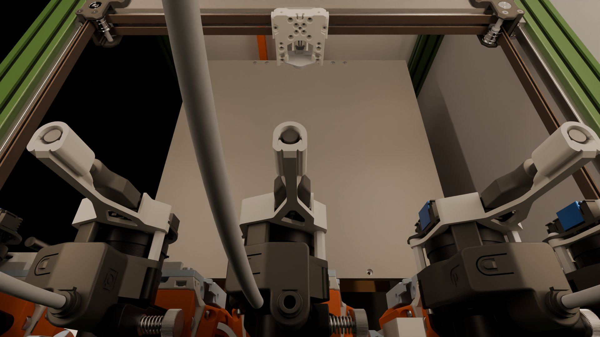
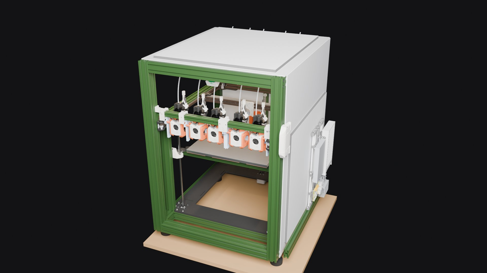

# CAD: model files, edit pipeline, and how to resume

The printer model is a FreeCAD document built from an imported STEP assembly.
The **model files are not in git** (140–510 MB each; GitHub refuses files over
100 MB). They live in `~/Documents/VT350/`. This folder holds everything needed
to understand them, check them, and redo any step.

## The model files

```mermaid
flowchart LR
    G["vt350-good.FCStd<br/>510 MB · 17,357 objects<br/><b>original, never saved over</b>"]
    L1["vt350-lite<br/>139 MB · 2,088 objects"]
    L2["vt350-lite-2<br/>Fasteners parts"]
    L3["vt350-lite-3<br/>+100 mm frame"]
    L4["vt350-lite-4<br/>3 door hinges"]
    L5["vt350-lite-5<br/>drilled verticals, bowden"]
    L5D["vt350-lite-5-dan<br/>user hand edit"]
    L6["vt350-lite-6<br/>+80 mm Y at the front,<br/>Monolith milled, Carbonara"]
    L7["vt350-lite-7<br/>belts on the 2WD milled path"]
    L8["vt350-lite-8<br/>Y rails 450, rear-flush"]
    L9["vt350-lite-9<br/>owned 400 steel + 74 mm<br/>front extension"]
    L10["vt350-lite-10<br/>gantry +50 mm, Z 400 rails + screws<br/>~348 mm print height"]
    L11["vt350-lite-11<br/>fixes: bowden placement,<br/>orphan screws, latch"]
    L12["vt350-lite-12<br/>materials (ShapeMaterial)"]
    L13["vt350-lite-13<br/>materials: backbone steel,<br/>kinematic supports Al"]
    L14["vt350-lite-14<br/>docks 5 mm back,<br/>arms lengthened"]
    L15["vt350-lite-15<br/>A4Tv2 + CNC Crossbow"]
    L16["vt350-lite-16<br/>insulation, camera,<br/>LED strips"]
    L17["vt350-lite-17<br/>tanaes Trident kinematic,<br/>10 mm plate<br/><b>current</b>"]
    G -->|make_lite.py| L1
    G -.->|extract_fasteners.py<br/>read-only| J[(fasteners.json)]
    L1 -->|rebuild_fasteners.py| L2
    J --> L2
    L2 -.->|frame_map.py| M[(frame_map.json)]
    L2 -->|frame_plus100.py| L3
    M --> L3
    L3 -->|door_hinges.py| L4
    L4 -->|lite5.py| L5
    L2 -.->|drilled bars| L5
    L5 -->|FreeCAD by hand| L5D
    L5D -->|lite6.py| L6
    L6 -->|lite7_belts.py| L7
    L7 -->|lite8_rails.py| L8
    L8 -->|lite9_rails.py| L9
    L9 -->|lite10_ztravel.py| L10
    L10 -->|lite11_fixes.py| L11
    L11 -->|lite12_materials.py| L12
    L12 -->|lite13_materials.py| L13
    L13 -->|lite14_docks.py| L14
    L14 -->|lite15_a4tv2.py| L15
    L15 -->|lite16_enclosure.py| L16
    L16 -->|lite17_kinematic.py| L17
```



| File | What changed | Verified by |
|---|---|---|
| `vt350-good.FCStd` | Original STEP-based model (2026-11-03). **Never saved over.** | — |
| `vt350-lite.FCStd` | 507 STEP fasteners removed; 3 PCB assemblies (Octopus Pro, 2× Nitehawk-36) → one box each; 3 leadscrews → plain rods; 90 empty containers removed | `data/logs/make_lite.log` |
| `vt350-lite-2.FCStd` | 442 parametric **Fasteners workbench** parts (`Thread = False`) put where the STEP fasteners were; 65 originals kept (T-nuts, square washers, self-tappers: no matching standard type) | `data/logs/rebuild.log`: 424/442 match the original's centre of mass; the other 18 are explained below |
| `vt350-lite-3.FCStd` | **+100 mm between the gantry and the top of the frame** (cut plane Z = 534). Verticals 640 → 740 mm, rebuilt as `Part::Extrusion` of their own end profile; back panel spliced; 71 parts above the cut moved +100 mm; leadscrew rods 8 mm | `data/logs/frame_plus100.log`: 0 problems; every untouched part unchanged within 1 µm |
| `vt350-lite-4.FCStd` | Door: **3 identical hinges** (copies of the complete bottom hinge) at −9.9…100.1, 265…375, 539.9…649.9; two loose top pins removed | `data/logs/door_hinges.log`: 0 problems |
| `vt350-lite-5.FCStd` | **6 verticals get their drilled side holes back**: lite-3's extrusions had lost them all, so the original drilled bars from lite-2 are spliced at Z = 534 (+100 mm of their own cross-section). **INDX parts removed.** **Rear 4040 corners follow the drilled holes**: each joint keeps its 2 staggered M5×50 through-bolts; 15 M5×16 BHCS + washers with no hole are removed. **Bowden tubes**: solid Ø4.12 mm (measured OD) from each Orbiter inlet to a top-rear exit (Y 460, Z 690, tilted 45° to the rear, for the EMU), 568 mm, tightest bend 119 mm at the docked pose; route parameters are stored on each tube | `data/logs/lite5.log`: 0 problems; hole faces 52/60/60/52/32/32 match lite-2; every untouched part unchanged |
| `vt350-lite-6.FCStd` | From `lite-5-dan`. **+80 mm of Y at the front** for the parked heads (#19 AC9: A4Tv2 + O2S head, deepest slice 68.6 mm with the plate → 6 + 4 + 68.6 ≈ 79). Everything in front of Y = 10 moves −80; the 4 side 4040s, 2 gantry 2040s and the cabinet 2040 are spliced (+80 of their own section). The old front 2040 verticals carry the front Z rails, so they **stay as Z posts** (Z −10…370); new front verticals and a new bottom front 2040 go 80 mm forward; the old bottom front 2040 stays for the Backbone. **Placeholder dock crossbar** (2040) between the new front verticals, 5 mm above the docked heads. **LDO Monolith milled 2WD VT 9 mm** (front 2WD_VT, rear VT **NP**, XY 2WD), aligned on the printed parts' pulley axes; **MGN9 × 470** Y rails; **Carbonara 20×20 CF X beam, 430 mm**; belts spliced with a copy of their own toothed stretch; both **Z cable anchors removed**; bowden tubes regenerated | `data/logs/lite6.log`: 0 problems; 999 original shapes unchanged or moved exactly −80; Monolith axes within 0.01 mm; collisions vs a lite-5-dan baseline: 5 new (below) |
| `vt350-lite-7.FCStd` | From lite-6. **Both XY belts re-drawn** on the Monolith 2WD path through the milled parts' pulleys and idlers: straight tangents plus wraps on the GT2 pitch line (pulley OD + 0.254 mm on the tooth side, 695 OD + 1.126 mm where the belt's back rides). Each end stops at its carriage belt clip's outer edge. **Printed Y endstop removed** with its hardware (8 solids): it sat in the lower belt's rear run and shared a slot with the milled rear mount | `data/logs/lite7_belts.log`: 0 problems. Belts are valid single solids touching nothing except their clips; every other part unchanged. **Belt length 1941.7 mm each** (pitch, clip edge to clip edge) + tuck-in |
| `vt350-lite-8.FCStd` | From lite-7. **Y rails 470 → 450**, the longest MGN9 West3D sells (Berserker). Placed **rear-flush** because the reach table (below) shows that keeps the same print reach as 470 | `data/logs/lite8_rails.log`: 0 problems; reach table for 470 and 450 front / centre / rear |
| `vt350-lite-9.FCStd` | From lite-8. **Y rails = the owned 2 × Berserker MGN9H 400 steel rails, rear-flush (Y 40.0…440.0), plus a 73.9 mm front extension** per side (Y −34.0…40.0, orange) that the Y blocks only ride while docking. Whether the extension is printed or cut from a shorter steel rail is still open | `data/logs/lite9_rails.log`: 0 problems. With the nozzle at the plate's front edge, the block front is at Y 40.24: **+0.28 mm on steel**, so all printing stays on steel |
| `vt350-lite-10.FCStd` | From lite-9. **Taller Z inside the same 740 mm frame.** lite-9's bed could rise only 14.8 mm, because its Z blocks hit the ends of the 300 mm rails, so the plate stayed 45 mm under the nozzle. **The gantry and everything on it move up 50 mm**: gantry bars and their joint bolts, the Monolith stations, beam, Y rails, X rail and carriage, MadMax carriage, belts, docks, docked heads and dock crossbar. **Z posts and the rear 2020 vertical are extended to Z 420.** **Z rails are MGN9 400; lead screws are 400** (the uncut 400 integrated-leadscrew motors). The rail stops now sit on the new rail tops; the right one had been floating 40 mm above its rail. **The printed X endstop is removed**: once raised, it swept into the left Z rail, its stop and the Z post. **Bowden tubes are regenerated** with handles chosen for the largest bend radius | `data/logs/lite10_ztravel.log`: 0 problems. **Max print height 347.8 mm.** The bed reaches the nozzle with 5 mm to spare before the rail stops, with no interference at either end of travel. The gantry clears the lead screws by 21.3 mm. **Bowden R 105.1 mm** (lite-9: 105.2), 646 mm, touching nothing |
| `vt350-lite-11.FCStd` | From lite-10, fixing three problems the user spotted. **Bowden tubes:** lite-10 placed the tube solids in the wrong group's coordinate frame, so they floated 35.5 mm above the couplers; they're rebuilt from their stored route and now start at the coupler tops. **4 orphan M3×8 screws deleted:** they held the printed front motorless mounts, which lite-6 replaced, but they were filed under the Door group and had floated since. **Clicky-Clack latch:** Hinge_Bottom sat 10.2 mm below the handle (already so in lite-5-dan) and is moved up flush, so its magnet pair has the same 0.4 mm gap as the top pair | `data/logs/lite11_fixes.log`: 0 problems. Tubes R 105.1, touching nothing but their couplers; Hinge_Bottom overlaps nothing; every other part unchanged |
| `vt350-lite-12.FCStd` | From lite-11; geometry and colours unchanged. Sets each solid's **ShapeMaterial** by rule: frame, Monolith and dock crossbar Aluminum-6061-T6; build plate Aluminum-Generic; fasteners, rails, carriages, bearings, pins and springs Steel-Generic; bowden PTFE-Generic; printed parts ABS-Generic (an explicit list of printed groups). FreeCAD has no ASA card. Anything whose material isn't known stays on **Default** and is listed in `data/materials-lite12.tsv` | `data/logs/lite12_materials.log`: 0 problems. 494 objects whose colour the material card changed were restored. Model mass of the assigned parts is 20.1 kg; it's not a real weight, because extrusions and electronics are simplified solids |
| `vt350-lite-13.FCStd` | From lite-12, with materials the user confirmed: the **backbone is steel** and the **kinematic bed-mount supports are aluminium**. The alloy wasn't given, so they use Aluminum-Generic. Also sets the back kinematic ball to steel, which lite-12's rule missed. `data/materials.tsv` lists the current material of every solid | `data/logs/lite13_materials.log`: 0 problems, 9 materials set, geometry and colours unchanged. 272 of 934 solids are still on Default |
| `vt350-lite-14.FCStd` | From lite-13. **Docks and docked heads 5 mm back (+Y)** so the carriage can reach them. The MadMax dock assembly includes a copy of the carriage at its pickup pose, with its front face at Y −24.00, but the gantry carriage can only reach Y −21.19. Pickup is now at −19.00, which leaves 2.19 mm before the XY-joint/mount hard stop. The printed **dock arms are 5 mm longer** through their straight section (193.2 mm², Y −57.6…−49.6), so their mounts on the front verticals don't move. Bowden tubes rebuilt from the moved couplers | `data/logs/lite14_docks.log`: 0 problems; arm volumes +966.2 mm³ exactly; no new collisions; tubes R 104.5 and touch nothing; everything else unchanged |
| `vt350-lite-15.FCStd` | From lite-14. **A4Tv2 replaces the A4T v1 on both heads**, from DW-Tas's `A4Tv2_assembly.step` (CC BY-NC-SA 4.0, not in git). Variant: Dragon Rapido UHF body, Orbiter, XOL mount; 4010 ducts; UHF hotend-fan duct and 2510 fan; low LED; Crossbow adapter; **DW-Tas's aluminium CNC Crossbow** (same parts as its CNC STEP, the one West3D sells); Dragon Ace with the **3 mm spacer**. It's placed by **all three XOL screw pairs on andrewmcgr's MadMax plate** (±15.5 at Z 441.1, ±16.2 at 449.5, ±16.25 at 397.8), so **the plate fits unmodified**. The v1 cowling, duct, LED, hotend mock-up and older Crossbow are removed. The Orbiters move (0, −0.89, −7.40) to sit on the new adapter, and the bowden tubes are rebuilt (R 107.4) | `data/logs/lite15_a4tv2.log`: 0 problems apart from one **known conflict, left visible: the left head's Crossbow lever (38 mm to −X) runs into the left dock's Dock Bracket and Alternate Bracket**. The A4Tv2's upper carriage screws reach 32 mm³ into the Alternate Bracket, so check the screw length. Nozzle Z 380.80 (unchanged, so ~348 mm print height); nozzle Y 0.88 mm further forward (on-steel margin +1.16, rear reach −9.08) |
| `vt350-lite-16.FCStd` | From lite-15. New group `Enclosure extras (lite-16)`. **Insulation:** the user's three 10 mm carbon-felt pads (508 mm square), each sheet sealed in 0.5 mm aluminium on both faces. Roof and back go **outside** their panels; the right wall sits between the side panel and the electronics. Cut plan: pad 1 = roof; pad 2 = back (top 508 mm); pad 3 = a 470 × 42 roof strip plus 508 × 466 for the right wall. Also a 3 mm roof panel and a 3 mm right side panel; the side panel starts behind the door latch. **Camera:** Nocturne USB (96° diagonal, rated −20 to +70 °C) in the public-domain Printables 305428 housing (front and back covers from its STEPs), top front centre at (−245, −52, 628). Its aim is searched so the whole plate stays in frame at every bed height. **Lights:** 24 V warm-white COB in 16 × 8 mm channel under the left and right top extrusions | `data/logs/lite16_enclosure.log`: 0 problems. Camera, out of 81 plate points: bed at Z 271, 81 in frame and 81 visible; bed at the top (first layer), 81 in frame and 63 visible (the X beam hides 18); bed at the bottom, 81 in frame and 72 visible (the bed frame and kinematic sandwiches hide 9). The bowden tubes pass through the rear roof strip, so the roof needs pass-throughs |
| `vt350-lite-17.FCStd` | From lite-16. tanaes's laser-cut **Trident** kinematic set (the user's West3D kit) replaces the printed `Z_Bed_Left/Right/Rear` holders and the V2.4 kinematic parts, built from his DXFs at the BOM thicknesses. A, B and G are anchored on the GE5C bores, with I on top. E's end holes sit on the front slot, and C/E slides along it until the pin groove runs through the bed's own front mount hole (C/E then lands 54.7 mm inboard of A's bore, the spacing his DXFs are drawn at). The rear ball sits on G's groove under the bed's rear hole. GE5Cs at the new bearing height (ring top = plate top). The front Z carriages move −2.85 and the rear one +1.55, with the Z cable chain. The build plate is the user's measured **10 mm** (was 6). The springs are shown flat. Fasteners are not modelled | `data/logs/lite17_kinematic.log`: 0 problems, 0 overlaps, 0 broken contacts. All three balls under the plate's mount holes (front 0.00 mm off, rear 0.10). Plate top is +17.6 mm relative to the front Z carriages (4 mm of it is the thicker plate) |

Git only has the recipe, not the models. The models are backed up to the home
NAS with restic: run **`cad/backup-models.sh --verify`** after any model
change (back up, then restore the newest `.FCStd` and compare checksums).
Where it backs up to is local config (`~/.config/vt350/backup.env`), kept out
of this public repo. Without the restic password the backup cannot be opened,
so keep it in the password manager as well.

After each successful backup the script prunes old snapshots: it keeps the
last 10 runs, one per day for 30 days, and one per month for 12 months
(override with `VT350_KEEP` in the local config). On this laptop the alias
`vt350-backup` runs `cad/backup-models.sh --verify` from any directory.

## Renders (lite-35, in colour)

Blender Cycles renders of `vt350-lite-35.FCStd` + `vt350-ebox.FCStd` (no filter: #115): the 5-dock row, the saddles, the O2S wire
restraints and the toolhead colours from #159–#162. Made 2026-11-15 by the batch lane's `vt350-render` chain
(`vt350-lite-35-20261115t000326-e44f`; `render/render_full.sh` below makes the same on the laptop), in the
chosen colours (#38): RAL 6011 green powder-coated frame (chosen 2026-11-14, tentative until the #102 sample is matched: DLLPDF Dull Green, Prismatic photo #6E8C5B, rendered with albedo #27461F so it looks like the photo, #101), PET-GF white printed parts, PET-GF orange accents, matte black backbone and Monolith parts, brown belts, chrome bearings. Photo references for the rest: #75. They are
re-rendered when worth it, not on every pass. Earlier renders (lite-16 in model colours, lite-26 in seafoam, lite-30 with two docks) are in git history.
How the frame colour was chosen: [notes/reference/frame-colour.html](../notes/reference/frame-colour.html).

| What the Obico camera sees (LED strips only, 3800 K) | Outside, front 3/4 |
|---|---|
|  |  |

### Full colour renders on this laptop: `render/render_full.sh` (#38)

```bash
cad/render/render_full.sh                 # lite-26 + vt350-ebox.FCStd, 128 samples
cad/render/render_full.sh 27 256          # another lite-N, more samples
VT350_REUSE_EXPORT=<run>/export cad/render/render_full.sh   # changed only a role's colour/finish: skip the export (a new RULE needs a full run)
```

- **What it does:** runs the FreeCAD GUI export (the window opens and closes by itself; click **Wait** if GNOME asks), then Blender Cycles on the RTX 2070 (OPTIX).
- **Output:** `~/Documents/VT350/renders/<model>-<UTC>/`. Each view is written twice: `<model>-<view>.png` (lossless master) and `<model>-<view>.jpg` (quality 85), the file that goes in `cad/renders/` for this README. The batch lane's `vt350-render` chain (homelab#1961) writes the same pair.
- **Test:** `python3 platform/render/test_render.py` renders a one-box fixture at 1 sample and checks both files per view (needs Blender; `VT350_BLENDER="docker run … gpu-batch-blender:<tag>"` runs it in the lane's image).
- **Colours** come from `render/colours.json` (user, 2026-11-06), applied at render time, so the model is never edited:

  | Role | Colour |
  |---|---|
  | frame extrusions | RAL 6011 green powder coat (tentative, Prismatic Dull Green #6E8C5B; render albedo #27461F, #101) |
  | printed parts (ShapeMaterial ABS) | PET-GF white |
  | Voron `[a]_` accents | PET-GF orange |
  | bed backbone | matte black |
  | GT2 belts | brown, almost black |
  | LDO Monolith milled parts (`VC9-*`, `VT9-*`) | matte black |
  | ball bearings (695, F695, MR148ZZ) | chrome |
  | hardware: screws, washers, nuts, T-nuts, pins, springs, magnets, any other steel part (`hardware`, #149) | brushed steel, #A7ABAF (**placeholder**, owner to pick) |
  | any other aluminium part: kinematic bed plates, build plate, milled dock (`stock_aluminium`, #149) | aluminium, #BFC3C7 (**placeholder**, owner to pick) |
  | circuit boards (`electronics`, #149) | green solder mask, #1E4D2B (**placeholder**, owner to pick) |

  Parts no rule matches keep the model's colour. The export writes them to `colour-audit.txt` beside `scene.json`, whatever their material: grouped by group path and material, with counts, the count on the first line, then the 8 largest sets and the totals by material (`colours.audit`, vt350#91, #149). `export.log`'s `colour map:` line repeats that count. Add a rule for any that are printed.
- **Tests:** `render/colours.py` holds the shared rule matcher, tested by `render/test_colours.py` (CI `render-colours`). `render/test_render_full.py` (same CI, stub FreeCAD + Blender) checks how `render_full.sh` judges the export: a `FAILED` or a missing `done:` line fails it, the part-index hook's `index: FAILED` does not (#90). `VT350_DOCS` moves its output folder.
- **Voron logos** (the filter's front hinge and top cap) render orange with the recessed part white: `render/logos.py` picks the inset faces (tested by `render/test_logos.py`, FreeCAD: `$APP freecadcmd $PWD/platform/render/test_logos.py`). Every export that shows the printer's look (`export_meshes.py`, `export_exploded.py`) must use `colours.role_of` and `logos.split`; `test_colours.Aligned` fails CI if one doesn't, or if a new `export_*.py` isn't classified.

### Rendering on node-03 (fire and forget)

Renders don't have to tie up the laptop. The GTX 970 on `k8s-node-03` runs the same Blender 5.2.2 and the same unmodified `render.py`. On lite-16 its output matched the laptop's to within sampling noise (mean abs diff 0.06 and 0.01 of 255), and it took about 4 minutes. Lane design: [`homelab/architecture/gpu-batch-lane.md`](https://github.com/dvystrcil/homelab/blob/main/architecture/gpu-batch-lane.md).

1. **Export on the laptop**, as before: run `render/export_meshes.py` in the FreeCAD GUI. It writes the STLs and `scene.json` into one directory.
2. **Submit** from `~/Code/homelab`. Everything after `--` goes to `render.py` after its input and output directories, so `128` is the sample count. The command copies the export to the NFS share, creates the Job, prints the job id and **returns**:

   ```bash
   bin/gpu-batch-submit.py blender \
     --input <export dir> --script ~/Code/vt350/platform/render/render.py \
     --name vt350-lite-N --min-outputs 2 --notify dvystrcil/vt350#<issue> -- 128
   ```

3. **The result arrives.** A single comment on `--notify`'s issue or PR:
   - ✅ with each PNG's path, size and hash;
   - ❌ with the log tail;
   - ⛔ if it was refused.

   The images are at `/mnt/nfs/media/gpu-batch/<job id>/out/`. There's nothing to watch. `bin/gpu-batch-submit.py status <job id>` reads the result once if you'd rather not wait for the comment.

**It will not render while Neptune is printing.** The 970 also runs Obico's failure detector. A printer that is printing, or that answers but can't report its state, means a refusal. A powered-off printer is fine, because Obico then confirms no print is active. If Obico can't confirm it but you know the printer is off, resubmit with `--printer-off`; that flag is ignored whenever the printer answers.

Success means the images exist. If `render.py` crashes, Blender still exits 0, and the job reports ❌ "expected outputs missing" with the traceback.

## Why the original was unusable, and what fixed it

Measured from the original file's internal data (2026-11-04):

| Contents | Size | Shapes |
|---|---|---|
| Fasteners (vendor STEP with full detail; one M5×50 = ~20 MB) | 892 MB | 526 |
| PCB components (every resistor and capacitor a solid) | 400 MB | 1,845 |
| Extrusions | 301 MB | 235 |
| **Printed parts, rails, motors: the actual design** | **26 MB** | 279 |
| Empty origin scaffolding (8 per `App::Part`) | — | 12,864 |

FreeCAD held **9.8 GB of RAM** with it open. On top of that:

| Problem | Fix (applied 2026-11-04) |
|---|---|
| Rendered on the **Intel UHD iGPU**, not the RTX 2070 | `~/Desktop/freecad-26.3rc2.desktop`: `Exec=env __NV_PRIME_RENDER_OFFLOAD=1 __GLX_VENDOR_LIBRARY_NAME=nvidia /home/dan/FreeCAD/FreeCAD_26.3rc2-Linux-x86_64.AppImage`. Check with `glxinfo -B` under the same env |
| Autosave every 15 min wrote a full recovery copy (1.3 GB in `~/.cache/FreeCAD`) | Preferences → General → Document: autosave **30 min** |
| Save compression level 7 | Compression **3** |

Longer-term option (not done): split the model into per-assembly `.FCStd`
files brought together with `App::Link`, so you only open what you edit.

## Tools

Every program the CAD, checks, renders and simulation use, with its pinned version, licence and link: [`tools.md`](tools.md). `cad/check-tools-page.sh` checks the page against the pins (CI runs it); `--local` also checks the laptop's installed versions.

## Running the scripts

Data in / logs out go to `VT350_WORK` (default: `~/Code/vt350/cad/data`).
Input and output model paths are constants at the top of each script.

```bash
APP=/home/dan/FreeCAD/FreeCAD_26.3rc2-Linux-x86_64.AppImage
NV="env __NV_PRIME_RENDER_OFFLOAD=1 __GLX_VENDOR_LIBRARY_NAME=nvidia"

# Headless (read-only passes: no colours needed)
$APP freecadcmd $PWD/cad/studies/extract_fasteners.py   # ~8 min (loads the 510 MB original)
$APP freecadcmd $PWD/cad/studies/frame_map.py

# GUI mode (passes that SAVE a model: keeps colours/visibility)
$NV $APP $PWD/cad/passes/make_lite.py
```

### After a model change: `refresh.py` (#69)

One command for everything a new lite-N (or a `derive_stls` change) has to be followed by. Plain `python3`; it never
writes a model and never commits, so opencode or CI can run it and the caller commits the result:

```bash
python3 cad/scripts/refresh.py 35 --dry-run       # the steps, and which parts/printed copies would change
python3 cad/scripts/refresh.py 35 --notify dvystrcil/vt350#69   # submit the batch-lane chain, then derive_stls -> sync_printed -> check_printed here
python3 cad/scripts/refresh.py 35 --collect       # after the chain's comment: its logs, index and print-area.svg into the repo, then test_print_area
python3 cad/scripts/refresh.py 35 --local         # every step here (lane down): part_index -> derive_stls -> sync_printed -> check_printed -> sweep -> z_sweep -> print_area -> test_print_area
python3 cad/scripts/refresh.py 35 --local --from sweep    # start part-way
```

**The model-reading steps run on the cluster's batch lane** (homelab#2257): part_index, sweep, z_sweep and print_area are
the homelab chain `vt350-refresh` (homelab `bin/gpu-batch-submit.py`; `VT350_GPU_BATCH_SUBMIT` overrides its path), on
max-01, read-only. On lite-32 they took ~78 of the local run's 80 min (z_sweep alone 54). `refresh.py N` submits the chain
first, then runs only the steps whose output is committed while it runs: `derive_stls` (the lane's STLs are never
committed: max-01 tessellates them differently, homelab#1961), `sync_printed`, `check_printed`. The chain posts ONE
comment on `--notify` when it ends; don't poll. `--collect [CHAIN-ID]` (default: the last one submitted, from
`data/logs/refresh_submit.out`) copies `sweep_toolhead.log`, `z_sweep.log`/`.json`, `part_index.log` and
`print-area.svg` from the NFS share (`GPU_BATCH_WORK_ROOT`, default `/mnt/nfs/media/gpu-batch`) to where the local
steps write them. It checks everything before it writes anything: every job `succeeded`, each log's completion marker,
and that the logs and the SVG are this lite-N's. It then adopts the chain's part index beside the models
(`part_index.py --adopt`) and runs `test_print_area`. The copied logs name the pod's paths
(`/work/<chain-id>-sweep/in/...`), which records which chain made them.

It stops at the first failed step (exit code **or** a missing completion marker) and names the step and its log. The
summary goes to stdout and `data/logs/refresh.log`: STLs re-copied (only their `sha256` cell in `manifest.csv` changes,
by text edit), the reach compared with the committed sweep log, the print area, and the status of each model's box index
(`part_index`, #90: `vt350-lite-N` plus each companion `.FCStd` the pass saved within 10 min of it, never another lite-N).
A completion marker read from a separate log (derive_stls, sweep, part_index) only counts if this run rewrote that log. Then `git diff --stat` and commit.
A new lite-N that remixes a part also needs its `derive_stls.py` JOBS row; a new parts/printed copy needs its manifest
row first (refresh only updates existing rows).

- **Pass absolute script paths.** In testing, a relative path produced no
  output and no error, while the same script by absolute path ran.
- **Model-writing passes must run in GUI mode.** A headless save drops
  `GuiDocument.xml`, so every part opens grey.
- During a GUI-mode run, GNOME shows **"FreeCAD is not responding"** (from
  about 84% of the load bar onward): the script holds the main thread.
  **Click Wait**; Force Quit kills the run before it saves.
- Every model-writing pass writes a **new** file, checks the result, and
  **refuses to save** if any check fails.

| Script | Kind | Purpose |
|---|---|---|
| `cad/passes/make_lite.py` | GUI, writes | original → lite |
| `cad/studies/extract_fasteners.py` | headless, read-only | records every STEP fastener: type, size, axis, tip, centre of mass, parent → `data/fasteners/` |
| `cad/passes/rebuild_fasteners.py` | GUI, writes | lite → lite-2 |
| `cad/studies/frame_map.py` | headless, read-only | Z extents of every shape → `data/frame_map/frame_map.json` |
| `cad/studies/open_time.py` | GUI or headless, read-only | #195 AC1: `VT350_MODEL=<model> $NV $APP $PWD/cad/studies/open_time.py` opens the model, draws the view once and appends the times to `cad/data/logs/open_time.log` |
| `cad/passes/frame_plus100.py` | GUI, writes | lite-2 → lite-3; also prints the cut list |
| `cad/passes/door_hinges.py` | GUI, writes | lite-3 → lite-4 |
| `cad/passes/lite5.py` | GUI writes; headless = dry run, never saves | lite-4 (+ drilled bars from lite-2) → lite-5 |
| `cad/passes/lite6.py` | GUI writes; headless = dry run, never saves | lite-5-dan → lite-6. Needs the Monolith/Carbonara STEPs (below) under `VT350_DL` |
| `cad/passes/lite7_belts.py` | GUI writes; headless = dry run, never saves | lite-6 → lite-7: belt path, belt length |
| `cad/passes/lite8_rails.py` | GUI writes; headless = dry run, never saves | lite-7 → lite-8: 450 Y rails (`RAIL_PLACE` front/centre/rear) + Y reach table |
| `cad/passes/lite9_rails.py` | GUI writes; headless = dry run, never saves | lite-8 → lite-9: owned 400 steel + front extension; checks that printing never needs the extension |
| `cad/passes/lite10_ztravel.py` | GUI writes; headless = dry run, never saves | lite-9 → lite-10: gantry +50, Z rails and screws 400; reports Z travel, print height, gantry-over-screw clearance, bowden bend |
| `cad/passes/lite11_fixes.py` | GUI writes; headless = dry run, never saves | lite-10 → lite-11: bowden placement, orphan screws, Clicky-Clack Hinge_Bottom |
| `cad/passes/lite16_enclosure.py` | GUI writes; headless = dry run, never saves | lite-15 → lite-16: insulation, camera (with the view check), LED channels. Needs the housing STEPs under `$VT350_DL/dl_camhousing/` |
| `cad/passes/lite17_kinematic.py` | GUI writes; headless = dry run, never saves | lite-16 → lite-17: Trident kinematic bed, 10 mm plate. Needs `$VT350_DL/tanaes_trident_parts.json`, made by `tanaes_dxf2json.py` (needs `ezdxf`) from his `DXFs/Trident/` |
| `cad/passes/lite18_plate.py` | GUI writes; headless = dry run, never saves | lite-17 → lite-18: the measured LDO build plate (355 square, Ø6.5×4.9 counterbores), 1.5 mm heater pad with its cut-outs, 4 pad hold-downs, 1.4 mm magnet sheet; rear ball onto the real rear hole. Clashes with the pad are reported as findings, not save-blockers. No downloads needed |
| `cad/passes/lite19_ebox.py` | GUI writes; headless = dry run, never saves | lite-18 → lite-19 + `vt350-ebox.FCStd`: the `Electronics` and `Electronics Cabinet` assemblies move to their own document, in the printer's coordinate frame, with colours. The printer keeps a transparent `Ebox envelope` box, not an App::Link (a link would load the ebox anyway). Refuses to save unless all 102 copied solids match their originals |
| `cad/passes/lite20_rear_row.py` | GUI writes; headless = dry run, never saves | lite-19 → lite-20: the plate's rear hole row (348.5, was 349.5), fuse/lock-washer screws, and the rear pad strip (12.3 deep) from the re-measured photos; rear ball slides 1.0 along G's groove. Refuses to save if any other solid's bounding box changed |
| `cad/passes/lite21_no_pad7.py` | GUI writes; headless = dry run, never saves | lite-20 → lite-21: removes the BTT Pad 7 screen (`case display 7 hdmi BTT v1.2 v1`, one solid, nothing mounted to it); it will be mounted elsewhere, place not decided. Refuses to save unless exactly that solid is gone and nothing else moved |
| `cad/passes/lite24_beacon.py` | GUI writes; headless = dry run, never saves | lite-23 → lite-24 (#54 AC2): **Beacon RevH** (Beacon's own STEP, MIT; Molex connector under Molex's terms; read from `$VT350_DL`) under the MadMax carriage on its two M3 holes. The carriage's probe pocket ceiling is raised 2.145 mm on the gantry carriage **and** both dock copies (same cut, checked), so the coil face is **2.60 mm** above the carried nozzle tip (Beacon nominal 2.6; as drilled it was 0.46). Normal vs LowProfile and connector front/rear are tested against the carriage, each carried head + plate, everything at the model pose, and a 15 mm plug way-in (assumed). LowProfile-front plugs into the hotend; **Normal, connector rear** is chosen (rear preferred: cable away from the bowdens). Klipper offsets x 0, y +27.4. Nothing inside Beacon's 20 mm keep-out cylinder |
| `cad/passes/lite26_carriage_on_block.py` | GUI writes; headless = dry run, never saves | lite-25 → lite-26 (#61): the gantry's MadMax carriage sat on the **X rail's** front face, not on the MGN12H block, in every model since the original assembly (vt350-good → vt350-lite, same Y). Its ~3 mm block recess (floor 3.0 / 3.2 mm in from the back, as in upstream `MadMax_Core_MGN12H_DB_AH_v11.step`) was at Y 265.6 against the rail face at 265.5; the block's top is at 260.825. Everything under `Carriage (1)` (carriage, its 2 SpeedClips, the Beacon) moves **dY −4.775**, measured by ray probes (block mounting face = its highest plane; recess floor), not assumed. Rail on the beam (273.5) and block on the rail are unchanged. So are the docks' carriage copies (positioned by the docked tool) and the belts (drawn from the XY-joint idlers). Checks: floor on the block top (gap 0.0001), carriage × rail 25.68 → 0, clips × rail 82.25 → 0, carriage × block 3530 → 0 mm³, belts × carriage/clips not worse (0.42 → 0), Beacon offset from the carried nozzle unchanged (Klipper x 0, y +27.4 stands), 4 solids moved exactly, 899 unchanged. **Belt line:** at each carriage end the belts (Y 257.5–259.6) now run in the 3.1 mm channel between the clip's back (257.7) and the block top, as upstream. Pickup gantry dY −262.50 → −257.73, so the margin to the front stop at the large opening is **+8.69 → +13.46**. The carried nozzle's rear Y reach drops **375.47 → 370.69** (print square rear 380.5). The model block's top is 0.325 mm behind HIWIN's H = 13. No shape changed, so `cad/derived/` and `parts/printed/` are unchanged. ~7 min |
| `cad/passes/lite27_feet_filter.py` | GUI writes; headless = dry run, never saves | lite-26 → lite-27 (#83 options 2+5, #74 option A): **4 levelling feet** (placeholders: 40×40×8 T-slot bracket under each side 4040, M8 stud, Ø50×18 rubber pad) on an **18 mm base board**, frame bottom 50 mm above the board. Writes **`vt350-filter.FCStd`**: the Nevermore StealthMax 300 core (22 parts from upstream `CAD/StealthMax_300.step` @ a3451c5, GPL-3.0, BPM configuration, turned 180°) **recessed in the backbone cutout**, Z −80.0…−4.4 (placed 0.5 below the −4.0 limit: optimalBoundingBox differs GUI vs headless). The printer keeps a transparent "Filter envelope" box (like the ebox); render with `VT350_EXTRA=…/vt350-ebox.FCStd:…/vt350-filter.FCStd`. Checks: frame bottom is the lowest point (Z −50); feet touch nothing; filter ≤ Z −4, ≥ 5 mm inside the cutout, no overlap; bed 2020 T at the bottom of travel 2.4 above it; 20.0 above the board. Nothing holds the filter up yet (mount = #74 AC3). Log: `data/logs/lite27_feet_filter.log` |
| `cad/passes/lite28_filter_lips.py` | GUI writes; headless = dry run, never saves | lite-27 → lite-28, vt350-filter → **`vt350-filter-2.FCStd`** (#74 AC3, user 2026-11-08: the filter hangs by a lip 10 mm over the backbone and is lifted out from above). Lips on the **left and right edges only**: at the bottom of Z travel the bed frame's 2020 T rests on the backbone's front edge (front bar) and rear edge (spine), so a lip there would be hit. Each side has a concept hanger (orange PET-GF): a 4 mm lip on the backbone top (Z −2…2), a 4 mm drop down the cutout gap, and a tab into the main chamber wall just under the lid frame, split around the lid latch. The printer's Filter envelope grows to X −430…−60, Z −80.7…2. Checks: the lip bottoms sit on the backbone top over ≥ 90 % backbone material (the side slots are allowed); the lips stay off the 2020 T's landing; the bed at the bottom of travel is ≥ 5 mm above (28.0); the hangers keep ≥ 0.5 mm off every other filter part (3.0 off the latches) and don't overlap the printer. Log: `data/logs/lite28_filter_lips.log` |
| `cad/passes/lite29_filter_cradle.py` | GUI writes; headless = dry run, never saves | lite-28 → lite-29, vt350-filter-2 → **`vt350-filter-3.FCStd`** (#74 AC3, user 2026-11-08: the filter sits in a **cradle of two halves**, left and right, and lifts out). It replaces lite-28's four hanger pieces, which were split around the lid latches. Each half is one piece, Y 90…390: a 10 mm lip on the backbone top, a 4 mm wall down the cutout edge, and a 15 mm ledge under the filter's **bottom tray** (`M_1a.0_Body_BPM`, underside Z −79.9; its plain BoundBox is polluted, the optimal box is right), plus a 3×5 ridge beside the tray wall. The centre of the underside (fan, exhaust slider, access hatches) stays open. The filter doesn't move. Checks: the tray rests on both ledges (0.00 mm, no overlap); ≥ 0.5 mm off every other filter part; lift-out path clear; bed ≥ 5 mm above at the bottom of travel (28.0); ledge 16.1 mm above the board; no overlap with the printer. Log: `data/logs/lite29_filter_cradle.log` |
| `cad/passes/lite30_filter_ring.py` | GUI writes; headless = dry run, never saves | lite-29 → lite-30, vt350-filter-3 → **`vt350-filter-4.FCStd`** (#74 AC3, user 2026-11-09): the filter holder goes **all the way round**, and the cutout is **sealed**. The first pass written on `litelib.py` (#93). One ring replaces lite-29's two cradle halves: a 4 mm collar 1.5 mm inside the cutout edge, concentric with its measured R10 corners (top Z −3, under the 2020 T's landing), lite-29's left/right lips, walls, ledges and ridges, and a 1 mm channel round the collar's outer face at the backbone's mid-height. **Seal:** a 3 × 3 TPU cord in the channel, squeezed 0.5 mm against the cutout's inner edge face, as **two U halves, left and right**, with a 10 mm half-height lap at X −245, each printable on the VT350 (`fits_print_area`; a front/rear split leaves each half 351 mm wide, over the 342 printable width). Front/rear ledges and the filter's duct wait on the airflow decision (the outlet is on the flow chamber's rear edge, Z −77…−66, under the backbone; see #74). Log: `data/logs/lite30_filter_ring.log` **Never run**: no lite-30 existed until `lite30_orbitool_o2s.py` wrote it (#6), and the filter comes off the printer in #115 (lite-31), so this pass is superseded |
| `cad/passes/lite35_o2s_wire_restraint.py` | GUI writes; headless = dry run, never saves | lite-34 → **lite-35** (#19, user 2026-11-14: "we may need to print a strain relief for the electrical cable which plugs into [the O2S]"): **the Orbitool O2S wire restraint on each of the 5 heads**, the part lite-30 left out. Body + lock from upstream's current `Orbitool O2S Wire restrain.step` (52a5a33, 2025-11-03; pinned by sha256, `o2s_wire_restrain.step` beside lite-30's assembly STEP), which shares the assembly STEP's frame (both parts' boxes identical in the two, checked). Each head's pose is recovered by `register.register` on its board, heat sink, USB stub and Smart Sensor vs the STEP (COM residual 0.00000 mm on all 5). Checks: lands where registered; overlaps its head's O2S/Orbiter only as the STEP does (body × board 2.10 mm³, as designed); nothing else in the printer overlaps it; at lite-32's 38 dock poses the nearest part that stays put is ≥ 16.31 mm away (box gap; slot 3/5: the neighbour's A4Tv2 body); role `printed` (ABS); solids 1277 + 10 = 1287. Printable STLs in `parts/printed/orbiter-toolboards/` (CC0-1.0), 2 of each per the 2-tool build. Saved 0 problems. |
| `cad/passes/lite36_roof_exit.py` | GUI writes; headless = dry run, never saves | lite-35 → **lite-36** (#3 AC4, #19; user 2026-11-14: "start on the roof access", each tool's electrical cable cable-tied to its bowden, and the bundle **clamped** at the roof, not sliding). Per head (5): the tube's axis is **measured** from its solid (sections at Z 690 and 700; the stored `ExitPoint`/`Inlet` X is stale: Bowden Left's solid is at X −409.70, its props say −399.0). Cut through the roof panel, the felt strip and both liners: Ø(tube + 2) and Ø(cable + 2) along the 45° exit, the felt notched out to the strip's rear edge. New printed (ABS) **roof exit clamp**, base + cap per head: a 36 mm flange on the felt (Z 704–708) stepping down onto the roof panel behind the strip, with the lower half of a split clamp along the exit; the cap is the upper half. Bores = tube 4.12 / cable 5.1 + 0.1, centres 6.21 apart (1.5 mm wall), halves 0.3 apart so the screws squeeze both. Per clamp: 2 × M5 + T-nut into the rear top 4040's slot (Y 490), 2 × M3 through-bolts at the front (flange + felt + roof panel), 2 × M3 into heat-set inserts for the cap. Checks: axis from the solid, roof parts stay one valid solid each, no tube left in the roof, clamps hit nothing (tubes included), walls ≥ 1.5 mm, neighbours ≥ 35.6 mm apart, role `printed`, solids 1287 → 1297. Cable side in the clamp: towards the restraint (L heads −X, R heads +X). No STL yet (like lite-32/33's saddles) | `data/logs/lite36_roof_exit.log/.json`: 0 problems; saved lite-36 (212778532 bytes) |
| `cad/passes/lite37_blowers.py` | GUI writes; headless = dry run, never saves | lite-36 → **lite-37** (#19): **the part-cooling blowers, a Vindr Berserker 4010B-24V-P in each 4010 duct, 2 per head** (10 in the model). No vendor CAD: the solid is built from the user's measurements (39.7 × 39.7 × 9.8 body, 6.5 tabs, Ø2.34 holes on a 34.5 square, outlet 8.56 × 27.84 on the right side 6.0–33.8 below the top, Ø27.4 intake on the back); corners r 3 (not measured; a square corner clips the duct pocket's corner fillets), wires not modelled. Pose **measured from each duct's solid**: the 4 r 0.75 pilot holes (35.0 square) and the 4 corner seats give the seat plane and centre; the tabs sit on the seats, flush with the label face, and the body stands 3.3 mm proud into the duct's 6 mm pocket, intake outboard (the duct's corner bosses fill the pocket's corners from the seats up, its inlet spans n −3.2…+5.3, its wire notch is on the label side). The rotation is the one of 4 whose outlet lands on the duct's inlet: in front of it ≥ 0.5 void **and** ≥ 0.5 duct wall around it, exactly one (outlet **down**, 59% void in 67% wall; the open side of the pocket is 100% void but 0.2% wall, so "open" alone would have picked it). Hole offset 34.5 vs 35.0: each hole 0.354 mm off its pilot, reported (M2 × 10 self-tappers take it). Checks: one valid solid each; holes parallel to the pilots, one per pilot; on the seats (0 mm³ into the duct, touching); nothing in the head or the printer overlaps them; **the 2510 fan is clear by 1.67 mm** (the handoff's 199 mm³ probe assumed the body 0…10 mm below the seats, not 3.3 proud of them); at lite-32's 38 dock poses ≥ 18.68 mm to anything that stays put; role `black_plastic` (a fan, like the 2510); solids 1297 → 1307 | `data/logs/lite37_blowers.log/.json`: 0 problems; saved lite-37 (212857025 bytes) |
| `cad/passes/lite38_tubes_panels_door.py` | GUI writes; headless = dry run, never saves | lite-37 → **lite-38** (#19, user 2026-11-14 on lite-37's render). **R heads' bowden tubes:** on slots 3 and 5 the tube's lower end was **10.70 mm −X** of the Smart Sensor's r 2.05 inlet bore (the L heads: 0.00); both moved +10.70 (the route is planar in X, so a shift keeps it; checked at 5 heights), their `Inlet`/`ExitPoint` now from the solid (#174, for these two). The tube sits in its sensor as the L ones do. lite-36's roof exits follow: the roof panel, felt strip and both liners are rebuilt from lite-35's uncut layers minus each exit's removed material, the R exits' moved +10.70 (same volume before and after, per layer); the R clamps move with them (neighbours ≥ 46.3 mm apart). **Left side panel**: the right one mirrored about the frame's centre (X −523…−520). **Paint:** each panel (right, left, back, roof) split into its inside (the model's white) and a 0.2 mm skin on its outward faces, role `panel_paint` (a rattle-can shade of the frame green); the back panel's existing overlap with the rear 4040s' slots (from the original model) is carried over unchanged, checked. **Door window:** a 3 mm clear sheet (acrylic or polycarbonate: #4) over the door's 2040 frame on a 2 mm black EPDM gasket ring (10–30 mm in from the outline), in the door's App::Part; the Clicky-Clack panel clips aren't modelled. Colours: O2S standoffs `brass`; felt liners `foil`, felt pads `carbon_felt` (were the model's white); window `glass_clear` (new `glass` kind in `render.py`: transmission 1, IOR 1.49); gasket `rubber`. Solids 1307 → 1314 | `data/logs/lite38_tubes_panels_door.log/.json`: 0 problems; saved lite-38 (212932983 bytes) |
| `cad/passes/lite39_camera_right.py` | GUI writes; headless = dry run, never saves | lite-38 → **lite-39** (#19, user 2026-11-14: the heads block the Obico view; "install it on the right side"; it mounts to the frame). The 4 camera solids move rigidly from the top front centre to the **rear-right corner**: lens at (−50, 440, 620), aimed at (−302, 28, 30), by the rear-right 4040 upright (housing 26 mm from it; the bracket isn't modelled). Chosen by rays from the lens to a 7 × 7 grid on the magnet sheet at the top of the bed's travel and at the floor stop, the bed's solids moved with it: **41 of 49** points seen at the worse height (46 at the other), against **21** from the old spot. A coarse probe of 20 spots on the right side: the front half of the right wall sees nothing (the parked heads' carriage), mid-wall Y 120 ties at 40 but has nothing to mount to; the corner at X −30 hits the right LED channel and, lowered, sees 33 past the belts. The render's obico view follows the lens. Colour: the Crossbow (main body, top cap, lever, blade caddy) → `brushed_aluminium`. Solids unchanged (1314) | `data/logs/lite39_camera_right.log/.json`: 0 problems; saved lite-39 (212932828 bytes) |
| `cad/passes/lite40_o2s_cables.py` | GUI writes; headless = dry run, never saves | lite-39 → **lite-40** (#3 AC2/AC5, #19; user 2026-11-14: the cables "zip tied to the bowdens (black zip ties)", routed "nicely to the sidepack", "elegant but accessible" like printed flat conduit with covers). **5 O2S USB cables** (Ø5.1) from each restraint's lock to the side pack: inside the chamber `cad/scripts/o2s_route.py`'s route (moved there from the study, unchanged: the study's log and JSON are identical before and after), the cable turning round its tube to the clamp's side along the bundle; **4 black zip ties** per head, ~100 mm apart; through the roof in the clamp's cable bore; then a lead-in (bend R 77–93) up and back into its own lane of a **printed cable channel** behind the roof's rear edge (lanes stacked in Z, slot 1 on top, so each cable only crosses empty lanes), which runs +X, turns down (R 60 on the inner lane) and drops behind the side pack to Z 380. Channel body white, open to the back, with an accent-orange **cover**; **4 posts** on the rear top 4040, **2 arms** from the rear-right upright. Every cable's whole centreline bends ≥ R 51 (assumed 10 × OD); nothing overlaps; the tubes' own lines, extended 250 mm past the clamps, clear the channel by ≥ 5.5 mm. A channel on the rear 4040's back face was tried first (bend R ~27: fails). Ends at the pack: its wiring and enclosure are #5 | `data/logs/lite40_o2s_cables.log/.json`: 0 problems; saved lite-40 |
| `cad/passes/lite41_skirts.py` | GUI writes; headless = dry run, never saves | lite-40 → **lite-41** (#19; user 2026-11-14: "voron type bottom skirts in ABS white with orange accents"). Closes the 50 mm band under the frame: **4 white skirt panels** (3 mm wall flush with the outer skins, down to Z −95; a 16 mm flange under each bottom extrusion; the front one 1 mm under the door window so it swings clear), each with an **orange slotted grille** in a vent window (29 % open), and **4 orange L corners** ending at Z −80, above the levelling feet's rubber pads (which stand 2 mm proud of the sides), so the feet show. Outline measured from the solids; nothing overlaps; each flange touches its extrusion; ≥ 1 mm off the pads and board | `data/logs/lite41_skirts.log/.json`: 0 problems; saved lite-41 |
| `cad/passes/lite42_skirts_v2.py` | GUI writes; headless = dry run, never saves | lite-41 → **lite-42-band** or **lite-42-tall**, picked by `VT350_SKIRT=band|tall` (#19; user 2026-11-15: "a lot of work to do on this. It really is about aesthetics", then "render both, and keep in mind the adjustable feet need a little room to poke out so the printer is not resting on the skirts"). Replaces lite-41's 12 skirt parts with 17, Voron style but drawn here (Voron's are for a 2020 frame 470 wide; this one is 556 × 641): **4 white panels** (3 mm wall, the lite-41 flange, cut clear of the foot brackets and studs) with **hex windows** (a chamfered outline filled with flat-top hexes, clipped by it), two per face; **8 orange mesh plates** (2 mm, fine hexes) behind the windows; an **orange badge** inset flush in the front; **4 orange corner** Ls (56 mm legs, chamfered outer edge). Every part has an **arch** round each levelling foot (R 29, up to 6 mm above the pad) and stays **≥ 12 mm above the board**. `band`: skirt Z −50…−88, stand unchanged. `tall`: Voron's 66.8 mm (official STLs, measured), so the pads and board drop 30 mm, the M8 studs grow to match, and the skirt is Z −50…−118. `none` (user 2026-11-15: "no skirt and the feet almost touching the extrusion, just leave 5mm for leveling", worried about wobble): no skirt; each foot body grows up to 5 mm under its bracket, so 5 mm of M8 thread shows. The board stays at Z −100: raising it 19 mm instead hit the StealthMax filter envelope, which hangs to Z −80 (a first try, refused by the check). Checks: outline measured and flush; one valid solid each; no overlap with the printer or each other; flanges on their extrusions; ≥ 1 mm to studs, pads and board; ≥ 12 mm above the board; roles; 17 parts. Logs `data/logs/lite42_skirts_{band,tall}.*` |
| `cad/passes/lite43_stand_up.py` | GUI writes; headless = dry run, never saves | lite-42-none → **lite-43** (#19, #115; user 2026-11-15: "the foot pads got thicker", "the filter is no longer there"). The StealthMax came off the printer at lite-31, but its transparent **Filter envelope** box (Z −84…2) stayed in the model, and lite-42-none's raise was refused against it. This pass **removes the stale envelope** (so `z_sweep` no longer loads `vt350-filter-3`'s solids), puts the **foot pads back to 18 mm**, still 5 mm under each bracket (5 mm of M8 thread), and **raises the base board 19 mm** (top Z −100 → −81). The feet stay placeholders until a bought levelling foot is picked. Checks: the envelope is gone; nothing but the stand reaches below the frame bottom (Z −50); each pad 18 tall, 5 mm under its bracket, on the board; the stand overlaps nothing; one solid fewer. Log: `data/logs/lite43_stand_up.log` |
| `cad/passes/lite44_dk08_feet.py` | GUI writes; headless = dry run, never saves | lite-43 → **lite-44** (#83; user 2026-11-15: "go with the Asmith DK-08 feet, board stays"). The placeholder studs and pads become **Asmith DK-0808035A** swivel levelling feet, modelled from the catalog drawing (M8×1.25, L 35, Ø40, H1 20, H2 15, H3 6.5, W 13; the cushion thickness and the base taper are estimated, because the vendor CAD ships as a RAR this laptop could not unpack). The bottom 4040's slots are 6 mm wide, so the stud cannot enter the frame: each stud is **cut to 19.5 mm**, flush with the top of its bracket (now tapped M8), with the jam nut tight under the bracket and **5 mm of thread showing** (user's pick). The **base board drops 8.5 mm** (top Z −81 → −89.5). Per foot: NBR cushion, steel base, bolt, jam nut. Checks: nut under the bracket, 5 mm of thread, stud flush (nothing enters the frame), cushion on the board; nothing but the stand below Z −50; the stand overlaps nothing, inside or out; +8 solids. Log: `data/logs/lite44_dk08_feet.log` |
| `cad/passes/lite45_bracket_screws.py` | GUI writes; headless = dry run, never saves | lite-44 → **lite-45** (#83; user 2026-11-16: "I would use M5 bolts with lock washers ... what I need is stability", no counterbore). Each foot bracket gets 4 Ø5.5 holes on a 20 × 24 pattern and 4 × **M5×14 DIN 912** with **DIN 127** split lock washers from below, into drop-in M5 T-nuts in the side 4040's two bottom slots. The slot was read from a cross-section: a 20-series slot 6, opening 6, lip 2, cavity Z −48…−44 (12 wide at the lip tapering to 5.88), so the T-nut is a 7.4 × 10 × 3 block and the screw the longest stock length with its tip ≥ 0.3 under the ceiling: tip Z −45.2, 2.8 mm in the nut. Checks: every screw position spot-checked against that profile on the solid, washers ≥ 1 mm off the jam nut (3.5), no overlap with the printer or each other, 48 solids more. Log `cad/data/logs/lite45_bracket_screws.log` |
| `cad/passes/lite46_frame_extension.py` | GUI writes; headless = dry run, never saves | lite-45 → **lite-46** (#5; user 2026-11-16: "extend the frame, top at 690. can we keep the top extrusions one peice across?", then "Yes, top and bottom"). **The e-box is built into the printer's frame.** The four X rails (front 2040, rear 4040, top and bottom) become one piece each, X −520…145: the stock rail with its own profile extruded onto both ends (this model's 2040s fail every OCC boolean, so each front 2040 is a compound of three butted pieces; the profile is taken from the end face, chosen by its normal). The four printer uprights are cut to Z −10…650 and stand between the long rails. The e-box gets 2020 outer uprights and 2040 outer side rails at X 125–145; X 125 is set by the BOSYTRO PSU (215 × 113 × 50) lying flat on a printed DIN clip, the clip's ~10 mm assumed. The right side panel is trimmed to Z −10…650; the 32 old rail-end joint parts (16 M5 screws + 16 washers) go; each side-rail joint screw gets a Ø5.5 hole and Ø10.5 × 6 counterbore in the long rail. Checks: each member once where expected, rail profiles equal at two places, extents as above, 32 removed, no overlap pair that lite-45 didn't already have (the back panel's existing overlap with the rear rails grows and is logged), solids 1374. Not in this pass: the new rail-to-upright corner joints, feet under the e-box's outer rail, re-laying out the e-box contents (its envelope overlaps the long rails; logged), the e-box door (next pass). Log `cad/data/logs/lite46_frame_extension.log` |
| `cad/passes/lite47_ebox_full_uprights.py` | GUI writes; headless = dry run, never saves | lite-46 → **lite-47** (#5; user 2026-11-16: "the verticals for the ebox, should be the full height of the printer ... then add the counter bores", only the e-box's, so the front reads even with the door closed). **The e-box's outer uprights run the full height, Z −50…690**, and the four long rails stop against them at X 125. The front is a 2020; the rear becomes a **2040 turned 40 along Y** (Y 480…520) so it covers the whole end of the 4040 rear rail, back face flush. Each rail end is held by **2 × M5×30 DIN 912 + DIN 125 washers** through the upright into the rail end's bores (the bores the printer's own corner joints used: front Y −80 at Z −40/−20 and 660/680, rear Y 490/510 at Z −40 and 680), in a Ø5.5 hole and a Ø10.5 × 6 counterbore in the upright's outer face. The lite-46 e-box side rails reached Y 480.00226 (a turned profile, 2.3 µm into the rear upright's face): clipped exact. Checks: rails X −520…125, uprights where specified, 8 holes cut, no overlap pair lite-46 didn't have except each screw's thread in its rail (logged), solids lite-46 + 16. Not in this pass: the e-box side rails' joints into these uprights (screws along Y would cross the joints above; corner brackets, a follow-up), the door. Log `cad/data/logs/lite47_ebox_full_uprights.log` |
| `cad/passes/lite48_clean_frame.py` | GUI writes; headless = dry run, never saves | lite-47 → **lite-48** (#195). **All 30 frame extrusions rebuilt from clean profiles** (`platform/freecad/profile_lib.py`): each member's cross-section is sliced from the middle of the member (not its end face, which carries the tapped bore), rebuilt as exact lines and arcs on an exact plane, and extruded over the member's own length (ends snapped to 0.1 mm when within 0.01). Of 8 slices the area most agree on wins; a member whose slices split (lite-46's 4040 (2) rail, half of it an extension piece extruded from an end face) takes the profile its size's self-consistent members have. Every cross-hole is cut back from its own faces (coaxial faces merged into one hole per stretch). The frame's BRep goes from **238.7 MB to 6.4 MB**, the file from 214 MB to 110 MB, its render mesh from 974k to 72k triangles, and booleans work on every member. The tapped ends become the plain bore, so screws in end bores overlap the bore (thread engagement, logged, not failed). **The orphaned joint holes move up**: lite-10 raised the gantry 50 mm and its 8 joint screws with it, but not their holes, so the M5x50s ran through solid upright; the holes (rear: Ø5 + Ø10 counterbore, front: Ø5 hex-key access) go from Z 380 to Z 430. The right-hand gantry joint's 8 screws and washers sat 1 mm +Y of their left-hand mirror (rear heads 1 mm proud, front washers 20 mm³ into the slot lips): moved −1 mm Y. Found on the way: `removeSplitter()` edits the shape it's called on (merge a copy); a Part::Feature's Placement is its shape's, so lite-46/47's `put` (shape in the parent's frame, then Placement := identity) is right only under an identity parent (it put the door frame 78 mm out until fixed; lite-46/47 only touched VT Frame members, so they are unaffected); Fasteners-workbench screws are Part::FeaturePython and are moved by Placement. Checks: 30 plain members, each one valid solid with its old box and volume within 3%, every kept hole open and every orphan filled (40 probe points each), moved holes open, each member in the document where it was built, the 8 joint screws clear their uprights, no new or grown overlaps against lite-47 except end-bore threads, same solid count. GUI open 133 s → 123 s only: the GUI's time is tessellation, led by 5 helical springs (19 s), the O2S boards and bearings, not file size (`cad/studies/open_time.py`). Log `cad/data/logs/lite48_clean_frame.log` |
| `cad/passes/lite49_spring_standins.py` | GUI writes; headless = dry run, never saves | lite-48 → **lite-49** (#195 AC3). **The 5 extruder springs get stand-ins.** Each "Spring v1" (one helical B-spline face, ~144k triangles, 14 s of the GUI open for the five) gets a plain tube beside it in its App::Part, at its placement, in its colour and material, fitted from points on the coil (`platform/freecad/standins.py`: OD 6.905, ID 5.095, length 10.472, within 0.002 of the spring's tight box), with a `StandInFor` property naming the spring. The real spring stays, hidden. **Measured (2026-11-16, test documents with the 5 springs):** a hidden part is not tessellated when the GUI opens a file (0.2 s vs 14.4 s visible); a visible part under a hidden App::Part still is (15 s), so hiding a parent saves nothing; showing a hidden part later costs its tessellation then. The render export draws the real part and leaves out its stand-in (`colours.standin_skip`; `RENDER_STANDINS=1` renders the stand-ins instead). Checks: 5 springs, plain, directly in an App::Part; the fit is a coil; each tube one valid solid holding every sampled point; in the document where built, the spring hidden and unmoved; +5 solids. After the save: the part index differs from lite-48 only by the 5 stand-ins; the export renders the 5 real springs. GUI open, 5–6 alternating runs: median 125.6 → **111.5 s**. Gotchas: sample a trimmed face on its own surface, not its parameter rectangle (the end planes' rectangles lie off the wire); `Shape.BoundBox` is loose on a B-spline, use `litelib.obb`. Log `cad/data/logs/lite49_spring_standins.log` |
| `cad/passes/lite50_mesh_standins.py` | GUI writes; headless = dry run, never saves | lite-49 → **lite-50** (#195 AC3). **Coarse-mesh stand-ins for the next heaviest parts to tessellate:** the 5 O2S toolboards, 5 Smart Sensors, 5 bowden tubes, 5 heat blocks and the 90 `_MR` bearing parts each get a `Mesh::Feature` (0.1 mm / 0.5 rad) beside them in their App::Part, at their placement, in their colour, with `StandInFor`; the real parts stay, hidden. A mesh is already triangles (nothing to tessellate) and still looks like the part; it isn't a Part::Feature, so passes, clash checks and the part index don't see it. The export now always walks the real part (its bucket, role and motion group) and never the stand-in; `RENDER_STANDINS=1` draws the real part with the stand-in's geometry (`colours.standin_source`). Checks: exact family counts (label + face count); plain parts in an App::Part, one colour; each mesh on its part (60 points, worst 0.001 mm) and its box matching the overlap of `BoundBox` and `optimalBoundingBox` (each overshoots on some B-splines); in the document where built, parts hidden and unmoved; Part solids unchanged, +110 meshes. After the save: part index identical to lite-49; both export modes give the same 60 buckets and part counts, bucket boxes within 0.011 mm. File 110 → 125 MB (the meshes). **GUI open, 3 alternating pairs: median 120.7 → 83.6 s** (lite-47 was 133.5). Log `cad/data/logs/lite50_mesh_standins.log` |
| `cad/passes/lite51_links.py` | GUI writes; headless = dry run, never saves | lite-50 → **lite-51** (#195 AC1/AC3). **Copies become App::Links:** a link stores no shape, and the GUI tessellates its target once for all its links. 22 links, found and made by `platform/freecad/dupes.py`: 5 SpeedClips (an STL turned into a solid, 5.2 MB each in the file), 4 O2S toolboards, 4 Smart Sensors, 4 + 4 of their lite-50 mesh stand-ins, and 1 MadMax carriage compound (`Part__Feature1507`, under the mirrored dock, is mirrored and re-meshed: it stays a real part). Each link keeps its copy's Name, Label, parent, Visibility and StandInFor, so motion groups, clash lists and the export find it as before; every walker reads parts through `platform/freecad/linkgeo.py`. Checks: each family's parts, one group each, every copy fit by a rigid move (no move, translation or principal-axes rotation, refined by a Kabsch fit), same material and colour as its master; each link within 1e-6 mm of its copy; every one of the 1,395 parts keeps its global box; parts and meshes the same in number. **File 125 → 68.7 MB** (a scratch copy measured save 19.2 → 9.5 s, headless open 9.7 → 4.5 s, part index identical). After the save, on the lite-51 file: the lane-built part index matches lite-50's for all 1,395 parts (boxes 0 mm apart); the batch-lane renders match lite-50's in all 6 views (0 pixels differ); `derive_stls` changes 0 STLs. **GUI open barely moves** (open phase median 71.8 → 71.0 s, 3 alternating pairs): the linked parts were already hidden or cheap to draw; the open-time lever left is the ×5 toolhead parts. Log `cad/data/logs/lite51_links.log` |
| `cad/passes/lite52_link_all.py` | GUI writes; headless = dry run, never saves | lite-51 → **lite-52** (#195). **Every copy `platform/freecad/dupes.py` can fit becomes an App::Link**, so the GUI tessellates each shape once: 1,001 links in 169 groups (screws, nuts, bearings, magnets, the ×5 toolhead parts, frame pieces). Groups are split by colour first (a link draws its master's colour; 32 copies in lite-51 were coloured unlike their master). Kept real: 10 copies whose link would land microns off (zip ties and a bar, up to 3 µm; `dupes.landing`), Fasteners-workbench screws and parts another feature uses. Checks: ≥ 900 links; each within 1e-6 mm of its copy; (GUI) each draws its copy's colour, transparency and visibility (`linkgeo.drawn_vo`); all 1,395 parts keep their global box; parts and meshes the same in number. **File 68.7 → 33.8 MB. GUI open median 70.4 → 46.9 s** (open phase 66.6 → 43.4 s; 6 alternating pairs, one lite-52 outlier at 237 s not repeated). After the save: the lane-built part index matches lite-51's for all 1,395 parts (boxes 0 mm apart, every field equal); the motion player's autotest plays all 492 frames and restores all 420 moving parts; the batch-lane renders match lite-51's in all 6 views to render noise (at a 2 % tolerance: 0–1 pixels in 4 views, 1 and 6 in the dock views; max per-pixel 7.8 %). The first render drew links' undrawn default appearance (teal screws): the export now reads `linkgeo.drawn_vo`, and the model was right all along. Log `cad/data/logs/lite52_link_all.log` |
| `cad/passes/lite53_ebox_inner_frame.py` | GUI writes; headless = dry run, never saves | lite-52 → **lite-53** (#5; user 2026-11-16: "I would rather not drill. if I add the 2020s then I have room to add and move things about later"). **An inner 2020 frame in the e-box for the DIN rails**, so nothing is drilled through the side panel: all at X 45–65 (1 mm clear of the felt); bottom and top cross members along Y between the long rails, Z −30…−10 and 650…670 (20 in from the frame's faces, so panels sit as on the rest of the printer: owner on the first render, who also dropped the middle upright); front and rear uprights Y −58 and 460 (+20), Z −10…650; 8 printed 20x25x25 angle brackets at the joints, as stand-ins of their outside size only (the owner prints a downloaded design whose licence forbids sharing: no file of it in the repo or the models). The front upright stands behind the printer door's hinges and latch handle, which wrap round the corner to X 51. **The e-box is 15 mm deeper:** a DIN rail on the inner frame has its face at X 72.5, + PSU clip ~10 (assumed) + BOSYTRO 50 + 5 = X 137.5, so the outer members move X 125 → 140 (the long rails get a 15 mm piece of their own end face; the outer uprights, side rails and lite-47's 16 joint fasteners move +15). Links move by their own Placement and a rail's extension goes into its local shape, so the linked top rails and fasteners follow. Checks: all members found; rails X −520…140; 22 parts 15 mm further out; new members and brackets where specified; 0 new overlaps; 1,407 solids (+4 members, +8 brackets). File 34.0 MB. Renders (and the new `ebox_side` view): `~/Documents/VT350/renders/lite-53-ebox-inner-frame-20261117/`. Log `cad/data/logs/lite53_ebox_inner_frame.log` |
| `cad/passes/lite54_ebox_layout.py` | GUI writes; headless = dry run, never saves | lite-53 + `vt350-ebox.FCStd` → **lite-54** + **`vt350-ebox-2.FCStd`** (#5; concept C, https://claude.ai/artifact/FMrmmceihcvcKo52hcFaw3; owner 2026-11-16: "lets see what you come up with and I will approve or ask for changes"). **The e-box layout on the inner frame:** the real Octopus (its board stand-in moved here from the printer model), Pi 5 and SSR kept and moved; the LRS-200, RS-25, old vertical rails, DIN mounts and WAGO mount dropped; every other part a box at its size, its label saying whether the size is measured, spec'd, assumed or from concept C: two BOSYTRO 600 W lying flat on printed clips with their terminal ends at an orange centre duct (60 V in front, 24 V behind), mains rail (SSR, K1, F4/F2/F1, Q1, X1), DC fuses F5–F8 + the 24→5 V buck, 2× TMC5160T Plus, Hexa upright, 40×40 ducts, inlet and switch in the rear panel. The kept assemblies' printed DIN clips were made for the old vertical rails: reprint them. The envelope points at ebox-2. Checks: kept parts moved exactly; every part inside the e-box; 0 overlaps between layout units or with lite-53. Log `cad/data/logs/lite54_ebox_layout.log` |
| `cad/passes/lite55_emu_roof.py` | GUI writes; headless = dry run, never saves | lite-54 + `vt350-emu.FCStd` → **lite-55** + **`vt350-emu-2.FCStd`** (#187; owner 2026-11-16: "when can we see an EMU up top? and then link 4 more to it", doors facing front). **The 5-lane EMU on the roof**, moved not turned (its lids already face −Y), centred in X, 5 mm in from the roof's front edge, feet on the roof felt (Z 704). Its copies linked as lite-52 did (`dupes.py`): 2,077 links, file 110 → 22 MB. The end lanes aren't copies of the 3 extenders, so the parts they share link and the rest stay real. An `EMU envelope` box in the printer model (renders skip it when the EMU file is merged in). Checks: every part moved exactly; links within 1e-6 mm, colours kept; 0 overlaps with lite-54 (roof exit clamps, cable posts, bowdens). Log `cad/data/logs/lite55_emu_roof.log` |
| `cad/passes/lite56_ebox_door.py` | GUI writes; headless = dry run, never saves | lite-55 → **lite-56** (#5; owner 2026-11-16: "also the ebox door", rear-hinged, clear like the front door). **The e-box door:** the front door's parts mirrored across x + y = 0 and moved +70 X (a mirror both turns it onto the outer face and puts its hinges at the REAR; a turn alone would put them at the front), the latch side 60 further forward and the horizontals 60 longer, as the face is 610 wide (front door 550). Frame X 163…183, 3 mm off the outer members. 67 plain solids (a mirror can't be a link; the Fasteners screws become plain). The handle and latch are mirrored prints. Checks: frame X 163…183, Y −90…520, Z −50…690; 0 overlaps. Log `cad/data/logs/lite56_ebox_door.log` |
| `cad/passes/lite57_din_rails.py` | GUI writes; headless = dry run, never saves | lite-56 + `vt350-ebox-2.FCStd` → **lite-57** + **`vt350-ebox-3.FCStd`** (#5; owner 2026-11-16: "the din rails need to added", holders from the owner's Neptune e-box CAD, shareable). **Real DIN rails on holders:** five TS35 × 7.5 rails drawn here (EN 60715 section, no slots), 538 long, back X 76, face X 83.5; 10 holders (`DIN_frame_mount_x4_square` from `~/Documents/3D Files/ebox/ebox.FCStd`, mesh made a solid: a 60 × 14 × 11 spacer with a 0.8 mm key) up the front and rear inner uprights, key centred in the X 65 face slot. Every rail-mounted part +11 X; the mains rail and its parts up 6 (Z 36) so the 90-tall modules (now to X 146) clear the bottom outer rail. Checks: 81 parts moved exactly; all inside X 64…160; 0 overlaps (the keys clear the slot lips). Log `cad/data/logs/lite57_din_rails.log` |
| `cad/passes/lite58_door_glazing.py` | GUI writes; headless = dry run, never saves | lite-57 → **lite-58** (#4, #5; owner 2026-11-16: the sheet looked "stuck on the outs of the door and not in the V channel of the frame"; both doors; rubber glazing strip). **Both door sheets go into the door frame's slot**, on the frame's mid plane (front door Y −103, e-box door X 173), 4.5 mm into the slot all round: **cut sizes front 479 × 669, e-box 539 × 669, 3 mm** (they were 550 × 740 and 610 × 740 on the outside). The foam gasket becomes a rubber U glazing strip on the sheet's edge, 6 across, 5.5 into the slot. Sheet and strip objects reshaped in place (Name, group, colour kept). Checks: 0 overlaps with lite-57 (so both sit in open slot, not in the profile); solids unchanged. Renders: `~/Documents/VT350/renders/vt350-lite-58-20261117T055628Z/` (render with `VT350_EXTRA=vt350-ebox-3.FCStd:vt350-emu-2.FCStd`). Log `cad/data/logs/lite58_door_glazing.log` |
| `cad/passes/lite59_ebox_panels.py` | GUI writes; headless = dry run, never saves | lite-58 → **lite-59** (#5; owner 2026-11-16 22:30 PST: top and rear = panels, bottom = open for air, front = "the Voron grille treatment, like the large skirt"). **Top panel** X 30..160, Y −90..520, Z 690..693 (the roof panel's plane, continued over the e-box). **Rear panel** Y 520..523, X 30..146 (1 mm short of the e-box door's hinges), Z −50..690, notched 1 mm clear round the cable channel's two arms. Both are a white core plus a 0.2 mm `panel_paint` skin, as lite-38 made the printer's. **Front grille** (white printed, lite-42 "tall" style): Y −93..−90, X 30..160, Z −50..690; three chamfered windows of 19 mm hexes (two below split by a rib, one above), an orange 2 mm mesh behind each, an orange upright-hexagon badge in the band Z 400..530, where it's notched round both doors' latch hardware (11 parts). It's 740 tall, so three pieces split at Z 195 and 400; each piece and mesh fits the bed flat. No corner blocks: the doors' latches use both front corners. Checks: the e-box members measured; one valid solid each; skin + core = panel; 0 overlaps with lite-58 and between new parts; notches only where expected; colour roles; solids 1474 + 11. Log `cad/data/logs/lite59_ebox_panels.log` |
| `cad/passes/lite60_grille_ears.py` | GUI writes; headless = dry run, never saves | lite-59 → **lite-60** (#5; owner 2026-11-16: "add ears to the grill so every 10cm or so we put a t-nut into the frame"). **18 M3 fixings** (M3x8 button head + M3 T-nut, listed, not modelled) on the e-box front grille. Top, bottom and right edges already lie on frame: holes through the grille onto the front rails' outer slots (Z −40, 680; X 60, 110) and the e-box front outer upright's slot (X 150; Z 10, 100, 180, 260, 380, 560, 640, clear of lite-47's joint screws). **Left edge: 7 L-ears**, 3 mm tabs on the grille's back folded onto the printer's front-right upright's X 30 face (slot Y −80), Y −90..−77, screwed along −X from inside the e-box; a flat ear further left would sit under the closing printer door. The right side panel's edge (Y −76) leaves 1.3 mm of wall beside each ear hole. Gaps ≤ 120 mm except across the latch band. Pieces reshaped in place (5, 6 and 7 fixings). Checks: every shank lies in open slot and the same shank 6 mm off the slot hits the profile; material round every hole; ears overlap nothing; one valid solid per piece; solids unchanged. Renders (with the two new glamour views, `glamour` and `glamour_ebox`): `~/Documents/VT350/renders/vt350-lite-60-20261117T072156Z/`. Log `cad/data/logs/lite60_grille_ears.log` |
| `cad/passes/lite61_offset_probe.py` | GUI writes; headless = dry run, never saves | lite-60 → **lite-61** (#186; owner 2026-11-16: "add the offset nozzel calibration to the front of the bed"). **Mellow MultiHead Zero** in front of the plate, centred in X (−245): ball centre Y 18, Z 292.2 (5 above the magnet top, so a nozzle touching it from the rear is still above the plate), clearing the plate's front edge by 5. Body 20 × 17.2 × 22 from Mellow's drawing; bushing, pin and D 10 ball estimated from the photo. The bed has nothing at its front edge (its front 2020 is 33 mm back), so a **printed bracket**: back plate on the bed's front 2020 (2 × M3 + T-nut, slot Z 250), an arm under the plate's overhang, a front plate the Zero bolts to (2 × M3x25 + nut; hole positions from the photo, to confirm). It stays 3 mm under the heater pad. Checks: 0 overlaps; nozzles reach all four sides of the ball (print square X, Y reach −51.9..370.7); over the bed's whole Z travel (dZ −242 .. +93.3) the probe's swept box hits no fixed part (docks, docked heads, frame); every part in the motion code's bed-side band. Renders: `~/Documents/VT350/renders/vt350-lite-61-20261117T073837Z/`. Log `cad/data/logs/lite61_offset_probe.log`. The refresh first read the probe as frame (its group wasn't in `sweep_toolhead.BED_PATHS`), so z_sweep had the bed land on its own bracket 3 mm down (print height 96.33 instead of 335.33); the group is now in `BED_PATHS`, so the probe moves with the bed. A new part bolted to the bed needs its group added there. |
| `cad/passes/lite62_trim_beacon_pads.py` | GUI writes; headless = dry run, never saves | lite-61 → **lite-62** (#114 AC4; owner 2026-11-17: trim the ledge pads if no other toolhead part depends on them). The MadMax carriage's underside sat **+1.665 mm** above the carried nozzle tip. That is lower than the Beacon's coil face (+2.60), so a tilted plate, a curled edge or a blob met it first (~3°). It turned out to be two pads, the bottoms of the Beacon pocket's side walls (6.25 × 9.1 × 1.335 mm, 52.6 mm³ each, X ±21–27 mm from the nozzle, Y +26..+35). The pass removes all carriage material below **+3.0 mm** on the gantry carriage and both dock copies (the Left copy is an App::Link to the gantry carriage). Checks: nothing within 1 mm of the removed volume (Beacon, block, screws, belts, gantry, each head carried, each dock); each part valid, same solid count; each part's Placement unchanged and its global shape exactly the trimmed one (centroid and box to 0.000 mm; a first save moved the linked copy 4.78 mm, see LESSONS); every other solid unchanged; the printable STL's frame matches the committed STL (max 0.0000 mm). The carriage is now +3.000 above the tip and the Beacon is the lowest part on it; still lower are the ducts' tips (+2.03) and the Dragon body (+2.50), on the head. Printable carriage 16 885.0 → 16 779.8 mm³, 63.5 → 62.17 mm tall (`cad/derived/madmax-andrewmcgr-carriage-beacon/`). Beacon placement against Beacon's docs: comment on #114. Log `cad/data/logs/lite62_trim_beacon_pads.log` |
| `cad/passes/lite63_materials.py` | GUI writes; headless = dry run, never saves | lite-62 → **lite-63** (#60; owner 2026-11-17): real materials from `cad/materials` (registered before the model opens). **Ambrosia PET-GF**: the printed parts on every head (the docked heads' links included), the MadMax tool plates and the carriages. **Ambrosia PETG Clear**: the A4Tv2 `[t]_` parts. **Ambrosia ASA**: every other part that was ABS (the owner can't print ABS). **Bought cards** (published masses, `cad/materials/bought.json`): each Orbiter + motor 135 g, the Beacon 3.5 g. **NdFeB N52**: the magnets already modelled (A4Tv2 6×1.5, the doors' 6×3). The Beacon is now **white** (owner); no other colour or geometry changes. Checks: each bought part's volume matches `bought.json`, no part given two cards, no ABS left, each Orbiter 135.000 g and the Beacon 3.500 g, every other colour and every box unchanged. Per tool, Default (weightless) volume 127.5 → 59.8 cm³; the carried system is 456–541 g (`toolhead_com.log`). MadMax's own magnets (carriage, plates, docks) aren't modelled yet: lite-64. |
| `cad/passes/lite64_madmax_magnets.py` | GUI writes; headless = dry run, never saves | lite-63 → **lite-64** (#60; owner 2026-11-17: "you need to add magnets for the weight"). MadMax's tool-holding magnets weren't modelled. MadMax `BOM.md` (`277a63c`): 6× 6×3 mm N52 in the carriage and 6× in each tool plate, pressed in flush. Every carriage copy (gantry + 2 docks) and tool-plate copy (5) has exactly six r 3.05 pockets about 3 mm deep (the 2×2 toolhead group + the lower 2); each gets a 6×3 magnet flush with the opening, as a Part::Feature beside its part in the same group (so it moves with it), with the NdFeB N52 card and a nickel colour: **48 magnets, 0.645 g each, 7.74 g per carried tool** (carriage 6 + plate 6). A pocket's floor is found as the small flat face square to its axis (an annulus round the push-out hole), the opening is the other end. Checks: six pockets per part on one axis; each magnet inside its own pocket and clear of every other solid; every other box unchanged. `sweep_toolhead.py` and `toolhead_com.py` carry a plate's magnets with it. The docks' own 3–4 magnets aren't carried and aren't added. |
| `cad/passes/lite65_bowden_props.py` | GUI writes; headless = dry run, never saves | lite-64 → **lite-65** (#174). The bowden tubes' stored route was 10.70 mm off in X. Since #195 the five tubes are one Part::Feature, `Bowden Left`, which holds the route (`Inlet`, `ExitPoint`, `ExitDir`, the handles), plus four App::Links to it, so one fix covers all five: `Inlet.x` and `ExitPoint.x` go from −399.00 (stale since before lite-31's copies) to the solid's plane, −409.70. No geometry. Checks: each tube's route (the target's props moved by the link's placement) within 0.1 mm of its solid's section centre at Z 530–680 (worst 0.046 mm, was 10.70); only X changed; every box, the count and every part's material unchanged. `cad/studies/test_bowden_props_fc.py` makes the same check on any model. |
| `cad/passes/lite66_fan_weights.py` | GUI writes; headless = dry run, never saves | lite-65 → **lite-66** (#60). The fans get a weight; they were FreeCAD's weightless Default. Neither maker publishes one, so the cards use a same-size, same-type fan's (owner's choice): **15 g** per Vindr Berserker 4010B blower (KB3D, Senhar and GDSTime 24 V 4010 blowers) and **6.8 g** per 2510 hotend fan (Sunon MF25101V1 datasheet); sources in `cad/materials/bought.json`. Each is one solid every head links to (`Blower_4010`, 10 blowers; `A4Tv035`, 5 fans), so the two cards go on those. Refuses to save unless each blower weighs 15 g and each fan 6.8 g, and no other material, box or colour changed. Found: each tool's known mass goes from 283 g to 320 g (+36.8 g); the carried head is now 357–399 g (Default parts as PETG..aluminium), was 359–445 g. |
| `cad/passes/lite67_dock_spacer.py` | GUI writes; headless = dry run, never saves | lite-66 → **lite-67** (#59; owner's design: "cut each of the bosses on the same plane as the side of the cowl … the remaining piece is essentially a spacer"). On each remixed 4010 duct (the Left head's left, the Right head's right; the docked heads link to them) the three lite-23 dock bosses are **cut off on the duct's print face** (its largest planar face, 10° off the screw axes). The duct keeps a stub of each boss flush with that face, filled down to the duct where its outside angles away (only gaps that open onto the cut and end on duct material; the front-top boss's column runs past the duct's edge and is left open), so it prints as DW-Tas's duct, 48.95 × 63.32 × 23.66 mm, no supports. The two top inserts move into the duct behind the cut (Voron M3 pocket, ≥ 1 mm of duct beyond it); the rear-bottom one stays in the spacer (only 5.2 mm of duct behind that boss). The cut-off pieces become one **spacer** per duct: three wedges (11.0 / 7.5 / 7.5 mm) joined by a 2 mm flange on the cut plane, which rings the 4010 blower's intake (Ø30.2) with 1 mm clearance (a straight web between the bosses covered half of it; caught on the render, now a check). Five spacers (a target per side + links beside each duct link). Refuses to save on: pocket floor, fill, one valid solid each, intake open, spacer copies placed as their duct copies, any new overlap, any other box moved, AC7. Found: each tool 357.2 → 359.5 / 359.7 g, CoM X −0.19 mm (Left) / +0.24 mm (Right), toward its dock, inside the proposed 0.5 mm. Renders: `cad/renders/lite67-dock-spacer/`. Printable copies: `cad/derived/a4tv2-duct-4010-madmax-dock/` (now print-oriented) and `cad/derived/a4tv2-dock-spacer/` (flat on the flange face). |
| `cad/passes/lite68_dock_pads.py` | GUI writes; headless = dry run, never saves | lite-67 → **lite-68** (#59; owner 2026-11-18: "Have we considered the opposite approach? that we extend the dock to the cowl?"). lite-67's spacer couldn't be held on: the dock screws' heads stand proud as the docking hooks and clamp nothing, and a nut against the dock has no consistent height and takes away the dock's play. So **the dock reaches to the cowl**: the 5 spacers go; each **keyslot plate** (all 5 docks: Left, Right, slots 2/3/4) gets a **pad per keyslot** carrying the keyslot's 2 mm head channel at its face, square to the screw, as long as keeps ≥ 1 mm from the head over the whole 6 mm pickup slide, then cut back so its **sleeve** is a whole mm (bought M3 aluminium spacers: 4 mm, the left rear-top 8 mm, where the left head's **Crossbow lever** stands 1.75 mm off the plate). The **cowl** keeps lite-67's flat print face and gets a spot-face + **short M3 insert** (3 × 5) per screw, ≥ 1 mm of cowl beyond and round each. The **rear-bottom screw moves 18.5 mm forward, 6.25 mm up** (owner's choice): where it was the cowl allows only a 2 mm pocket; the new spot is the one place both cowls (not mirror images) allow a full one; the plate grows a wing there and the old keyslot is filled. Checks: pockets/floor/wall/seat, pad clearance at 13 slide poses, each slot plate sits to its cowl as its side's own (`rel` = cowl⁻¹·plate), no new overlap, every other box unchanged, valid after the write (offset curves → `toNurbs()`, LESSONS.md), AC7. Found: each tool 357.2 → 355.5 g vs lite-66, CoM X +0.14 / −0.16 mm. Renders: `cad/renders/lite68-dock-pads/`. Printables: `cad/derived/a4tv2-duct-4010-madmax-dock/` and `cad/derived/madmax-andrewmcgr-dock-keyslot-pads/`. |
| `cad/passes/lite69_insulation_inside.py` | GUI writes; headless = dry run, never saves | lite-68 → **lite-69** (#4, #14; owner 2026-11-18: "move the insulation to the opposite side of the panel so its on the inside of the printer"). The roof and back felt stacks move straight across their panels to the inside faces. The back felt is rebuilt thinner (3.893 mm, the gap to the frame) until the owner's compression test. The roof strip gets a hole for each of the 10 bowden tubes and USB cables that cross it. The EMU envelope comes down 19.117 mm onto the roof (emu-4) | `data/logs/lite69_insulation_inside.log`: 0 problems. 1537 solids (unchanged); every moved part moved by exactly its offset, every other box unchanged; no new overlap |
| `cad/passes/lite70_roof_exit_low.py` | GUI writes; headless = dry run, never saves | lite-69 → **lite-70** (#3; owner 2026-11-18: clamps "flush against the roof", "lower the channel, it will give us back some cable lenght"). The five roof-exit clamps (lite-36) come down 11 mm along their 45° axis, the flange flat on the roof panel. lite-40's cable channel comes down to the lowest lanes every lead-out reaches at R ≥ 51 while staying 0.5 mm clear of the EMU tubes that emu-4 routes (lanes Z 737–763, was 795–821; posts 39.5 mm, was 97). The five O2S USB cable tails are rebuilt, 83–98 mm shorter. Every new printed part is chamfered by `platform/freecad/printchamfer.py` from `cad/data/print-profile.json` (0.5 first layer, 1.0 top in 0.2 layers, bores none). Fixings for the channel are still not modelled | `data/logs/lite70_roof_exit_low.log`: 0 problems. 1537 solids (18 replaced, 5 cables rebuilt in place); tails bend R 52.9–66.3; each cable's centre line ≥ RC off the channel; side-pack envelope overlap no worse; two 7 mm window-end edges on slot 5 OCC can't chamfer (logged) |
| `cad/passes/emu4_lower.py` | GUI writes; headless = dry run, never saves | `vt350-emu-3.FCStd` (+ lite-70 read) → **`vt350-emu-4.FCStd`** (#187, #4). The EMU comes down 19.117 mm onto the roof (the insulation moved inside, lite-69); its five bowdens are re-routed from the lite-70 clamps (`emu_bowden.lead_in` + `tube`, shared with lite-70) | `data/logs/emu4_lower.log`: 0 problems. 2258 parts moved by exactly dz, bottom on the roof (Z 693); tubes 485–486 mm, bends R 85.9–88.1 (≥ 80), clear of every printer part |
| `cad/passes/lite71_channel_fixings.py` | GUI writes; headless = dry run, never saves | lite-70 → **lite-71** (#3; owner 2026-11-18/19: "how is that cable channel attached?", "not tape", a 220 × 220 bed, a lip down the 4040, printed upside down, a ~60° gusset). lite-40's channel was never fixed (its post arms stopped edge-on at the front wall; its drop arms ran through the e-box rear panel). Now 4 posts with a lip down the rear top 4040's back face (M5×10 + T-nut in the upper back slot, Z 680), an arm under the channel floor and a 60° gusset under its cantilever, printed upside down; 2 arms bolted to the rear-right upright's back slot (M5×16 + T-nut) bridging over the e-box rear panel. The channel screws down into them from inside (M3×6 countersunk into heat-set inserts). Body and cover cut into 5 pieces each, all within the bed (`bed_mm` in `cad/data/print-profile.json`), joints over posts where the floor is whole (X −380, −186, 10; Z 560); the cover snaps on with 27 clips. Chamfer retrofit of the older parts we designed only (probe bracket, grille panels 1–3, badge; upstream parts untouched); the probe bracket's section is carried down to Z 240 so it prints on a flat side without supports | `data/logs/lite71_channel_fixings.log`: 0 problems. 1545 solids (+8); spans ≤ 196; ≥ 2 screws per piece; ≥ 3 clips per cover piece; posts clear of cables and clamps by ≥ 1 mm; side-pack envelope overlap 0 (was 3595 mm³); no overhang printed upside down (insert-hole floors are 4 mm bridges) |
| `cad/passes/lite72_dock_print_fixes.py` | GUI writes; headless = dry run, never saves | lite-71 → **lite-72** (#59; the owner's first slice of lite-68's dock parts, 2026-11-18/19: "you did not remove the old lower docking standoff", and one keyslot plate a layer or two higher). Four print fixes, nothing else moves. (1) Both cowls: lite-23's old rear-bottom boss (a Ø8 stub, 138.48 mm³, with its old Ø2.9 screw tail), left on by lite-68, is cut off, so the cowl there is DW-Tas's duct again. (2) Both keyslot plates: the old rear-bottom keyslot and its nut pocket are filled solid (31.3 mm³), no more bridges inside the plate. (3) Both plates: where a pad passes the plate's edge, its overhang is extruded to the bed (28.5 mm³). (4) Left plate (and its 2 slot-dock copies): lite-68's 0.16 mm rear-top pad (kept short for the Crossbow lever, 8 mm standoff) sliced as one stray layer; the keyslot is lowered 0.161 mm, a slice taken from a straight-walled band below its lips, so it sits flush in the plate face, lips at h 4.01, the 2 mm channel unchanged. Mirroring the right plate instead would put a 4.16 mm pad 2.6 mm into the lever. The keyslot lips stay (MadMax's keyhole feature, owner: keep it); derive_stls now takes these four STLs from lite-72 | `data/logs/lite72_dock_print_fixes.log`: 0 problems, 98 checks. Cowls 10245.28 / 10272.60 mm³, proud of the original only by the two top stubs; plates 14123.55 / 14720.80 mm³, outline unchanged at 6 heights, every overhang left over a hole; every pad ≥ 1 mm; no new overlap; every other solid's box unchanged |
| `cad/passes/emu3_bowdens.py` | GUI writes; headless = dry run, never saves | `vt350-emu-2.FCStd` (+ lite-61 read for the roof ends) → **`vt350-emu-3.FCStd`** (#187; owner 2026-11-17: "we need to add a bowden from the roof to the emu. I think this can be part of the EMU document"). Five PTFE tubes (4.12 OD, as the head tubes), each from its head bowden's roof end (Y 481.2, Z 711.2, heading up and back at 45°) to its EMU lane's rear push-fit (Y 197, Z 799), paired in X order. Route in Y-Z: an R 100 arc over the top (Z max 886) heading forward, an S-bend (two R 100 arcs, 33°) down to the coupler, the last 27 mm straight into it; X moves over by a smoothstep between the top and the S-bend. Each is a B-spline through the route, swept with the binormal fixed along X: Frenet twisted on the straights and `makePipe` segfaulted (LESSONS.md). Checks: one valid solid within 1 % of π r² L, smallest bend radius ≥ 80 (85.7–87.1: the spline dips under the R 100 arcs where they meet a straight), Y ≤ 525 (in front of the cable channel), no overlap with an EMU part, a lite-61 part (envelopes excluded) or another tube. Each is 473–474 mm. The lite-61 EMU envelope's label still names emu-2: z_sweep reads that, and the tubes are well clear of the bed's travel, so it waits for the next printer pass. Render: `renders/vt350-lite-61-20261117T083914Z` (`VT350_EXTRA=...ebox-3.FCStd:...emu-3.FCStd`; the loops show best in `glamour_ebox`) |
| `cad/passes/lite34_o2s_heatsink.py` | GUI writes; headless = dry run, never saves | lite-33 → **lite-34** (#19, user 2026-11-14): **the O2S board's heat sink as its own part.** The blue heat sink is the O2S board's (the Dragon's is orange-red, `colours.json` `dragon_heatsink`). lite-30 built each Orbitool O2S as one object from the STEP's `Orbitool USB O2S v3.3` subtree, so its `Orbitool O2&3 2.5 HeatSink 13 fins` (2113.1 mm³, 30.4 × 23.4 × 12.0) couldn't take its own colour. In each of the 5 boards (225 solids) exactly that one solid moves into `Orbitool O2S heat sink <side> (Orbiter-Toolboards 52a5a33, CC0-1.0)` in the same head group, ShapeMaterial `Aluminum-Generic`; nothing moves. Checks: one heat sink per board by volume and box; board + heat sink = the old board (volume 0.001 mm³, box 0.000); roles `o2s_heatsink` / `black_plastic`; solids 1272 + 5 = 1277. Log `data/logs/lite34_o2s_heatsink.log` |
| `cad/passes/lite33_dock_saddles.py` | GUI writes; headless = dry run, never saves | lite-32 → **lite-33** (#19 AC7, user 2026-11-14): **the dock brackets clamp both faces of the bar.** lite-32's brackets held only the bar's front face. The user: plastic creeps and a head's weight (~350 g: an LH Stinger is 289 g without its board) bends them forward, and at pickup the carriage's magnets tug the head **rearward**, so a bracket that rocks lets the holders catch and the head fall. Each bracket (`Dock bracket slot 1/2/5`, `Dock pair hanger`) gains a bridge over the bar's top and a rear leg/block behind the bar with an **M3 + T-nut in the rear slot** (counterbored from behind), so aluminium takes the load in bearing either way. Same labels and groups; the bar end brackets are trimmed 1 mm clear of the slot 1/5 legs. Slot 2's leg narrows above Z 477.9 because slot 1's Orbiter knob passes over it as slot 1 detaches. The heads pass 2.00 mm behind the bar's rear face, so rear legs only fit between heads. Checks: valid solids keeping their lite-32 shape (less the rear hole); each saddle on the bar's top **and** rear face; no overlaps (but its lite-32 self); lite-32's 38 carried-head poses per slot ≥ 2 mm (min **2.42**, slot 1's knob vs slot 2's leg); counterbore walls ≥ 1 mm; roles `printed`; solids unchanged (1272). Log `data/logs/lite33_dock_saddles.log` |
| `cad/passes/lite32_dock_brackets.py` | GUI writes; headless = dry run, never saves | lite-31 → **lite-32** (#19 AC7, user 2026-11-14): **what holds the docks.** Keyslot plate → bar (user: printed L-bracket, M5 T-nuts, on the plate's **existing** holes): each `Dock Asembly` has 2 × 2 M3 heat-sets on its outer face (the face the corner arm used); the upper four, measured from the model (Y −54.26/−45.26, Z 459.30/465.30), take a 6 mm printed web (M3 SHCS counterbored 3.2) that runs forward to an upright on the bar's **front** face, M5 + T-nut in the front slot, tightened from the front: `Dock bracket slot 1/2/5`. **Slots 3 (R) and 4 (L) are back to back** (R\|L): their outer faces are 2.00 mm apart and their holes face each other, so no web fits. Under the user's rule ("redesign the bracket, keep the row") the pair prints as **one part**: both plates + a 2 mm `Dock pair filler` (full height), with 2 × M3 heat-sets in the filler's front edge, and a `Dock pair hanger` screwed to those and to the bar's front slot (2 × M5). Above Z 450 the plates' front is at Y −58.80, not their overall −72.26, so the hanger reaches back to it, inset 2 mm from the plates' outer faces. **Bar → 2040 front verticals** (user: inside corner brackets, so the bar's height can be changed later for a remixed head): a printed corner bracket on each bar end's top, M5 + T-nut into the vertical's inner slot and one into the bar's top slot; **no machining** (`notes/cut-list.md`). The bar is relabelled `2020 dock bar (front; …)` and takes `2020 (1)`'s ShapeMaterial, so `colours.json`'s frame rule paints it (vt350#149). New parts get an ABS ShapeMaterial (role `printed`). Checks: the three plates' holes match; slots 3/4 2.00 mm apart; every new part one valid solid, overlaps nothing and no other new part, and touches what it is screwed to (0.000); every slot's carried head + MadMax plate + tube + the empty carriage at the pickup, at park_x (Y attach…parked) and detach_x (Y attach…+60), ≥ 2 mm from every new part (min 4.67, slot 1 at detach vs slot 2's bracket); colour roles; solids 1265 + 7 = 1272. **`distToShape` is wrong here for some head solids** (0.00 for boxes > 10 mm apart), so each pair is raised to its box gap, a lower bound, and raised pairs are logged. Log `data/logs/lite32_dock_brackets.log` |
| `cad/passes/lite31_dock_row.py` | GUI writes; headless = dry run, never saves | lite-30 → **lite-31** (#19, user 2026-11-13): **five docks in a front row, `LLRLR`**, from `dock_layout.py`'s committed result (`data/logs/dock_layout.json`, 2 mm: L\|L 85.16, L\|R 76.12, R\|L 92.00), **centred** in the sweep's nozzle-X reach (6.30 mm margin each side). Docked nozzles at X −409.70, −324.54, −248.42, −156.42, −80.30. Slot 1 = the Left head + Left Dock, slot 5 = the Right head + Right Dock, moved in X; slots 2–4 are copies (`Toolhead slot N (L/R)`, `Dock slot N (L/R)`, `Bowden slot N`) **without** a dock carriage copy (the pickup reference stays only in Left/Right Dock, where `sweep_toolhead.py` reads it). Both bowden tubes live in the Left head's group, so the Right tube is re-placed after the move. **Mount (user: "by a 2020"):** the 2040 placeholder above the heads is removed, and so are both corner dock arms; a 2020 (the model's own `2020 (1)` profile, X −480…−10) rests on the five keyslot plate tops, Y −75.53…−55.53, Z 469.30…489.30, its rear face 2.00 mm in front of the carried head at attach_y (the Orbiter hub sets it in that band). The bracket joining each keyslot plate to the bar is **not modelled** (AC7). Checks: row fits the reach (≥ 5 mm each side), every docked nozzle on target (0.01 mm), each slot overlaps nothing outside itself, the tubes cross only the roof parts lite-30's tubes already cross (top exit, pass-through not cut, #3 AC4), the bar overlaps nothing, ends on the 2040 front verticals, sits on all five keyslot tops (gap 0.00), carried head and carriage at attach_y ≥ 1.5 mm off it (2.00 / 49.66), solids 919 − 2 + 348 = 1265. ~40 min GUI. Log `data/logs/lite31_dock_row.log` |
| `cad/passes/lite30_orbitool_o2s.py` | GUI writes; headless = dry run, never saves | lite-29 → **lite-30** (#6 AC2 + AC3): the **Orbitool O2S** toolboard and the **Orbiter Smart Sensor** on both heads, from LorinczElectronics/Orbiter-Toolboards @ `52a5a33` (`Orbiter v2.5_SmartSensor and O2S Toolboard.step`, CC0-1.0, the Orbiter designer's own assembly; not in git, checked by size and sha256). **Registration** (`register.py`): the STEP's Orbiter and each head's `Orbiter V2.0 Mockup` pair on 15 labels; 14 fit to 0.0003 mm with no rotation, but the head's **HubHousing sat 2.000 mm low against its own motor/gear stack** (every horizontal face), inside the gear housing (40.7 mm³) and spider shaft (46.0). The hub is the part bolted to the Crossbow adapter and sits on it (0.000), so **the stack is corrected −2.000 mm onto the hub** (49 solids per head) instead of replacing the mockup (same solids, labels, materials, colours); then all 15 pairs fit (COM max 0.0003 mm) and the hub coincides with the STEP's. Added per head, in the head's App::Part (so `sweep_toolhead` carries them): the O2S board, its standoffs + screws, its **USB cable stub** (for #3), and the Smart Sensor; not the 4 Orbiter screws (lite-1 removed fasteners) or the wire restraint (a printed part). **Removed:** both `Nitehawk-36 … (simplified box)` placeholders, and each head's old inlet (`4mm Bowden Coupler`, `BrassCouplerRing`), which the sensor's coupler and collet replace. **Bowden tubes** rebuilt from the collet top (+18.25 mm, same filament axis) with handles from `bezier.py`'s search (largest bend radius ≥ R 100 with no new hits). Named checks, by boolean volume: new parts vs the A4Tv2 cowl, the Crossbow adapter, the MadMax carriage (gantry + both dock copies), both docks, and everything else |
| `cad/passes/lite25_carriage_9mm.py` | GUI writes; headless = dry run, never saves | lite-24 → lite-25 (#58): the belts are **9 mm**, but andrewmcgr's MadMax carriage is the stock **6 mm** one. Its two belt-clip pockets are swapped for those of upstream `Carriage_MGN12H_9mm.stl` (zruncho3d/madmax @ 6bf670d, GPL-3.0; 20 → 26 mm tall, same centre line and depth), on the gantry carriage **and** both dock copies; andrewmcgr's probe pocket and lite-24's Beacon cut are kept. The six `4mm Gap 6mm Belt` SpeedClips become upstream `SpeedClip_4mm_Gap_9mm` (registered on the old clips, centred in the pocket). Checks: STL→model frame on the carriage (0.006 mm), the swap boxes hold every 6/9 mm difference (re-triangulation only outside) and none of andrewmcgr's changes, copies = carriage + offset (point sampling: OCC booleans of coincident copies returned 0/negative volumes), volumes add up, clips seat flush (3.81 mm³ mesh-contact overlap, sharp minimum), belts don't touch the carriage, everything else unchanged. Writes `cad/derived/madmax-andrewmcgr-carriage-beacon/MadMaxCarriage Beacon RevH pocket 9mm belts.stl`. Needs the upstream STLs in `$VT350_MADMAX`; ~30 min |
| `cad/passes/lite23_cowl_docks.py` | GUI writes; headless = dry run, never saves | lite-22 → lite-23 (#53): the MadMax dock screws move from the Dock/Alternate Brackets (deleted) onto **bosses fused to each head's A4Tv2 4010 duct** (head Y −8.8/−28.8, Z 7.5/61.5; Voron M3 insert pocket Ø4.8×4.4 + Ø2.9 tail, from andrewmcgr's bracket). Each boss ends 0.2 mm inside the duct wall's solid run (no air-channel intrusion), keeps ≥ 0.4 mm off the fan screws and the tilted body-screw counterbores. Heads parked 12.5 mm further back; the keyslot plates move (0, −14.06, −5.78) and both arms of each dock are 14.06 mm shorter through their constant section. Checks pocket axes vs moved keyslots (0.0004 mm), pickup margin at the keyslots' large opening (**+8.69 mm**, lite-22 −3.81), tubes rebuilt, no new collisions. STLs to `data/stl/` |
| `cad/scripts/derive_stls.py` | headless, read-only on the models | (Registration lives in `reglib.py`, shared with lite-25.) Printable copies of remixed parts into `cad/derived/` (`VT350_ONLY=<name>` writes just one; `VT350_REPO` picks the checkout): matches each part as it sat in the old model to the upstream STL (principal axes + closest-point refinement, every sampled vertex ≤ 0.05 mm), then applies that transform to the remixed part. Log `data/logs/derive_stls.log` |
| `cad/passes/lite22_pad_cutouts.py` | GUI writes; headless = dry run, never saves | lite-21 → lite-22: the heater pad's side strips and front notches and the fuse/lock-washer screws, as measured with calipers; K341 holes confirmed. Checks the pad volume against the measured outline and that no other solid moved |
| `platform/freecad/clashlib.py` | library; read-only workers (headless) | Parallel clash checks (#45): `clashlib.run(model, groups, poses, ...)` starts N headless `freecadcmd` workers on the **saved** model (N = `VT350_WORKERS`, else the CPUs this process may really use − 2: cgroup quota + affinity, from `litepool.py`, not `os.cpu_count()`, which reports the host's cores in a pod). Pairs are moving group × fixed solids, or group × group, at each pose (translations only). They're split round-robin by the fixed solid, so each solid's bounding box is computed once. Each pair gets an `optimalBoundingBox` + 0.1 mm prefilter, then `Shape.common()`. The parent merges the JSON results. Workers never save, and model-writing passes stay single GUI runs. `FREECADCMD` overrides the command |
| `platform/freecad/test_clashlib.py` | plain `python3`, in CI (`refresh-chain`) | `clashlib.run`'s job dir with fake workers: removed on success, on a worker failure, on a worker that wrote nothing, and on a timeout (which also kills the hung workers); `keep_dir` is kept; and each worker's peak RSS, reported at the end of every run (`clashlib:`/`litepool: peak RSS: …` in the log, homelab#2267) |
| `platform/freecad/litelib.py` | library, imported by lite-N passes (#93) | The shared skeleton of a model-writing pass, so a new pass is a short spec: inputs, the new parts, and **named checks**. `Pass(name)` opens the log (`data/logs/<name>.log`), `p.open(path)` gives a `Model` (leaf solids, global shapes, optimal boxes), and `p.finish([(doc, path), ...])` writes the verify summary and saves only in GUI mode with no failed check. Named checks, each one `ok`/`FAIL` line: `on_face`, `over_material`, `clear_of_bed_travel` (`BED_LOWEST_DZ` −242.00, from `z_sweep.py`), `no_overlap`, `min_distance`, `lift_out_clear` (bounding-box column; with `parts=` an exact second stage, vertical lines through what the box flags, so a holder beside a chamfered corner isn't reported), `fits_print_area` (the VT350's printable area from `print_area.py` + the committed sweep log, either way round, with a margin); anything else goes through `p.check`. **Parallel (#45):** the named checks' heavy work goes through one hook, `Pass.map(fn, tasks)`: `no_overlap`'s booleans (via `Pass.volumes`), `min_distance`'s `distToShape`, `lift_out_clear`'s column booleans and its exact line grid (split into 2 × workers strips), and `Model.boxes` (the optimal boxes `clear_of_bed_travel` and `no_overlap` use). With more than one worker (`Pass(workers=N)`, else `VT350_WORKERS`, else available CPUs − 2) it runs on persistent headless `freecadcmd` workers (`litepool.py`); `VT350_WORKERS=1` is the old serial run. Results are **bit-identical** to serial: a worker rebuilds every document shape from the same saved file with the same code (a binary BREP round trip moved one StealthMax part by 1 ulp), and only shapes the pass built itself travel as binary BREP. A shape whose fingerprint differs in the worker (changed in memory, or GUI-tessellated) is redone in the parent. Logging stays in the parent, so the log is line for line the serial one. In a GUI pass the workers' optimal boxes are the headless ones. **Memory** (a 4-worker try took the laptop to ~1 GB free): tasks on shapes of a saved document over 100 MB (the 173 MB printer model; `VT350_WORKER_DOC_MB`) and distances to a shape with more than 10,000 faces (`VT350_HEAVY_FACES`: `distToShape` to the StealthMax carbon basket, 18,651 faces, takes 10.2 GB and 239 s) stay in the parent, one at a time as in serial; workers give freed memory back after every task (`malloc_trim`: 3.7 → 0.57 GB), so each stays under ~1.5 GB. lite-28, lite-29 and lite-30 use it. **How to write a new pass:** see below the table |
| `platform/freecad/test_litelib.py` | headless (`freecadcmd`), builds its own fixture | litelib's unit tests on a box fixture: `$APP freecadcmd $PWD/platform/freecad/test_litelib.py` prints `Ran N tests` and `OK`, exit code 0/1. Includes #45's: each named check's work goes through `Pass.map` (a faked `map` result changes the outcome), and 2 workers give bit-identical results and log lines to serial. Not in CI (the CI runners have no FreeCAD) |
| `platform/freecad/litepool.py` | library (no FreeCAD import) | #45: `worker_count()` = min(CPU count, memory cap). CPU count: `VT350_WORKERS` pins it (an integer ≥ 1, else an error); unset = CPUs from the cgroup quota and affinity − 2. Memory cap: (available MB − `RESERVE_MB` 12000, the parent at its serial peak) ÷ `WORKER_MB` 2000, at least 1; a pin can lower the count, never raise it past the cap. Available = `MemAvailable`, capped by the cgroup's `memory.max − memory.current` (in a pod `/proc/meminfo` is the host's); `VT350_RESERVE_MB` / `VT350_WORKER_MB` override. `Pool`: N persistent worker processes over socketpairs, tasks handed to whichever is free, results in input order. A worker exception comes back as its message; a dead worker fails the map, it does not hang. Used by `litelib.py` and (the count) `clashlib.py` |
| `cad/studies/prove_parallel.py` | plain `python3` (spawns headless dry runs, never saves) | #45: runs each named lite-N pass serially (`VT350_WORKERS=1`) and then with `--workers N`, one after the other, and passes only if the logs are identical line for line apart from the timestamps, the JSON dumps identical, and the parallel run ended with the `DRY RUN` line. Prints both wall times; `summary.json` in `--out`. Use it after changing `litelib`'s checks. Tests: `test_prove_parallel.py` (fake `freecadcmd`, in CI) |
| `platform/freecad/test_litepool.py` | plain `python3`, in CI (`refresh-chain`) | litepool's tests with plain-python workers: CPU count (cgroup v1/v2 quota, affinity, the env pin), ordering, spread, errors, stale, a dead worker, shutdown, and the pool dir: removed by `close()`, by a dropped pool, and at exit without `close()` (a still-busy worker is ended too); and each worker's peak RSS, reported at the end of every run (`clashlib:`/`litepool: peak RSS: …` in the log, homelab#2267) |
| `platform/freecad/register.py` | library (no FreeCAD import) | #6: put a STEP assembly where the model already has a copy of the same part. `pair` matches solids by label (FreeCAD's copy suffixes stripped, unique on both sides, ≥ 10 mm³); `fit` is Horn's closed-form least-squares rigid fit (a proper rotation, never a mirror) of their centres of mass; `register` reports the COM and volume residuals against sweep_toolhead's limits (0.05 mm, 0.5 mm³); `plane_offset` is the one Z shift that takes a part's horizontal faces onto its copy's |
| `platform/freecad/test_register.py` | plain `python3`, in CI (`refresh-chain`) | register's tests: label suffixes, pairing, known rotations (incl. half turns), mirror images, collinear and too-few points, residual limits at their edges. Mutation: 90/99 killed; the 9 survivors are the Jacobi solver's convergence constants (same result, slower) |
| `platform/freecad/bezier.py` | library (no FreeCAD import) | #6: the bowden tube's cubic Bézier as the lite-N passes build it (vertical out of the inlet, along `ExitDir` into the exit), its bend radius, and `ranked_handles` / `best_handles`: the handle search lite-10 did by hand |
| `platform/freecad/test_bezier.py` | plain `python3`, in CI (`refresh-chain`) | bezier's tests: straight line, quarter circle, scale, any plane, a curve bent in all three axes against the circumradius, the tightest point inside and at the end, pole layout, the search's ranking and ties. Mutation: 34/34 killed |
| `platform/freecad/part_index.py` | headless (`freecadcmd`) writes, read-only on the model; `--check` is plain `python3` | #90: a per-part bounding-box index **beside each model**, `<model>.parts.json` (format `vt350-part-index/1`), so layout questions are a `jq` query instead of a FreeCAD session. One entry per litelib leaf solid: name, label, group `path`, `material`, `consumed` (a boolean's base or tool), and the **global** `optimalBoundingBox(True, False)` from `Model.boxes`, rounded to 0.1 µm. `bbox.mode` records `gui` or `headless`, because the two differ (~0.14 mm, see Gotchas); a GUI run never uses the headless workers. `source` holds the model's size + sha256: fresh means both still match (`python3 platform/freecad/part_index.py --check <model…>`, exit 0 = all fresh). Write: `VT350_INDEX_MODELS=a.FCStd:b.FCStd $APP freecadcmd $PWD/platform/freecad/part_index.py` (skips fresh ones; `VT350_INDEX_FORCE=1`), log `data/logs/part_index.log` ending `part_index: done`. `render/export_meshes.py` also refreshes the index of every model it exports (`index:` lines in `export.log`; a failure there doesn't fail the export). An index a batch-lane chain made (`<job>/out/index/`) comes back with `--adopt [--models DIR] <index…>` (plain `python3`): only onto a model with the same size + sha256, never over a fresh one. Query examples: `notes/scripts.md` |
| `platform/freecad/test_part_index.py` | plain `python3`, in CI (`refresh-chain`) | part_index's schema validation, sidecar name, atomic write, staleness (same size different bytes; a copy with a new mtime stays fresh), the `--check` CLI's exit codes, and `--adopt` (copies only a same-bytes index, never over a fresh one, never outside the models folder) |
| `platform/testing/check_test_tmp.sh` | `bash`, in CI (`test-tmp`) | every `test_*.py` that runs under plain `python3` runs with its own empty `TMPDIR`; anything it leaves there fails the check (leaked test dirs once filled the laptop's `/tmp` inodes). Prints `check-test-tmp: OK`. FreeCAD and Blender tests are listed as skipped: run those by hand with `TMPDIR` set |
| `check_tool_tmp.py` | the shared action [dvystrcil/tmp-cleanup-action](https://github.com/dvystrcil/tmp-cleanup-action), in CI (`test-tmp`) | the tools' side of `check_test_tmp.sh`, by reading the code (most tools need FreeCAD): every `mkdtemp`/`mkstemp`/`NamedTemporaryFile(delete=False)` needs a cleanup in the same function, every shell `mktemp` an `rm`; or a `# tmp-kept: <reason>` marker on the line or the one above (an output dir handed to the user). Rules and tests live in that repo; run it locally with `python3 ~/Code/tmp-cleanup-action/check_tool_tmp.py` |
| `platform/freecad/test_part_index_fc.py` | headless (`freecadcmd`), builds its own fixture | #90 AC5: the index of a fixture (rotated App::Part, nested group, torus, a Part::Cut, a material) against FreeCAD's own optimal boxes and the known geometry; group paths, `consumed`, GUI mode never using workers, 2 workers == serial; and the shipped entry points run as separate `freecadcmd`s: `part_index.py` and `export_meshes.py` (writes the index, survives an unwritable model folder). `$APP freecadcmd $PWD/platform/freecad/test_part_index_fc.py` prints `Ran N tests` + `OK`. Not in CI |
| `platform/freecad/test_profile_lib_fc.py` | headless (`freecadcmd`), builds its own fixtures | #195: `profile_lib` on synthetic members: a messy profile (B-spline edges, 0.004 gaps, 0.002 off-plane) rebuilt as lines and arcs on the exact plane; the profile from the middle, not a tapped end; cross-holes kept or dropped and merged per stretch; the slice vote and `prefer`; snapped ends. `$APP freecadcmd $PWD/platform/freecad/test_profile_lib_fc.py` prints `Ran N tests` + `OK`. Not in CI |
| `platform/freecad/test_standins.py` | plain python3, in CI (refresh-chain) | #195 AC3: `standins.fit_coil` on synthetic helical coils: the axis, centre and radial range (the wire) for coils along X, Y and Z, a last turn ending part-way, every point inside the fitted tube; a solid block isn't a coil (large spread) |
| `cad/studies/clash_lite18_repro.py` | plain `python3` (spawns the workers) | #45 AC1/AC2: re-runs lite-18's clash rule on the saved lite-18, with 1 worker and with N, and matches `lite18_plate.log`'s pairs and volumes (`data/logs/clashlib_lite18.log`) |
| `cad/studies/sweep_toolhead.py` | plain `python3`; plan stage headless, read-only, never saves | #19 AC5 / #53 AC4 on **lite-26** (was lite-25): each A4Tv2 head is put on the MadMax carriage by transform, using the dock's carriage copy at its pickup pose. Bed (Z), gantry (Y), carriage + head + plate + Beacon (X+Y) move. **Belts:** the part inside the XY joints' Y band rides with the gantry (clashlib `clip`), not checked against gantry/carriage; the side runs are left out. Poses: the 4 corners + centre of the 350 square × bed top/bottom, the head's own dock pickup parked **and slid 6 mm to the keyslots' large opening**, an X scan from each side, and head vs plate. Runs on `clashlib`; log `data/logs/sweep_toolhead.log`. lite-24 result: both heads reach nozzle X −418…−72 (print square −420…−70; lite-22 left −406, right −84), now limited by the carriage meeting the XY joint. (lite-24/25, superseded by lite-26 below:) At the attach slide the belts run 3.2 mm into the OTHER head's parked plate (2 mm clear at contact): **contact by design** (#58), since MadMax's own core puts the plate's coupling magnets at belt height and the ~6 mm slide is upstream's. The belt deflects around the plate (~1–2.5 N, belt tension assumed). **Now runs on lite-26** (#61, carriage on the MGN12H block; lite-25 changed nothing but the clips × rail overlap, 23.24 → 41.12 mm³). lite-26 result: clips × rail and carriage × rail are gone at every pose. X reach is **−416…−74** for both heads (lite-25 −418…−72), now limited by the SpeedClips' outer ends meeting the XY joints' front idler bearings (695 / F695): the carriage sits 4.775 mm further forward, in the idlers' Y band. Rear Y reach is 370.69. **The attach-slide belt × parked-plate contact is gone:** at pickup the gantry stops 4.775 mm further back, so the belts clear both parked plates by ≥ 0.79 mm at the large opening (6.8 mm parked). lite-25 had up to 4.0 mm into them. The #58 "contact by design" reading came from the carriage error **Baseline now lite-29** (2026-11-09, chain `vt350-lite-29-20261110t041309-1456`): reach unchanged (X −416…−74, Y −51.93…370.69), the same overlaps; bed-bottom poses at the configured floor dZ −237.00 instead of a box estimate **Baseline now lite-30** (2026-11-10, chain `vt350-lite-30-20261110t071220-43b4`, #6): reach unchanged (X −416…−74, Y −51.93…370.69, print height 335.33). The Nitehawk boxes' overlaps are gone, but at the front corner next to the parked head the active head's Orbiter now overlaps the **parked head's O2S board**: Right head at front-left, 23 → 34 overlaps (hub 168.42 + latch 137.53 mm³ …), Left head at front-right, 25 → 29 (≤ 5.38 mm³). lite-29 had the same kind against the Nitehawk boxes (61.14 / 44.80 mm³). Open: https://github.com/dvystrcil/vt350/issues/121 |
| `cad/studies/test_sweep_toolhead.py` | plain `python3`, in CI (`refresh-chain`) | `plan_stage()` with a fake `freecadcmd`: the plan JSON's temp dir is removed whether the plan stage succeeds, fails or writes nothing |
| `cad/studies/dock_layout.py` | plain `python3`; export stage headless, read-only, never saves (~4 min, ~3 GB, one `freecadcmd`) | #19 AC2 on **lite-30**: a front **row** of MadMax docks. The export samples each template slot's surfaces (Left and Right: head + plate + keyslot plate parked; carriage + Beacon at the pickup; the carried head) into extent fields (per 1 mm row, the min/max along X or Y); the analysis (no FreeCAD) moves them with MadMax's dock moves from `cad/klipper/toolchanger.cfg` (6 mm keyslot slide, 5 mm detach away from the keyslot plate) and reports the smallest nozzle distance between neighbours for every mix of slot styles, the best row per tool count in the sweep's X reach, and how far behind the row the carried head and the empty carriage must stay. lite-30 at 2 mm: L\|L 85.16, L\|R 76.12, R\|L 92.00, R\|R 90.06; **5 tools as `LLRLR`** (329.40 of 342, slack 12.6), 6 never; carried head behind the row at parked +67.96 (cfg safe_toolhead_y +111), so with docks along the whole front the carried nozzle stays at Y ≥ 37.50 (print square 30.50). Left out: bowden tubes, USB cables beyond the stub, dock arms/crossbar (AC7), gantry/belts (the sweep's pickup check). Accurate to about ±0.5 mm. `DOCK_LAYOUT_KEEP=<json>` keeps the fields; `dock_layout.py <json>` re-runs the analysis in seconds. Log `data/logs/dock_layout.log` + `.json` |
| `cad/studies/toolchange_clash.py` | plain `python3` driving `freecadcmd` workers; read-only, never saves (~1 h 40 min with 8 workers, ~8 GB) | #116 AC5 on **lite-61**: replays `cad/klipper/toolchange_timeline.jsonl` (the macros' own moves: pick Left, drop it, pick Right, drop it) through the clash check. Each move is sampled every 25 mm near the docks (printer Y < 50) and 100 mm elsewhere; the empty carriage grabs a head on arriving at (park_x, attach_y) and lets go when it leaves that point in Y, and a let-go head stays where it was released. Printer → model XY uses the PROPOSED mapping in `toolchanger.cfg` (origin −420, 30.5). Reported per pose: overlaps not already in the saved model, less the rail blocks sliding on their own rails, and whether a sweep_toolhead pose covers it (carriage and head within 0.5 mm). lite-61: **140 poses, 0 new overlaps** for either head (the dock approach, the 5 mm detach, the run out to safe_toolhead_y and back, the parked other head); 130 of them are poses the model-derived set did not cover. `toolchange_clash.py [N_WORKERS [HEAD ...]]`; tests `test_toolchange_clash.py` (CI). Log `data/logs/toolchange_clash.log` |
| `cad/studies/test_dock_layout.py` | plain `python3`, in CI (`refresh-chain`) | the analysis on boxes with hand-worked answers: separation along an axis, part-cell Y shifts, mirrored sides, pitch per MadMax phase, pair gaps of mixed slots (two copies of one slot = the uniform pitch, wherever it sits), best rows, tool count |
| `cad/studies/belt_plate_gap.py` | headless, read-only | #61: the belts (XY-joint band, moved with the gantry) vs both parked MadMax plates at the dock pickup, parked and at the large opening, on lite-25 and lite-26. Clearance by `distToShape`; on overlap, the Y depth. lite-26: ≥ 0.79 mm clear at the large opening, ≥ 6.79 mm parked (lite-25: 3.25–4.0 mm into the plates). Log `data/logs/belt_plate_gap.log` |
| `cad/studies/o2s_cable_route.py` | headless, read-only, never saves (~2.5 min) | #3 AC2 on **lite-35**, rerun on **lite-38** (the R tubes moved; same join, Z 663, for all 5 heads; the committed log is that run). The route itself is in `cad/scripts/o2s_route.py` since lite-40, which builds the cables from it: each head's O2S USB cable (OD **5.1 mm**, measured by the user 2026-11-14: flexible, rubber jacket; upstream's stub says 5.0), from its wire restraint's lock (straight up) to the roof, tied along its own bowden tube. For every join height along the tube it searches the lead-in's handles for the gentlest bend, takes the **lowest join whose bend R ≥ 51 mm** (assumed: 10 × OD, cautious for a rubber-jacketed cable; no datasheet), then checks the cable beside the tube (R ≥ tube R − 5.15) and its clearance to every solid outside its own head's O2S/restraint/tube, and cable vs neighbouring cable. Result on lite-35, same for all 5 heads: tie at **Z 663, 113 mm above the lock** (lead-in R 57; the step below, Z 660, gives 50); any lower bends tighter (Z 603: R 15; Z 557: R 3), because the cable starts 44 mm behind the tube's inlet and the tube only arcs back over it near the roof. Cable lock → roof underside **543 mm** (lead-in 133 + bundle 410); nearest part the roof panel at the exit (1.05 mm: the exit hole has to take tube + cable, #3 AC4); neighbouring cables ≥ 60.9 mm apart. Tube X from the solid, not the stale stored `Inlet`/`ExitPoint` (10.7 mm off on the L heads; #169/#171 used them: tie height and lengths moved < 1 mm, neighbour gap 49.8 → 60.9), checked against the solid's section centres. Docked pose only. → `data/logs/o2s_cable_route.log/.json` |
| `cad/scripts/refresh.py` | plain `python3`; submits the batch-lane chain or runs the read-only steps, never saves or commits | #69: the after-a-model-change chain above. `test_refresh.py` (CI `refresh-chain`) tests the sync, the step runner, the summary, the lane plan and `--collect` (homelab#2257) |
| `cad/studies/print_area.py` | plain `python3`, no FreeCAD | #67: draws `data/print-area.svg`: the 355 plate, the 350 print square and the area the carried nozzle reaches (tightest head per side, clamped to the square). It reads the reach from `data/logs/sweep_toolhead.log` and the plate constants from `sweep_toolhead.py`, so **re-run it after every sweep**. `test_print_area.py` fails in CI when the drawing is stale. lite-26: **342.0 × 340.19** (plate X 6.5…348.5, Y 2.5…342.69; left/right −4, rear −9.81, front 0). The user accepts a smaller print area (2026-11-06): printing to the plate edge cools faster and curls |
| `platform/render/export_meshes.py` + `platform/render/render.py` | GUI export (never saves), then `blender -b -P render.py -- <export> <out>`, or on node-03 (see "Rendering on node-03") | Cycles renders: the Obico camera's view lit only by the LED strips, plus an outside 3/4 view |
| `cad/render/export_pose.py` + `platform/render/render.py` | headless export (never saves), then render locally or on node-03 | One `sweep_toolhead.py` pose (`VT350_POSE="Left:front-left, top"`). Parts are coloured by role (head, plate, standard vs Alternate bracket, carriage, gantry), the overlap volumes glow red, and the door, panels and insulation are left out. `scene.json` carries its own `views`, with per-view `hide` and `alpha`; `render.py` renders those in place of the obico/outside views |
| `cad/passes/lite15_a4tv2.py` | GUI writes; headless = dry run, never saves | lite-14 → lite-15: A4Tv2 + CNC Crossbow on both heads. Needs `A4Tv2_assembly.step` under `$VT350_DL/asm/` |
| `cad/passes/lite14_docks.py` | GUI writes; headless = dry run, never saves | lite-13 → lite-14: docks back `DOCK_BACK` (5 mm), lengthens the dock arms, rebuilds the bowden tubes, writes STLs of the new arms to `data/stl/` (not committed; the printable arm is in `cad/derived/madmax-andrewmcgr-dock-arm/`, GPL-3.0) |
| `cad/passes/lite13_materials.py` | GUI writes; headless = dry run, never saves | lite-12 → lite-13: confirmed materials (backbone, kinematic supports); rewrites `data/materials.tsv` |
| `cad/passes/lite12_materials.py` | GUI writes; headless = dry run, never saves | lite-11 → lite-12: ShapeMaterial by rule, keeps colours; writes `data/materials-lite12.tsv` |
| `cad/studies/ac9_head_envelope.py` | headless, read-only | #19 AC9: A4Tv2 + Orbiter/OSS/O2S head, width and exact depth at each height |
| `cad/studies/bowden_study.py` | headless (FreeCAD's Python for numpy) | bend radius vs exit position and tube length; results on #3 |
| `cad/studies/fs_probe.py` | headless | probes the Fasteners workbench API and screw orientation |
| `platform/freecad/analyze.py`, `platform/freecad/cats.py`, `platform/freecad/tree.py`, `platform/freecad/fastener_review.py` | plain Python | read an `.FCStd`'s `Document.xml` (unzip it first): sizes, categories, assembly tree, fastener classification |

### Writing a new lite-N pass on `litelib.py` (#93)

A pass that designs a **printed part** follows the design rules in [`parts/printed/README.md`](../parts/printed/README.md#design-rules-for-the-parts-we-design): a 0.5 mm chamfer on the first-layer face's edges (sized for the squish), 1.0 mm on the top edges in whole 0.2 mm layers, none in bores; the sizes come from `cad/data/print-profile.json`, in the part's print orientation.

Start from `lite29_filter_cradle.py`, the shortest complete example. A pass is:

```python
# GUI pass: vt350-lite-NN + ... -> vt350-lite-MM   (headless = dry run, never saves)
# <issue, what the user decided, and every check in words>
import FreeCAD, Part, os, sys
sys.path.insert(0, os.path.dirname(os.path.abspath(__file__)) if "__file__" in globals()
                else os.path.join(os.environ.get("VT350_REPO", "/home/dan/Code/vt350"), "cad/scripts"))
import litelib
from litelib import box, obb, is_leaf, MODELS
SRC, DST = f"{MODELS}/vt350-lite-NN.FCStd", f"{MODELS}/vt350-lite-MM.FCStd"

def main(p):
    pr = p.open(SRC)                                   # Model: .leaves .shapes (global) .boxes (optimal) .leaf("label prefix")
    part = box(x0, x1, y0, y1, z0, z1)                 # the new geometry
    p.on_face(part, -2.0, "sits on the backbone top", top=2.0)
    p.clear_of_bed_travel([("part", part)], pr, lambda r: f"bed at the bottom of travel: {r.gap:.2f} ({r.who})")
    p.no_overlap([("part", part)], pr, lambda r: f"part x printer: {r.hits[:5]}")
    p.check(some_condition, "anything without a named check")
    # ... p.add_solids(...), p.resize_envelope(...), p.dump({...}) ...
    p.finish([(pr.doc, DST)])                          # verify summary; saves only in GUI mode and only with 0 FAIL

litelib.Pass("liteMM_what").run(main)                  # log: $VT350_WORK/logs/liteMM_what.log
```

- **Every check is one log line.** A named check takes its message as a string, or as a `lambda r: ...` that gets the
  result, so the line can show the numbers (`r.frac`, `r.gap`, `r.who`, `r.hits`, `r.near`, `r.d`, `r.blocked`).
  It returns that result, truthy when the check passed.
- **Dry-run it headless first.** `$APP freecadcmd $PWD/cad/passes/liteMM_what.py` runs every check and never saves;
  read the log, then run it in GUI mode to write the model.
- **A refactor of an existing pass** must leave its headless log the same, line for line, apart from the
  `[  t.s]` timestamps (that's how lite-28 and lite-29 were moved onto the module).
- **Checks run on workers by default** (#45). `VT350_WORKERS=1` runs them serially; `VT350_WORKERS=N` pins the count
  (the count is also capped by free memory: on the laptop, with the desktop running, that is ~3). New heavy work in a
  named check goes through `p.map(op, tasks)` with `op` a module-level `_t_*` function, so it runs on the workers too.
- After the GUI run, `refresh.py MM` (above).

## Gotchas hit while doing this (so they aren't hit twice)

- **Bounding boxes lie on B-spline parts.** `Shape.BoundBox` uses the spline
  control points: the leadscrew read 10.27 mm wide but is 8.00 mm (thread
  crest, from its cylinder faces). Use `shape.optimalBoundingBox()`.
- **The Fasteners workbench silently substitutes a stocked length** (M3×6
  FHCS came out 8 mm). Read `Length` back after setting it; use
  `Length = 'Custom'` + `LengthCustom`.
- Fasteners geometry: screws have their origin at the **underside of the
  head**, head toward +Z; countersunk screws at the **head top**;
  washers/nuts sit on z = 0 going +Z; inserts and set screws top at z = 0
  going −Z.
- Measuring a screw's diameter from its smallest coaxial cylinder reads the
  **hex socket**, not the shank. The label sizes were right.
- Checking placement against a point on the axis fails on anything with a
  hole or socket there. Compare **centres of mass** instead.
- 18 of the 36 McMaster `91290A198` (M5×50 SHCS) originals have their centre of
  mass 0.6 mm off their own shank axis (something extra on one side of those
  solids); the other 18 are within 0.001 mm. The new bolts sit on the shank
  axis.
- Removing an `App::Part` already removes its Origin; touching the Origin
  afterwards raises `ReferenceError`.
- `Base.Rotation` has `inverted()`; `Placement` has `inverse()`.

## lite-6: inputs, choices and what is left open

**Downloaded inputs** (not in git; `lite6.py` reads them from `$VT350_DL`):
- [LDO_Monolith_Gantry_Kits](https://github.com/Monolith3D/LDO_Monolith_Gantry_Kits) `CAD/`: `Front_{left,right}/LDO_2WD_VT_9mm.step`, `Rear_{left,right}/LDO_VT_9mm_0_NP.step`, `XY_{left,right}/LDO_2WD_9mm.step`. Their checksums don't match `CAD/manifest.json`, and neither do the byte sizes, so the manifest looks out of date.
- [Monolith3D/MISC](https://github.com/Monolith3D/MISC/tree/main/CF_tube_mounting) `CF_tube_mounting v6.step`: the 20×20×17 CF tube section, extruded to the Carbonara 350's 430 mm.

**How the kit was placed.** The kit's STEPs share one printer-centred frame, but this 4040 frame is ~100 mm wider and longer than the kit's reference printer. Each station is translated on its own, with no rotation:

| Station | Matched axis | Offset (X, Y, Z) | Residual |
|---|---|---|---|
| Front R / L | idler pulley pin | (−195 / −295, +115, +380): +195 minus the 80 mm move | 0.01 mm |
| Rear R / L | stepper shaft (NP) | (−195 / −295, +295, +380) | 0.00 mm |
| XY R / L | live-shaft pulley | (−195 / −295, +260, +380): the gantry stays at the printed pose | 2.8 / 2.2 mm from the printed **AWD** joints, as expected for 2WD |

**Choices made in the script (review these):**
- **Rear mounts NP, not FT.** FT sits 4 mm further back and puts the VC9-RTA tensioners 4 mm into this frame's rear gantry 2020 (911 mm³). NP is what the printed mounts were.
- **Z posts.** The front Z rails bolt to the old front verticals' rear face, so those verticals stay as posts between the bottom side bar and the gantry side bar. They need new joints (corner brackets or blind joints into the side bars mid-length); none are modelled yet.
- **Dock crossbar** is a placeholder 2040 above the parked heads (Z 467…507). Its real height and position come from the dock design.
- **Y rails** are 470 mm, the longest 10 mm step that fits the 474 mm between the front and rear mounts.
- The XY joints' slot T-nuts and M5×10 into the beam are dropped. A CF tube is through-bolted with printed inserts (M5 BHCS + nuts, per the Monolith README); that hardware isn't modelled.

**New collisions in lite-6** (vs the same check on lite-5-dan, where 131 overlaps already existed):

| Parts | mm³ | Why / action |
|---|---|---|
| Belts × XY joint idlers (both sides) | 37.6 | The belts were drawn for the printed AWD joints, which are 2.2–2.8 mm off. **Fixed in lite-7** (belts re-drawn) |
| Belts × rear mount M5×13 spacers | 8.9 | Same cause. **Fixed in lite-7** |
| Rear-right mount T-nut × Y-endstop T-nut | 17.8 | Both want the same spot in the slot. **lite-7 removes the printed Y endstop** (it was also in the belt path); a Y endstop that fits the milled rear mount still has to be chosen |

**Belt path (lite-7):** each belt runs clip → XY-joint idler → front pulley (223° wrap) → front idler → rear motor (180°) → rear idler → far toothed rear idler → far XY pulley → clip. That order is this script's reading of the Monolith 2WD path; no LDO belt drawing for this frame was available to compare it against. The collision check proves it's clear of every part, but not that it's LDO's routing, so look at the corners in lite-7. The carriage's clips are labelled "4mm Gap 6mm Belt", while these belts are 9 mm: check the clips before building.

## Y reach (lite-8 / lite-9)

**Travel is limited by the XY joints hitting the milled mounts, not by the rails.** At the front, an XY joint touches the front mount when its Y block's front end is at Y −30.0. At the rear, a joint touches the rear mount when its block's rear end is at Y 433.3. The gap between the mounts is 473.9 mm, so a 500 rail won't fit, and anything longer than 470 gains nothing. Measured by `lite8_rails.py` / `lite9_rails.py` from the model's own block, joint and mount geometry. "Carriage" means the toolhead carriage's front (mating) face; the nozzle is the stand-in E3D v6's, 21.1 mm in front of the head's mating face.

| Y rails | Pickup margin (carriage vs docked heads) | Nozzle vs plate rear edge | Printing on steel |
|---|---|---|---|
| 470 (lite-6/7) | −6.8 | −8.2 | yes |
| 450 front-flush | −6.8 | −25.4 | yes |
| 450 centred | −14.8 | −13.4 | yes |
| 450 rear-flush (lite-8) | −26.8 | −8.2 | yes |
| **400 rear-flush + 73.9 extension (lite-9)** | **−6.8** (−2.81 against the pickup pose; **+2.19 after lite-14**) | **−8.2** | **yes, +0.28 mm** |

What this leaves open:
- ~~Docks 6.8 mm too far forward~~ **Fixed in lite-14.** That number measured to the A4T's back face. The right reference is the carriage copy at the pickup pose in the MadMax dock assembly, which was **2.81 mm** out of reach. lite-14 moves the docks 5 mm back, leaving 2.19 mm before the hard stop. The 73.9 mm front extension stays full length. Pickup now needs about 6 mm less of it, but keeping it lets the block reach the hard stop without running off the rail end.
- **Nozzle 8.2 mm short of the plate's rear edge** with every rail option, because of the joint/mount limit. Check this against the plate's actual printable area (its bounding box is 360.5 mm in Y), or move the bed forward.
- **lite-9's +0.28 mm on-steel margin is tight** and depends on the nozzle position. Re-check it once the Dragon Ace Volcano replaces the E3D v6 stand-in.
- **The extension, printed or steel:** the MGN9 raceway's accuracy, ball retention as the block crosses the joint, wear, and aligning it to the 400 steel rail.

## Z travel (lite-29, measured)

Both ends are measured on the saved model by `cad/studies/z_sweep.py` (#82). It's headless and read-only. The bed moves against every other solid plus the documents the envelopes name (`vt350-filter-3`, `vt350-ebox`). Contact is a `common()` volume, found by a 0.5 mm scan then bisected to 0.005 mm. Rail ends and plate tops come from vertical ray probes, never bounding boxes. Log: `data/logs/z_sweep.log` (+ `.json`), from the vt350-refresh batch-lane chain `vt350-lite-30-20261110t071220-43b4` (lite-30: the same ends as lite-29, `vt350-lite-29-20261110t041309-1456`). The lite-26 run of the first two ends gives the same numbers.

| | Bed dZ from the model pose | LDO plate top Z | What limits it |
|---|---|---|---|
| **Lowest** | **−242.00** | **43.76** | the bed-frame 2020 T (front bar and spine) lands on `backbone-350 v2` |
| **Nozzle touch** (a head carried over the print centre) | **+93.33** | **379.09** | the magnet sheet touches the nozzle; Left and Right heads the same |
| **Mechanical top** (toolhead parked at either dock) | **+113.60** | **399.36** | the rear Z block's end cap reaches its `rail_stop`, ray probe and boolean agree (113.60 / 113.604); the left and right blocks would reach theirs at +118.00 |
| **Max print height** | | | **335.33 mm**, magnet-sheet top from the lower stop to the nozzle (no steel sheet modelled; with one, subtract its thickness) |
| **Full travel** | | | **355.60 mm**, lower stop to mechanical top |
| **Configured floor** (printer.cfg) | **−237.00** | **48.76** | 5.00 mm above the lower stop (`contact.FLOOR_MARGIN`, user 2026-11-09): both bed-frame 2020s (front crossbar `2020 (1)`, spine `2020 (2)`) stop 5 mm above the backbone |

**In Klipper's terms** (#82 AC6). Z0 is the nozzle touching the print surface, and on a Trident Z goes negative above it:

| Klipper Z | Bed position | Limited by |
|---|---|---|
| **+330.33** (`position_max`, `cad/klipper/printer.cfg`) | the configured floor | 5 mm above the lower stop (user, 2026-11-09) |
| +335.33 | the mechanical lower stop | the 2020 T on the backbone (crash limit behind the configured one) |
| 0 | the nozzle touches the magnet sheet | — |
| **−20.27** | the mechanical top, with the toolhead parked | the rear Z block on its rail stop |

With a steel sheet of thickness *t*, Z0 moves up by *t*: `position_max` becomes 330.33 − *t* (mechanical 335.33 − *t*) and the top −20.27 − *t*. `test_refresh.py` fails if `printer.cfg`'s `position_max` differs from `klipper_position_max_configured_mm` in the committed log. `position_min` must stay above the top with margin. Below Z0 the bed only clears the toolhead when the toolhead is parked: with a head over the bed, the bed meets the nozzle at Z 0.

Runners-up, i.e. what would limit next:
- **Bottom, Z rails:** the left and right Z blocks' bottom end caps reach their rails' bottom ends at dZ −242.10. That's only **0.10 mm** past the stop: the blocks stay on the rails, just. The rear block has 4.50 mm.
- **Bottom, Z carriages:** the left and right Z carriages land on their Z motors' M3 screw heads at −243.30.
- **Bottom, filter (lite-29 only):** the 2020 spine reaches the StealthMax lid latch at −244.50, 2.5 mm under the spine at the mechanical stop. The filter comes off the printer (#115, user 2026-11-09: rear-outside mount later; a printed panel with a lip closes the backbone cutout).
- **Top:** past the nozzle tip (lite-62, `cad/data/logs/carriage_clearance.log`), the magnet sheet next meets:
  - the 4010 duct tips at +2.03 mm (carried head);
  - the Dragon heater-block cover at +2.50 (carried head);
  - the Beacon coil face at +2.60;
  - the gantry's MadMax carriage body (label `COMPOUND`) at +3.00, since lite-62 trimmed its ledge pads (it was +1.66).

  **Beacon height, decided (#114 AC3, owner 2026-11-17):** what matters is that the Beacon coil face sits in Beacon's
  prescribed height zone above the nozzle tip (nominally 2.6 mm; Beacon's mount drawing gives 2.6–3). The model has
  2.60, at the zone's low edge. Parts lower than the Beacon face are fine as long as they stay above the nozzle tip:
  they clear the bed whenever the nozzle touches it. The real height is measured after the build (AC5); a shim under
  the Beacon raises it if the printed parts put it below the zone.
- **Heads docked, carriage at the model pose** (over the middle of the bed): the Beacon is the first thing above the bed, at +95.93 (Klipper Z −2.60; it was the carriage body at −1.66 before lite-62).
- **Toolhead parked** (gantry dY −257.73, carriage at the Left or Right dock pickup): no part of the toolhead, gantry or frame reaches the bed before the Z rail stops; both parkings give the same contacts. That's 110 pairs searched each, 0 boolean errors.

Left out of the sweep, and listed in its log: the Z drag chain (its links are posed for one bed height), the docks' carriage copies, with a head carried, the belts and that head's own bowden tube, and with the toolhead parked, the belts. Pairs already overlapping at the model pose are listed, not limits. There are 13: the Z blocks' 0.002–0.07 mm³ overlaps with their own rails, and the rear lead-screw nut on its rod (63.8 mm³).

`litelib.BED_LOWEST_DZ` (−242.00) is this lower stop, and `litelib.BED_FLOOR_DZ` (−237.00) the configured floor; `sweep_toolhead.py`'s bed-bottom poses use the floor, where the bed actually goes. Its bounding-box estimate is only a cross-check. On lite-29 it lands the spine on the filter **envelope** box at −238.00, which is not the filter's contents, so it is never used for a pose. #74's bisection found the same contact at −241.98, but the part index puts both faces at exactly 242.00 apart. `refresh.py` re-runs the sweep after every model change (its `z_sweep` step) and reports the Z travel against the committed log.

## Z travel (lite-10, history)

| | lite-9 | lite-10 |
|---|---|---|
| Gantry bars | Z 370–390 | Z 420–440 |
| Nozzle tip (E3D v6 stand-in) | Z 330.8 | Z 380.8 |
| Z rails / lead screws | 300 / 300 | **400 / 400** |
| Bed's highest position | **45 mm under the nozzle** (Z blocks reach the rail ends) | reaches the nozzle; 5 mm left before the rail stops |
| Bed's lowest position | — | ~~plate top Z 33.0, the rear lock nuts on the Backbone (bounding-box estimate)~~ wrong: the lock nuts drop into the rear motor hole. Measured since: see *Z travel (lite-29, measured)* above |
| **Max print height** | — | ~~347.8 mm~~, from the bounding-box bottom and the lite-10 plate. Measured on lite-29: **335.33 mm** (above) |
| Gantry over the lead screws | — | 21.3 mm clear (left and right); the rear screw is never under the gantry |
| Bowden, tightest bend | R 105.2 | R 105.1, using the best handles (290, 175); lite-5's handles would give R 95.9 |

300 mm lead screws with the gantry raised would leave the bed 74.8 mm under the nozzle. The other layout considered was keeping the gantry at Z 370 with 350 rails and screws, for about 300 mm of print height. Machining that lite-10 adds (#7): **re-drill the 4 gantry-joint holes in the verticals 50 mm higher**, since the M5×50 joint bolts now land 50 mm above their old holes; **Z posts and the rear 2020 vertical become 430 mm**.

## Model notes that affect the build

- **Drive layout is inconsistent:** `_11_9mm_2WD_belts` and
  `front_motorless_mounts` are 2WD parts, but the X axis is
  `_4_Printed_9mm_AWD_X_axis`. Resolve before ordering motors and belts
  (stage issue #11).
- The two **Nitehawk-36 boxes are gone** (lite-30, #6): each head has the
  Orbitool O2S + Smart Sensor from the Orbiter designer's STEP instead.
- Door handle (latch side) is unchanged at ~435–495 mm, pending the
  side-pack/top-pack decision (#5).
