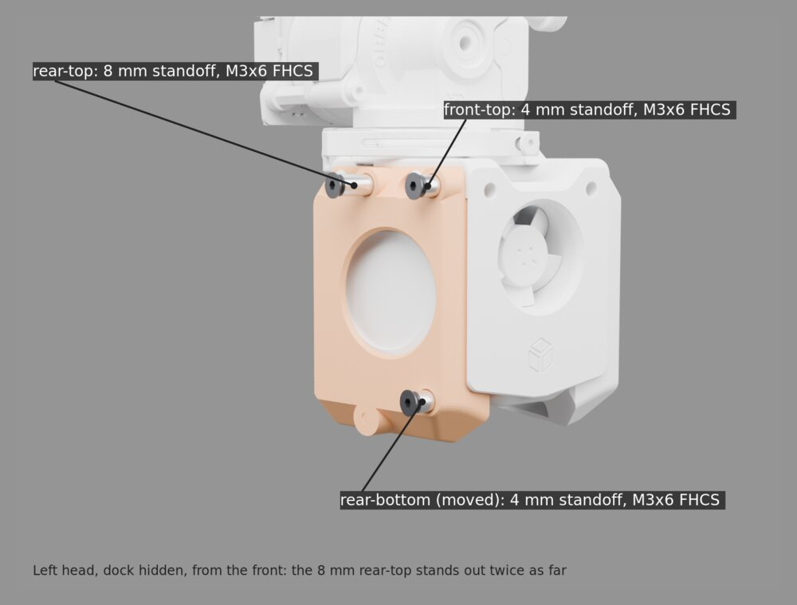

# Stage 12: toolchanger and toolheads

Assembly notes for stage #12. This page is the first of the repo's assembly instructions (#40: repo markdown, later
published with GitHub Pages); the per-step Print and Buy tables (#40 AC2–AC3) aren't generated yet.

## Dock screws on each head (lite-68, #59)

Each head hangs in its dock on **three screw heads**: front-top, rear-top and rear-bottom. They're on the head's
A4Tv2 4010 duct (the orange "cowl" in the renders). Each one is a short heat-set insert in the cowl, a
**male-female standoff** screwed into it, and a **flat-head (countersunk) screw** in the top of the standoff. The screw's head is
the hook that the dock's keyslot plate catches. The standoff's body sets how far the head stands off the cowl, so the
height comes from the part, not from how far a screw is turned.

### Parts, per pair of heads (left + right)

| Part | Qty | Notes |
|---|---|---|
| M3 heat-set insert, **short**: 3 mm long, 5 mm OD | 6 | Not the Voron 4 mm ones: the pocket is 3.4 mm deep |
| M3 male-female round standoff, **4 mm body**, Ø5, M3×4 stud (e.g. "M3x4+4") | 5 | The 4 mm points |
| M3 male-female round standoff, **8 mm body**, Ø5, M3×6 stud (e.g. AWclub "M3x8+6", 304 stainless) | 1 | The left head's rear-top |
| M3 flat-head screw (FHCS, ISO 10642), **alloy steel** (black, strongly magnetic), not stainless; head **Ø5.8–6**, not the 5.5 kind | 6 | One per standoff. **M3×6** if the standoff's female thread is ≥ 4.5 mm deep, **M3×5** if it's 3.5–4.5 (measure it) |
| 6×3 mm N52 magnet (real N52, from a known vendor, e.g. Fabreeko) | 3 per dock | In the keyslot plate (step 5) |
| CA glue | | For the magnets |
| Threadlocker (medium, blue) | | On each stud |

| Point | Left head | Right head |
|---|---|---|
| front-top | 4 mm | 4 mm |
| rear-top | **8 mm** | 4 mm |
| rear-bottom | 4 mm | 4 mm |

The left head's rear-top is 8 mm because the dock plate can't reach closer there: the head's Crossbow lever stands
1.75 mm off the plate.

**Standoff body:** round, **Ø5.5 mm or less**. It seats in a Ø5.5 spot-face. A hex body won't fit: 5 mm across the
flats is 5.8 mm across the corners.

### 1. Inserts

Press each insert in square to the spot-face, **flush with the spot-face's floor, not below it**. The spot-face is the
shallow round seat around each hole. If an insert sits deeper, the standoff still seats at the right height, but its
stud has fewer threads to grip.

Don't push an insert past the bottom of its pocket. Behind each pocket there's only **1 mm of cowl, then the duct's
air channel**.

### 2. Cut the standoff studs to 3 mm

The stud comes 4 mm long; the insert is 3 mm and its pocket 3.4 mm. A 4 mm stud hits the pocket floor 0.6 mm
before the shoulder seats. The hook height would then be wrong, and tightening would push on that 1 mm floor.
So **grind every stud that goes into an insert to 3 mm**, measured from the shoulder:

1. Thread an M3 nut onto the stud, all the way to the shoulder.
2. Grind the stud to **3.0 mm** (2.8–3.2 is fine; at 2.8 about 5½ threads still grip).
3. Unscrew the nut. It straightens the cut threads as it comes off.
4. Take a small chamfer off the tip so it starts cleanly in the brass.
5. Check the length with calipers.

With a 3 mm stud the shoulder seats flat on the spot-face, and the tip stops 0.4 mm short of the pocket floor.

### 3. The left head's rear-top: 8 mm

Use one **8 mm standoff** (M3×8+6). Its stud is **6 mm**, so grind it to **3 mm** as in step 2: 3 mm comes off, not 1.
Measure its female thread's depth: it decides the screw length (M3×6 needs ≥ 4.5 mm).

No 8 mm to hand? Stack two 4 mm standoffs instead. The bottom one's stud goes into the insert, ground to 3 mm. The top
one's stud goes into the bottom one's female thread; if that hole is shallower than the stud, grind it to fit so the
two bodies meet flat. Threadlocker on both. Don't make 8 mm from a 6 mm standoff plus washers: loose washers aren't
rigid enough.

### 4. Fit and check

1. Put threadlocker on each stud and screw the standoff into its insert until the shoulder sits flat on the spot-face.
   Don't overtighten: the insert is in plastic.
2. Screw a flat-head into the top of each standoff, snug. Its cone sits on the edge of the standoff's hole: don't countersink the standoff, or the head sinks and the hook drops.
3. Check each one: from the cowl's spot-face to the top of the standoff is **4.0 mm**, or **8.0 mm** at the left head's
   rear-top, and the screw's flat top stands about 1.7–1.9 mm above that.
4. On the dock: slide the head in, check it drops into all three keyslots, has a little play, the magnets pull each
   screw head home, and it lifts off cleanly.

### 5. Magnets in the dock's keyslot plate

Each keyslot has a hex hole at the parked screw's position that holds a 6×3 magnet. The magnet must sit at the
**bottom of the head channel**, right behind the parked screw head, as on the upstream plate. Our pads make that hole
about 11.5 mm long, so **press the magnet in from the pad side** (the channel side), flush with the channel's floor.
Don't push it in from the plate's back face: it would stop about 8 mm short of the screw, and the hold would be a small
fraction of what it should be. A drop of CA glue holds it. Mind the polarity: all three the same way.

Why it's built this way, and the render views: `cad/derived/madmax-andrewmcgr-dock-keyslot-pads/README.md` and PR #240.
