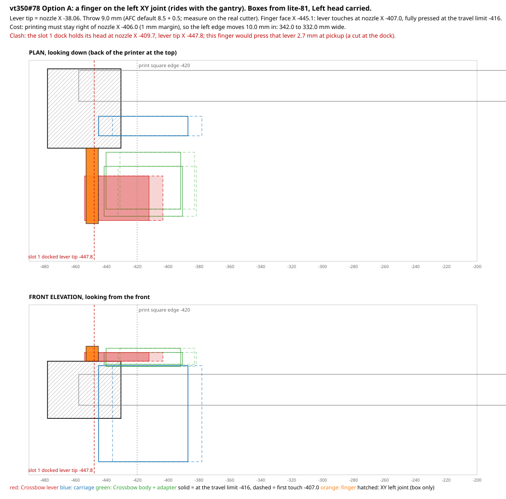

# Crossbow depressor: the options (#78)

The Crossbow cuts when its lever is pushed in. The owner's rules (2026-11-18): never cut at the dock. The cut is a
macro after pickup, against a fixed brace. The push should seat the head on the carriage, never peel it off (AC7).
This page lists where that brace can go, and what each place costs. Numbers are from lite-81's bounding boxes
(`cad/studies/crossbow_depressor_probe_fc.py` → `cad/data/crossbow_depressor_probe.json`), the committed toolhead
sweep (`cad/data/logs/sweep_toolhead.log`), and the part index of lite-81. Nothing here is modelled yet (AC4).

## What the model says

- **Every head's lever is on its −X side.** The tip is at nozzle X −38.06. That holds for both carried heads and all
  five docked ones, since every head is the same A4Tv2 build. So one brace on the left serves every tool.
- **The lever is 5.7 mm tall** (Z 458.49–464.19), right above the XY left joint's top (Z 458.5). It is 18.0 mm in front
  of the joint's front face, and 26–55 mm in front of the carriage's front face.
- **Left travel limit: nozzle X −416.** At −417 the carriage's SpeedClip hits the XY left joint (sweep). The print
  area's left edge is already set there (342.0 mm wide).
- **The slot 1 dock holds its head at nozzle X −409.7,** so that head's lever tip sits at X −447.8. A brace on the
  gantry, right of −447.8, presses that lever while the head is docked or being picked up. That is a cut at the dock.
- **The front is full of docks:** five slots, nozzles at X −409.7 to −80.3. There is no free front zone for a brace
  fixed to the frame.

## Throw (AC1): not published, so measure it

Neither the Crossbow README nor its drawings give the lever's travel or force. AFC's cut macro defaults to
`cut_move_dist` 8.5 mm (compressed), plus a 6 mm park before the push, and speeds of 32 mm/s then 10 mm/s
([AFC_Macro_Vars.cfg](https://www.afcproject.dev/configuration/AFC_Macro_Vars.cfg.html)). That's a generic
default, not a Crossbow measurement. The numbers below use **9.0 mm** (8.5 + 0.5). **To measure on the real cutter:**
- the throw: from first touch to fully pressed;
- the force: a luggage scale on the lever tip.

Both numbers decide the options below.

## Prior art (AC2)

Both upstream depressors ride on the gantry, on the left, and both are CC BY-NC-SA 4.0. That's fine to use on our own
printer, and to remix with attribution under the same licence. Neither is copied into this repo.

- **DW-Tas, Monolith gantry** (the Crossbow repo, `CAD/Crossbow Depressor Arm and Holder [Monolith Gantry].step`): a
  printed base, 20 × 55 × 16 mm, held with 2 × M3 × 10 BHCS. On it sits an arm that reaches 45.6 mm, 6 mm thick, held
  with 2 × M3 × 14–18 into heat inserts. The arm is slotted, so its position adjusts.
- **Rob Searing, ZeroG FMG** (Printables, 6 mm and 9 mm belt versions): sits on top of the ZeroG front motor gantry.
  He prints it weak on purpose (ASA, 10–20 % infill, 2–3 walls), so a failed cut breaks the depressor, not the
  Crossbow. He re-checks the cut position after re-tensioning belts.

## Options (AC3)

| | Where the brace is | Print reach lost (left edge) | Clash | Extra parts |
|---|---|---|---|---|
| **A1** | finger on the XY left joint (the DW-Tas pattern); face X −445.1, pressed at the travel limit | **10.0 mm** (342.0 → 332.0) | slot 1 dock: presses its lever by 2.7 mm. **Fix: move the slot 1 dock +X by ≥ 3.7 mm** (a dock pass and a sweep) | printed finger + 2 screws |
| **A2** | same finger, docks unchanged; face X −448.8 (1 mm clear of slot 1's lever) | 6.3 mm (342.0 → 335.7) | none, **only if the measured throw is ≤ 5.3 mm** | printed finger + 2 screws |
| **C** | finger on the joint, *beyond* the print area; the cut alone travels past the print limit | **none** | needs about 10 mm more carriage travel to the left (nozzle −426), so first clear the SpeedClip / MadMax plate against the XY left joint, which today hits at −417 | carriage-side change |
| **D** | finger on the joint that swings in only for the cut (servo; spring-back so it fails retracted) | **none** | none while retracted | servo, cable, Klipper `[servo]`, a sensed position |
| ~~E~~ | at each dock, cut during drop-off | — | — | ruled out by the owner, 2026-11-18 |
| ~~B~~ | fixed to the frame, in front, between the docks | — | the five docks fill the front | — |

**My recommendation:**
- Measure the throw first.
- If it's ≤ 5.3 mm, take A2: one small printed part, no dock change, and 6.3 mm lost on the left.
- If it's more, choose between A1 (move a dock, 10 mm lost) and D (no reach lost, but a servo that must never
  stick out).
- C is the cleanest result but the biggest job. It only makes sense if #53-style clearance work at the left end is
  happening anyway.

## Reaction force (AC7)

The brace pushes the lever tip in +X; on a binding retreat, the pull is in −X. Either way the force acts **in the
plane of the carriage face**, so it doesn't pull the head straight off the magnets. But it acts 26–55 mm in front of
the carriage face (the lever's Y span; the box gives no exact contact point), so it makes a **yaw moment about Z**.
That moment lifts one vertical edge of the head off the carriage:
- pushing in (+X) lifts the head's −X edge;
- a stuck retreat (−X) lifts the +X edge.

The lifting force at a magnet is about F × (26 to 55 mm) / (magnet spacing in X). If the magnets were 40 mm apart (an
illustration, not the MadMax figure), the edge would see **0.7 to 1.4 × the lever force**. So the owner's worry is real, and the hold to compare against is a single
magnet's pull, not the sum.

The answer needs:
- the lever force (measure it, above);
- the MadMax magnet size, count and X spacing (from the MadMax BOM, not guessed).

Two things shrink the moment:
- a finger that touches the lever's **rear** end (nearest the carriage: the 26 mm end, not the 55 mm one);
- a slow retreat (AC8).

The A1/A2 finger in the drawing spans the lever's whole Y depth. A real part would sit on the rear 10 mm.

## The cut move (sketch for AC5 and AC8; written properly once an option is chosen)

1. After pickup, travel to nozzle Y at the centre of the print area. Then move X to the finger's contact position
   + 6 mm (the park).
2. Push −X to full press:
   - fast (32 mm/s) for 85 % of the throw, then slow (10 mm/s);
   - dwell 50 ms;
   - then back +X slowly.
3. Check that the tool is still seated (tool-detect). If it isn't, stop with an error.

## Next

- [ ] Owner: measure the throw and force on a cutter; choose A1, A2, C or D.
- [ ] MadMax magnet data for AC7 (the MadMax BOM).
- [ ] The chosen brace in a lite-N pass, then a refresh (AC4). Note: `sweep_toolhead.py` checks only the Left and Right heads
      (the outer docks), not the middle three.
