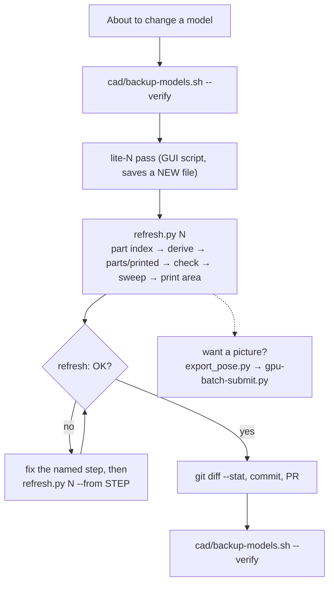

# Scripts at your command: what to run, when, and how

The everyday commands for this build. Who can run each one, and what
needs a person. Per-script history (which lite-N each pass made, and what it found) is in
[`cad/README.md`](../cad/README.md). This page is the "what do I type" view.

```bash
APP=/home/dan/FreeCAD/FreeCAD_26.3rc2-Linux-x86_64.AppImage     # FreeCAD 26.3; used below
NV="env __NV_PRIME_RENDER_OFFLOAD=1 __GLX_VENDOR_LIBRARY_NAME=nvidia"
cd ~/Code/vt350
```

## When to run what



| Situation | Run | Time |
|---|---|---|
| Before any model edit, and after saving a new lite-N | `cad/backup-models.sh --verify` | minutes (restic) |
| **After every new lite-N or remix change** | `python3 cad/scripts/refresh.py N` | ~18 min |
| Only the reach changed (sweep re-run by hand) | `python3 cad/scripts/refresh.py N --from print_area` | seconds |
| Changed a file in `parts/printed/` or `manifest.csv` | `python3 platform/parts/check-printed.py` (add `--write-index` to rebuild the README table) | seconds |
| Will a part print without supports? (before any PETG test-fit) | `python3 platform/parts/slice-check.py <stl…>`: report + red-support preview; see `parts/slice/README.md` | ~1 s/part, up to ~1 min for big ones |
| Checking pinned upstream STLs haven't drifted | `python3 platform/parts/check-printed.py --upstream` (network; CI doesn't run it) | ~1 min |
| See what refresh *would* do, writing nothing | `python3 cad/scripts/refresh.py N --dry-run` | seconds |
| Full colour renders of the whole printer, here on the laptop | `cad/render/render_full.sh [N] [samples]` (below) | ~6 min; prints the image paths |
| Where is part X? What sits below/above Z? (no FreeCAD) | `jq` on `~/Documents/VT350/<model>.parts.json` (below; `part_index.py --check` first) | instant |
| A render of a sweep pose (clash in red) | `export_pose.py`, then `gpu-batch-submit.py` (below) | ~5 min, result posted to the issue |
| A new model change (lite-N) | a GUI pass script: Claude writes it, you click **Wait** | 5–40 min |

## The everyday commands

### `cad/scripts/refresh.py`: after a model change

```bash
python3 cad/scripts/refresh.py 26                # all 7 steps
python3 cad/scripts/refresh.py 26 --from sweep   # start part-way
python3 cad/scripts/refresh.py 26 --dry-run      # plan + which parts/printed copies would change
```

- **What it runs, in order:** `part_index` (the model's box index and its companions', below; skipped if fresh) → `derive_stls` → `sync_printed` → `check_printed` → `sweep` → `print_area` → `test_print_area`.
- **When a step fails:** it stops and prints `refresh: FAILED: step X …`, naming the log to read. A missing completion line also counts as a failure.
- **On success:** it prints `refresh: OK` and a summary: STLs re-copied, reach vs the committed sweep, and print area. The summary is also saved to `cad/data/logs/refresh.log`.
- **What it never does:** save a model or commit. Afterwards, `git diff --stat` shows what changed, and you commit it.
- **Who can run it:** you, opencode, or a CI runner with the models mounted. It needs no judgement until the summary.
- **What it can't do:**
  - create a manifest row for a brand-new printed part (add the row first);
  - add a `derive_stls.py` JOBS row for a newly remixed part.

### `cad/backup-models.sh`: the models aren't in git

```bash
cad/backup-models.sh            # back up ~/Documents/VT350 models (restic)
cad/backup-models.sh --verify   # back up, then restore the newest model and compare checksums
```

Run it before and after any model-writing pass. The target and password are in `~/.config/vt350/backup.env`, which
exists only on this machine. The password is escrowed in Infisical.

### `platform/parts/check-printed.py`: the printed-parts reference

```bash
python3 platform/parts/check-printed.py                  # what CI runs; must end "check-printed: OK"
python3 platform/parts/check-printed.py --write-index    # rewrite the generated table in parts/printed/README.md
python3 platform/parts/check-printed.py --upstream       # also re-download every upstream part at its pinned commit
```

It fails on:
- a missing file or a wrong sha256;
- a part that isn't in the manifest, or a BOM "print" row with no part;
- a remix copy that differs from `cad/derived/`. `refresh.py` fixes that one for you.

### Sweep and print area (run by refresh; you can also run them alone)

```bash
python3 cad/studies/sweep_toolhead.py           # ~11 min, 10 headless workers; VT350_MODEL=<.FCStd> to pick the model
python3 cad/motion/rig.py --check               # rig.json vs the CAD logs and toolchanger.cfg; "rig: OK" (vt350#135)
python3 platform/freecad/timeline.py --timeline cad/klipper/toolchange_timeline.jsonl --rig cad/motion/rig.json --moves   # frames, one per move
python3 cad/motion/play.py                       # FreeCAD GUI player: watch the tool-change timeline on lite-30 (play/pause/step/speed/stop)
python3 cad/motion/play.py --autotest out.json   # the same under xvfb: plays every frame, stops, checks every Placement is back; "play autotest: OK"
python3 cad/motion/render_frames.py prepare      # Blender frames of the timeline: ONE grouped mesh export + frames.json; then submit (batch lane), encode (MP4)
python3 cad/studies/print_area.py               # redraw cad/data/print-area.svg from the sweep log
python3 cad/studies/test_print_area.py          # CI fails if the drawing is stale: re-run print_area after EVERY sweep
```

### `cad/scripts/derive_stls.py`: printable STLs of remixed parts

```bash
$APP freecadcmd $PWD/cad/scripts/derive_stls.py                      # all JOBS, ~6 min (opens lite-22/23/24)
VT350_ONLY=MadMaxCarriage $APP freecadcmd $PWD/cad/scripts/derive_stls.py   # one job
```

Each remixed part is moved into its upstream part's print orientation. Its JOBS table pins which model each remix
comes from.

### `cad/render/render_full.sh`: full colour renders on this laptop (#38)

```bash
cad/render/render_full.sh                 # lite-26 + vt350-ebox.FCStd, 128 samples
cad/render/render_full.sh 27 256          # another lite-N, more samples
VT350_REUSE_EXPORT=<run>/export cad/render/render_full.sh   # changed only a role's colour: skip the export
```

- **What happens:** a FreeCAD window opens and closes by itself (click **Wait** if GNOME asks), then Blender renders on the RTX 2070.
- **Output:** the last lines are the full image paths, then `render_full: OK`. Each run gets `~/Documents/VT350/renders/<model>-<UTC>/` with `out/` (each view as a PNG master plus the quality-85 JPEG that `cad/renders/` and the README use), `export/` (meshes, `export.log`) and the raw logs.
- **Colours** live in `cad/render/colours.json`: role colours plus ordered rules on label, group and material.
  - Changed only a role's hex? Re-run with `VT350_REUSE_EXPORT`.
  - Added or changed a rule? Run a full export.
  - `export.log` lists the parts no rule coloured.
  - Photo references: #75.

### `platform/freecad/part_index.py`: layout questions with `jq`, not FreeCAD (#90)

Each model has a per-part box index beside it, `~/Documents/VT350/<model>.parts.json`: label, group `path`,
`material`, `consumed`, and the global `optimalBoundingBox(True, False)` in mm. Answer "what sits where" from the index:

```bash
cd ~/Documents/VT350
python3 ~/Code/vt350/platform/freecad/part_index.py --check vt350-filter-3.FCStd    # fresh? (exit 0 = yes)
jq -r '.parts[] | select(.bbox.zmax < -60) | .label' vt350-filter-3.parts.json  # parts of the filter wholly below Z -60
jq -r '.parts[] | select(.bbox.zmin < -60) | .label' vt350-filter-3.parts.json  # ... or reaching below it
jq -r '.parts[] | select(.path | index("Electronics")) | .label' vt350-ebox.parts.json  # everything in a group
jq '.bbox' vt350-lite-29.parts.json                                             # which mode made the boxes
```

The first query answers (checked against FreeCAD's own boxes, 2026-11-09) `M_1a.0_Body_BPM`, `M_1a.1_AirExhaustWheel_BPM`,
`M_2.6a_PicoAccessLatch`, `M_2.7_IntakeSensorStackAccessLatch`, `M_2.8_BowdenTubeAccessLatch` (all `StealthMax ...`).

- **Writing or refreshing an index** (headless, never saves the model; skips a fresh one, `VT350_INDEX_FORCE=1` rewrites):
  `VT350_WORKERS=1 VT350_INDEX_MODELS=$HOME/Documents/VT350/vt350-lite-29.FCStd $APP freecadcmd $PWD/platform/freecad/part_index.py`.
  It takes ~2 min for lite-29 + filter-3 + ebox. The log is `cad/data/logs/part_index.log`, ending `part_index: done`.
- **Automatically:** `refresh.py N`'s first step indexes `vt350-lite-N` and every companion the same pass saved
  (another `.FCStd` saved within 10 min of it, e.g. `vt350-filter-3` with lite-29); the summary prints `part index: ... fresh`.
  `render_full.sh`'s export (`export_meshes.py`) also refreshes the index of every model it exports
  (`index: written|fresh ...` in `export.log`).
- **From the batch lane:** the `vt350-refresh` chain indexes lite-N + its companions on max-01 (headless), and the
  `vt350-render` chain's export does the same as `render_full.sh` (GUI under xvfb, so `bbox.mode` is `gui`). Both leave the
  index in the job's `out/index/`; copy it beside your model with
  `python3 ~/Code/vt350/platform/freecad/part_index.py --adopt /mnt/nfs/media/gpu-batch/<chain id>-*/out/index/*.parts.json`.
  It is copied only when your model still has the exact bytes (size + sha256) the pod indexed, and never over an index
  that is already fresh. Prints `adopted`, `fresh` or `skipped` + why for each one (exit 1 if any was skipped).
- **Stale index?** `--check` says `stale` when the model's bytes changed since the index was made; re-run the writer.
- **GUI vs headless:** `.bbox.mode` says which made the boxes; they differ by up to ~0.14 mm on STEP parts.

### Sweep-pose renders: `cad/render/export_pose.py`, `platform/render/` + the GPU batch lane (node-03)

```bash
VT350_POSE="Left:front-left, top" VT350_RENDER_OUT=/tmp/pose $APP freecadcmd $PWD/cad/render/export_pose.py
~/Code/homelab/bin/gpu-batch-submit.py blender --input /tmp/pose \
    --script ~/Code/vt350/platform/render/render.py --notify dvystrcil/vt350#<issue> -- 128
~/Code/homelab/bin/gpu-batch-submit.py status <job-id>        # once, later; the issue comment usually arrives first
```

- **How it reports:** fire and forget. n8n posts the outputs and their sha256 to the `--notify` issue.
- **Where the images land:** `/mnt/nfs/media/gpu-batch/<job>-render/out/`. The Desktop launcher "VT350 Renders" runs an installed copy of `platform/render/open-latest-render.sh`, which opens the newest finished one (`--print` shows the path instead). The copy keeps the launcher working whatever branch this clone is on. Install or update it with `install -m755 platform/render/open-latest-render.sh ~/.local/bin/vt350-open-latest-render`; the launcher has `Exec=/home/dan/.local/bin/vt350-open-latest-render`.
- **While Neptune is printing:** the job refuses to start. If Neptune is off but Obico still shows a print, add `--printer-off`.
- **Full model renders:** `export_meshes.py` (GUI) → `render.py` (`blender -b -P …`).

## Model-writing passes (lite-N): Claude writes, you supervise

```bash
$NV $APP $PWD/cad/passes/liteNN_<what>.py      # GUI mode: keeps colours; saves vt350-lite-NN.FCStd only if every check passes
$APP freecadcmd $PWD/cad/passes/liteNN_<what>.py   # headless = dry run: all checks, never saves
```

- **Each pass saves a NEW file.** It refuses to save if a check fails. Never save over `vt350-good.FCStd`. Hand edits go in a `-dan` copy (File → Save As).
- **"FreeCAD Not Responding"** during a pass means **click Wait**, not Force Quit.
- **Closing FreeCAD:** use File → Quit. A killed window leaves recovery files behind.
- **New passes are built on `platform/freecad/litelib.py`** (#93): a short spec of parts plus named checks. See "Writing a new lite-N pass" in `cad/README.md`.
- **Who writes them:** these are geometry and design work, so Claude writes them. Every `liteNN_*.py` already in
  `cad/passes/` is a historical record of how its model was made, not something to re-run.

## Handing work off (homelab lanes)

| Lane | Status | Use it for | Command |
|---|---|---|---|
| refresh chain | **live** (#69) | everything after a model change | `cad/scripts/refresh.py` (above) |
| GPU batch | **live** (homelab#1935) | Blender renders on node-03 | `~/Code/homelab/bin/gpu-batch-submit.py` |
| dmf edit | **live** (homelab#1856) | a small, bounded edit to one file by the local model. A guard decides if it lands, and you read only the diff | `~/Code/homelab/bin/dmf-edit.py FILE -i "instruction" --allow 40-55 [--expect TOKEN] [--write]` |
| dmf handoff | **live** | a one-shot text task from a prompt file, response saved | `cd ~/Code/homelab && DMF_MODEL=automation-tool-free bin/dmf-handoff.sh prompts/dmf-tasks/<task>.md` |
| slicer check | **live** (#70) | supports, time, warnings, keep-out boxes + preview of each printed part, headless | `python3 platform/parts/slice-check.py <stl…>` |
| dmf status drafter | planned: [homelab#1962](https://github.com/dvystrcil/homelab/issues/1962) | turn a run log into a guarded AC status comment draft | not yet |
| CAD batch lane | planned: [homelab#1961](https://github.com/dvystrcil/homelab/issues/1961) | sweeps/clash checks off the laptop, result posted to the issue | not yet |

**What to hand to whom:**
- **opencode or you:** anything deterministic with a pass/fail line (refresh, check-printed, backups, renders).
- **The local model through dmf:** text and small bounded edits, always behind a guard.
- **Claude:** geometry, lite-N passes, and reading a sweep's new clashes.

## In CI (runs on every PR; nothing to do)

| Workflow | Runs | Fails when |
|---|---|---|
| `printed-parts` | `platform/parts/test_check_printed.py`, `platform/parts/check-printed.py` | manifest, sha256 or BOM drift |
| `print-area` | `cad/studies/test_print_area.py` | `print-area.svg` is stale against the sweep log |
| `slice-check` | `platform/parts/test_slice_check.py`, `keepout.json` validity | the G-code parser, keep-out or report logic breaks |
| `refresh-chain` | `cad/scripts/test_refresh.py`, `cad/scripts/test_derive_stls.py`, `test_litepool.py`, `test_prove_parallel.py`, `test_part_index.py` | the chain's sync, step runner or markers break, `derive_stls` stops honouring `VT350_MODELS`, or the part index's schema/staleness check breaks |
| `render-colours` | `platform/render/test_colours.py`, `cad/render/test_render_full.py` | the colour rules break, or `render_full.sh` misjudges the export (a real `FAILED` passes, or the index hook's `index: FAILED` fails it) |
| `secret-scan` | gitleaks | a secret in the diff |

## One-off and investigation scripts

These were written for a single question. Their findings are in `cad/README.md` and the issues. Read them before
re-running one:

| Group | Scripts |
|---|---|
| model inspection | `analyze.py`, `tree.py`, `cats.py`, `fs_probe.py`, `frame_map.py` |
| fasteners | `extract_fasteners.py`, `fastener_review.py`, `rebuild_fasteners.py` |
| one-time studies | `ac9_head_envelope.py`, `bowden_study.py`, `belt_plate_gap.py`, `clash_lite18_repro.py`, `door_hinges.py` |
| model building blocks | `make_lite.py`, `frame_plus100.py`, `lite*.py`, `tanaes_dxf2json.py` |
| libraries (imported, not run) | `clashlib.py` (parallel clash checks), `reglib.py` (STL registration), `litelib.py` (lite-N pass skeleton + named checks, on parallel workers; tests: `test_litelib.py` under `freecadcmd`), `litepool.py` (worker pool + worker count, `VT350_WORKERS`; tests: `test_litepool.py`, in CI) |
